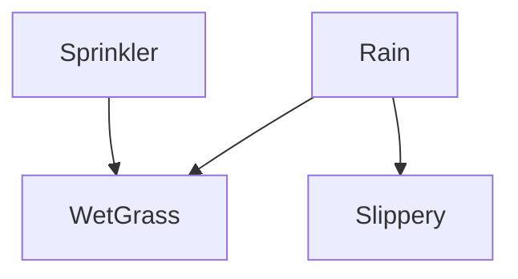

### THINK

嗯，用户问的是贝叶斯网的定义核心，具体是问“使用有向无环图来刻画什么”。这是一个关于概率图模型的基础概念问题。

贝叶斯网（Bayesian network）的核心是表示变量之间的依赖关系。有向无环图（DAG）中的节点对应随机变量，有向边则直接表示了变量之间的条件依赖关系，更精确地说，是刻画了变量之间的条件独立性。

具体来说，贝叶斯网利用DAG来编码一组条件独立性假设：给定一个节点的父节点，该节点独立于它的所有非后代节点。整个图结构联合概率分布被分解为每个变量在其父节点条件下的概率乘积。

所以，答案是：贝叶斯网使用有向无环图来刻画随机变量之间的**条件独立性关系**，或者说变量间的**依赖关系**。用户问的是“刻画什么”，回复需要明确指出是条件独立性或依赖关系，并可以简要说明其作用（如分解联合概率）。回复应该简洁直接，满足用户获取定义性知识的需求。

### DeepSeek

贝叶斯网使用有向无环图（DAG）来刻画**随机变量之间的条件独立关系**以及**依赖关系**。

具体来说，图中的每个节点代表一个随机变量，而有向边则表示变量之间的直接依赖关系（即“影响”关系）。通过这种结构，贝叶斯网能够直观地表达出：在给定父节点的条件下，每个节点与其非后代节点条件独立。这为复杂概率模型的表示、推理和学习提供了简洁而强大的框架。

### 我（提问）

贝叶斯网是使用有向无环图来刻画什么啊

### THINK

我们需要理解用户的需求: "贝叶斯网有一个条件概率连乘的一个公式，就是书里写的那个，请你给我写一个那个完整的工作，并且给我画一下图"

用户要求：写出贝叶斯网中联合概率分布的分解公式（条件概率连乘公式），并且画一下图。可能需要画出贝叶斯网的图例，比如一个有向无环图，并展示对应的连乘公式。

由于这是一个文本聊天，无法直接画图，但可以用字符画或描述，或者用Mermaid语法。通常我可以用Mermaid代码块画图，用户可以在支持Mermaid的环境中查看。或者简单描述。

用户要求"完整的工作"可能指的是完整的推导或示例。我会给出一般公式：对于随机变量X1,...,Xn，联合分布P(X1,...,Xn)=∏_{i=1}^n P(Xi | Pa(Xi))，其中Pa(Xi)是Xi的父节点集合。然后提供一个简单贝叶斯网的图示，比如三个节点A->B, A->C，并写出对应的分解式。

我会用文本和Mermaid图来满足要求。

### DeepSeek

当然！下面给出贝叶斯网中联合概率分布分解的“条件概率连乘公式”，并附上一个简单的图示。

---

## 一、核心公式

对于一个有 \( n \) 个节点的贝叶斯网，设随机变量为 \( X_1, X_2, \dots, X_n \)，其联合概率分布可以分解为每个节点在其**父节点**条件下的乘积：

\[
P(X_1, X_2, \dots, X_n) = \prod_{i=1}^{n} P\big(X_i \mid \text{Pa}(X_i)\big)
\]

其中 \( \text{Pa}(X_i) \) 表示 \( X_i \) 在图中所有直接父节点（有向边指向 \( X_i \) 的节点）的集合。

这个公式体现了贝叶斯网的**局部马尔可夫性**：给定父节点，每个节点与它的非后代节点条件独立。

---

## 二、图示（Mermaid）

下面是一个简单的贝叶斯网，包含四个变量：  
- **Rain**（是否下雨）  
- **Sprinkler**（洒水器是否打开）  
- **Wet Grass**（草地是否湿）  
- **Slippery**（路面是否滑）



这个图表示：  
- 草地湿度的概率依赖于是否下雨和洒水器是否打开。  
- 路面是否滑只依赖于是否下雨（不考虑草地湿）。  
- 洒水器和下雨之间没有边，表明它们在先验上独立。

---

## 三、对应的分解公式

设变量：  
\( R = \) Rain，\( S = \) Sprinkler，\( W = \) Wet Grass，\( L = \) Slippery

根据上图，父节点关系：  
- \(\text{Pa}(R) = \varnothing\)  
- \(\text{Pa}(S) = \varnothing\)  
- \(\text{Pa}(W) = \{R, S\}\)  
- \(\text{Pa}(L) = \{R\}\)

则联合概率分解为：

\[
P(R, S, W, L) = P(R) \cdot P(S) \cdot P(W \mid R, S) \cdot P(L \mid R)
\]

这就是一个完整的“条件概率连乘公式”实例。

---

## 四、文字说明（补充一个手绘风格的ASCII图）

如果无法渲染Mermaid，这里再给你一个纯文本示意图：

```
    Rain (R) ----------> Slippery (L)
       |
       v
    Sprinkler (S) ----> WetGrass (W)
```

箭头表示直接影响。  
联合分布：  
P(R, S, W, L) = P(R) × P(S) × P(W|R, S) × P(L|R)

---

希望这个回答满足了你的需求！如果你想针对某个具体贝叶斯网（例如书中的例子）重写公式或作图，请告诉我书的名称或具体的图结构。

### 我（提问）

贝叶斯网有一个条件概率连乘的一个公式，就是书里写的那个，请你给我写一个那个完整的工作，并且给我画一下图

### THINK

我们被问到“什么是EM算法啊”。需要解释EM算法（Expectation-Maximization），它是一种用于含有隐变量或缺失数据的概率模型参数估计的迭代方法。回答应简明扼要，涵盖基本思想、步骤（E步和M步）、应用场景，以及为什么需要它（比如极大似然估计直接求导困难）。用户期待一个清晰的解释。

### DeepSeek

EM算法（期望最大化算法，Expectation-Maximization algorithm）是一种用于**含有隐变量**的概率模型进行**参数估计**的迭代方法。当模型依赖未观测到的隐变量（或数据存在缺失）时，直接对观测数据做极大似然估计往往很困难，EM算法通过“猜测”隐变量的期望并不断优化，逐步逼近最优参数。

---

## 1. 为什么需要EM算法？

假设我们想估计一个混合高斯模型的参数，但我们不知道每个样本来自哪个高斯分量（这个“来自哪个分量”就是隐变量）。如果强行对观测数据求极大似然，由于隐变量出现在对数求和内部，无法直接求导解析求解。EM算法提供了一种迂回但有效的思路。

---

## 2. EM算法的两步迭代

E步（Expectation，期望步）：  
基于当前参数估计值，计算隐变量的**后验概率**（或关于隐变量的期望），构造出完全数据对数似然的期望函数 \( Q(\theta \mid \theta^{(t)}) \)。

M步（Maximization，最大化步）：  
最大化这个期望函数，得到新的参数估计 \( \theta^{(t+1)} \)。

重复上述两步，直到参数收敛。

---

## 3. 一个直观例子：抛硬币

有两枚硬币A和B，但不知道每次抛的是哪一枚，只记录了抛掷结果（正/反）。  
- **隐变量**：当前抛的是A还是B  
- **参数**：A和B各自正面朝上的概率 \( p_A, p_B \)

EM算法会：
1. **E步**：根据当前猜测的 \( p_A, p_B \)，估计每次抛掷“属于A”的概率（比如0.6属于A，0.4属于B）。
2. **M步**：用这些软分配重新统计正反面次数，最大化似然更新 \( p_A, p_B \)。
3. 重复直至稳定。

---

## 4. 关键特性

- 保证每次迭代后似然函数**不下降**，最终收敛到局部极大值（不一定全局最优）。
- 广泛用于**高斯混合模型（GMM）**、**隐马尔可夫模型（HMM）**、**贝叶斯网的参数学习（部分观测）**等领域。

---

## 5. 与普通MLE的对比

| 方法 | 适用场景 | 是否直接求导 | 有无隐变量 |
|------|---------|--------------|-------------|
| 普通极大似然估计 | 完全数据 | 是 | 无 |
| EM算法 | 含隐变量/缺失数据 | 间接（期望+最大化） | 有 |

---

如果你需要更具体的数学推导（比如Q函数的形式）或一个GMM的EM算法公式，我可以继续帮你展开。

### 我（提问）

什么是EM算法啊

### THINK

我们注意到用户的问题有三个点：1. 不清楚高斯混合模型是什么；2. 确认对EM算法两步的理解（用户复述了一遍，基本正确）；3. 不清楚GMM、HMM、贝叶斯网参数学习是什么。用户希望得到解释。

需要回答：
- 解释高斯混合模型（GMM）：简单的说，就是认为数据是由多个高斯分布（正态分布）混合生成的，每个高斯对应一个“簇”，有一个权重。常用于聚类。
- 确认用户对EM的理解正确：是，E步计算隐变量期望构造Q函数，M步最大化Q得到新参数，迭代至收敛。
- 解释GMM、HMM、贝叶斯网参数学习（部分观测）是什么：
  - GMM：如上，用于聚类或密度估计，EM用来估计每个高斯分布的均值、方差和混合系数。
  - HMM：隐马尔可夫模型，用于序列数据（如语音、基因序列），有隐藏状态序列，EM算法（Baum-Welch算法）用于学习转移概率和发射概率。
  - 贝叶斯网部分观测：当贝叶斯网中有些变量未被观测时，EM可用于估计网络参数（条件概率表）。

回答要友好、清晰、通俗。

### DeepSeek

感谢你提出这些问题，我来逐一解释得更清楚一点。

---

## 1. 什么是高斯混合模型（GMM）？

**一句话**：高斯混合模型假设数据是由**多个不同的高斯分布（正态分布）**混合在一起生成的。  
比如，一群人的身高数据可能来自两个不同的群体：成年男性和成年女性，每个群体的身高近似一个高斯分布。GMM就是用来描述这种“混合分布”的模型。

- 每个高斯分布称为一个“成分”（component），有自己的均值、方差和混合系数（权重）。
- 我们不知道每个样本属于哪个成分——这就是**隐变量**。

EM算法在GMM中的作用：估计出每个成分的均值、方差和权重。

---

## 2. 你理解的EM算法正确吗？

你总结得非常准确：
- **E步**：用当前参数，计算每个样本属于各个成分的概率（即隐变量的期望），构造出一个期望函数 \( Q \)。
- **M步**：最大化这个 \( Q \) 函数，得到新的参数估计。
- **迭代**：重复E步和M步，直到参数不再明显变化。

这就是EM算法的核心思想。

---

## 3. GMM、HMM、贝叶斯网参数学习（部分观测）都是什么？

这三个都是EM算法的重要应用场景，我分别用最通俗的话解释：

### ① 高斯混合模型（GMM）
- **用途**：聚类（软聚类）、密度估计。
- **举例**：你有100个学生的考试成绩，这些成绩可能来自“认真学习”和“临时抱佛脚”两类学生，每类学生的成绩分布大致是正态的。GMM能自动帮你找出这两类分布各自的平均值、标准差，以及每类学生占比。
- **为什么用EM**：因为你不知道每个学生属于哪一类（隐变量）。

### ② 隐马尔可夫模型（HMM）
- **用途**：处理**序列数据**，比如语音识别、基因序列分析、股票价格走势。
- **举例**：你要识别一段语音说了什么词。真实“状态”（说的哪个音素）是看不见的（隐状态），你只能观察到声波特征。HMM假设隐状态之间按概率转移，每个隐状态以一定概率产生观测。
- **EM在这里叫什么**：Baum-Welch算法，用于学习状态转移概率和观测概率。

### ③ 贝叶斯网的参数学习（部分观测）
- **用途**：当你有一个贝叶斯网（就是你之前问的有向图模型），但某些节点的值没有观测到（缺失数据），你想学习网络中的条件概率表。
- **举例**：网络中有节点“发烧”、“咳嗽”、“新冠”。你观测到了部分病人的发烧和咳嗽，但没测是否得了新冠。EM算法可以帮你推断出“新冠”的条件概率（即使有缺失值）。
- **为什么用EM**：因为未观测到的节点就是隐变量。

---

## 总结

| 模型/方法 | 主要用途 | 隐变量例子 |
|-----------|----------|-------------|
| GMM | 聚类 / 密度估计 | 样本属于哪个高斯成分 |
| HMM | 序列数据建模 | 隐藏的状态序列（如音素） |
| 贝叶斯网（部分观测） | 概率图模型的参数学习 | 未观测到的节点值 |

这三个都是EM算法的经典应用对象。如果你对其中某一个特别感兴趣，我可以再画个简单图或者给个数值例子帮你加深理解。

### 我（提问）

1.假设我们想估计一个混合高斯模型的参数，
你说的这个高斯混合模型我也不知道是什么模型啊
2.也就是说EM算法分为期望步和最大化步，期望步是根据当前的额参数估计值计算关于隐变量的期望，构造出期望函数，M步是用来最大化这个期望函数，得到新的参数估计，一直反复直到参数收敛
3.高斯混合模型（GMM）、隐马尔可夫模型（HMM）、贝叶斯网的参数学习（部分观测）
这三个我也不知道是干什么用的啊

### THINK

我们注意到用户上传了一个图片文件（image.png），但内容只有一行文字："3. 贝叶斯网借助有向无环图刻画（属性）之间的依赖关系。" 这看起来像是一个填空题或选择题的题干。用户问"这个题目的正确答案是什么啊"。需要根据贝叶斯网的定义来填空。

贝叶斯网（Bayesian network）借助有向无环图（DAG）来刻画**随机变量**之间的依赖关系（或条件独立关系）。有时也说是"变量"或"属性"。常见的填空是"随机变量"或"变量"。考虑到题干中已经写了"（属性）"，可能原题括号里要填的就是"属性"？但是仔细看：题干是"刻画（属性）之间的依赖关系"，这像是已经写了"属性"这个词，但用户问正确答案，可能意味着括号里需要填一个词，比如"随机变量"？或者题干是"刻画（ ）之间的依赖关系"，括号里要填"属性"？但是用户提供的文本中已经写了"（属性）"，这有些奇怪。

重新读用户消息："3. 贝叶斯网借助有向无环图刻画（属性）之间的依赖关系。" 这里的括号可能是原题中已有的下划线或括号，用户把括号里的内容写成了"属性"？或者用户自己猜测答案是"属性"？他问"正确答案是什么"，可能想确认是否填"属性"。

根据标准定义：贝叶斯网是借助有向无环图刻画**随机变量**之间的依赖关系（或条件独立关系）。有时在机器学习或数据挖掘中，也称"属性"或"特征"，但更严谨的说法是"变量"或"随机变量"。

考虑到题目可能来自某本教材或习题，常见的填空答案是"变量"或"随机变量"。如果原题中已经有"（属性）"，那可能原题写的是"刻画（ ）之间的依赖关系"，而用户把"属性"作为自己填的答案？但用户明确问"正确答案是什么"，我需要给出最合适的回答。

因此，我回答：正确答案是"随机变量"（或简写为"变量"）。同时可以解释贝叶斯网中每个节点代表一个随机变量，有向边表示依赖关系。

另外，用户之前对话中已经确认过贝叶斯网是用有向无环图刻画随机变量之间的条件独立关系。所以这里直接给出答案。

### DeepSeek

根据贝叶斯网的标准定义，题干中括号里应填的内容是 **随机变量**（或简写为 **变量**）。

因此完整的正确表述是：

> 贝叶斯网借助有向无环图刻画 **随机变量** 之间的依赖关系。

有的教材或考题中也会写成“属性”或“特征”，但最严谨、最通用的答案是“随机变量”。如果原题括号处就是让你填这个词，那么 **随机变量** 就是正确答案。

### 我（提问）

这个题目的正确答案是什么啊

### THINK

我们被问到："随机森林中基学习器的多样性不仅有样本扰动，还包含（**随机**）扰动。这个涉及到机器学习的什么部分的只是带你" 用户可能打错字："只是带你" 应该是 "知识点" 或 "知识内容"。所以问题是：这个描述涉及到机器学习的哪个部分的知识点？

答案是：集成学习（Ensemble Learning）中的随机森林（Random Forest）。具体来说，随机森林通过两个随机性来增加基学习器（决策树）的多样性：一是样本扰动（Bootstrap采样），二是特征扰动（随机选择特征子集）。题目中说的"随机扰动"通常指特征随机选择。

因此，知识点属于机器学习中的"集成学习"或"随机森林"部分。

### DeepSeek

这个题目涉及的是机器学习中的 **集成学习** 部分，具体来说是 **随机森林（Random Forest）** 算法的核心原理。

随机森林通过两种随机性来增强基学习器（决策树）之间的多样性：

1. **样本扰动**：使用 Bootstrap 采样（有放回抽样）生成不同的训练子集。
2. **随机扰动**（即特征扰动）：在每棵决策树的每个节点分裂时，随机选择一个特征子集进行最优分裂，而不是使用全部特征。

题干中描述的“不仅有样本扰动，还包含随机扰动”正是随机森林区别于普通 Bagging 方法的关键。所以相关知识点属于 **集成学习** 下的 **随机森林**。

### 我（提问）

这个涉及到机器学习的什么部分的只是带你

### THINK

我们收到用户请求：详细讲解文件中的Stacking算法内容。用户上传了文本描述，要求“详细讲解一下”。需要根据提供的内容，解释Stacking的定义、算法流程、关键点、优缺点等。注意保持清晰、有条理。

### DeepSeek

好的，我来为你详细讲解一下 **Stacking（堆叠泛化）** 这种集成学习方法。结合你提供的文本，我会把原理、流程、关键细节以及注意事项都说清楚。

---

## 一、Stacking 的核心思想

- **普通集成方法**（如投票法、平均法）：直接对多个初级学习器的输出做简单的算术组合（例如取多数投票或平均值）。这种“静态”组合方式比较机械，不能针对不同样本动态调整。
- **Stacking**：用一个**次级学习器（元学习器）** 来“学习”如何最佳地结合初级学习器的输出。也就是说，让模型自己学会对初级学习器的结果赋予不同的权重或进行非线性组合。

简单类比：  
- 初级学习器好比多个“专家”，各自给出一个预测结果。  
- 次级学习器是一个“决策者”，它根据专家们的意见来做出最终判断，而且这个决策者本身也是经过训练的。

---

## 二、算法详细步骤（结合你提供的流程）

### 1. 准备原始训练集
原始训练集 \( D = \{ (x_i, y_i) \}_{i=1}^m \)，其中 \( x_i \) 是样本特征，\( y_i \) 是标签。

假设我们有 \( T \) 个初级学习器（如决策树、SVM、KNN 等），记作 \( h_1, h_2, \dots, h_T \)。

### 2. 划分数据为 K 折（通常 K=5 或 10）
为了防止过拟合，Stacking 不能直接用原始训练集的预测结果来训练次级学习器（否则次级学习器会记住初级学习器在训练集上的表现，导致泛化能力差）。因此采用 **K 折交叉验证** 方式来生成次级训练集。

### 3. 生成次级训练集 \( D' \)
对每一折 \( k = 1 \dots K \)：

- 用 **除第 k 折以外的所有数据** 训练每一个初级学习器 \( h_j \)。
- 用训练好的 \( h_j \) 对 **第 k 折中的每个样本** \( x_i \) 进行预测，得到预测值 \( \hat{y}_{i}^{(j)} \)（对分类问题，常取预测概率或类别标签）。
- 将这些预测值作为该样本的新特征。

经过 K 折循环后，原始训练集中的每个样本都会得到一组新特征：  
新特征向量 = \( [ \hat{y}^{(1)}, \hat{y}^{(2)}, \dots, \hat{y}^{(T)} ] \)，即每个初级学习器对该样本的预测结果。  
标签仍为原始标签 \( y_i \)。

这样形成的新数据集 \( D' = \{ ( [\hat{y}_i^{(1)}, \dots, \hat{y}_i^{(T)}], y_i ) \}_{i=1}^m \)。

### 4. 训练次级学习器
用 \( D' \) 训练一个次级学习器 \( g \)（通常选用简单的模型，如线性回归、逻辑回归或岭回归，以避免过拟合）。  
次级学习器的任务是：输入初级学习器的输出向量，输出最终预测。

### 5. 预测阶段
对新样本 \( x_{\text{new}} \)：

- 用 **所有初级学习器**（注意：这里要用完整原始训练集重新训练得到的版本，而不是交叉验证时产生的临时模型）分别预测，得到 \( T \) 个预测值。
- 将这 \( T \) 个预测值组成向量，输入次级学习器 \( g \)，得到最终结果。

---

## 三、为什么需要 K 折交叉验证生成次级训练集？

- **不能直接用原始训练集预测**：如果直接用初级学习器在训练集上的预测结果来训练次级学习器，那么次级学习器会发现：只要记住哪个初级学习器在训练集上正确率最高，就能在训练集上取得很好效果。但这会导致过拟合，在测试集上表现下降。
- **K 折交叉验证的作用**：每个样本在生成新特征时，所用的初级学习器都没有见过该样本（因为该样本所在的折被排除了）。这样得到的新特征更接近“真实泛化情况”，次级学习器学到的是真正的“结合规律”，而不是记忆。

---

## 四、Stacking 的关键细节

| 方面 | 说明 |
|------|------|
| **初级学习器** | 应具有较强且多样化的预测能力（常选用不同类型的算法，如树模型、线性模型、KNN等）。 |
| **次级学习器** | 通常选用简单的线性模型（如逻辑回归、岭回归），因为复杂模型容易过拟合。线性模型也能提供可解释的结合权重。 |
| **特征类型** | 对于分类任务，初级学习器输出类别概率比输出硬类别标签更常用，因为概率包含更多置信度信息。 |
| **计算成本** | 需要训练 K 次初级学习器（每个初级学习器在 K-1 折数据上训练 K 次），训练开销比 Bagging / Boosting 大。 |

---

## 五、与其他集成方法的对比

| 方法 | 结合方式 | 是否需要元学习器 | 训练方式 |
|------|----------|------------------|-----------|
| 投票法 | 简单多数投票 | 否 | 直接组合 |
| 平均法 | 算术/加权平均 | 否 | 直接组合 |
| Bagging（如随机森林） | 平均/投票 | 否 | 并行训练，独立组合 |
| Boosting（如 AdaBoost） | 加权求和 | 否 | 串行训练，动态更新权重 |
| **Stacking** | 学习组合函数 | **是** | 交叉验证生成元特征，再训练元学习器 |

---

## 六、简单例子

假设我们要预测房价（回归问题），初级学习器：线性回归 \( h_1 \)、决策树 \( h_2 \)、KNN \( h_3 \)。  
次级学习器：岭回归。

对于某个样本，三个初级学习器分别预测：\( \hat{y}^{(1)}=100, \hat{y}^{(2)}=110, \hat{y}^{(3)}=95 \)。  
次级学习器的输入向量为 \([100, 110, 95]\)，它输出最终价格，例如 \( 0.5\times100 + 0.3\times110 + 0.2\times95 = 102.5 \)（这里的权重是次级学习器学到的）。

---

## 七、总结

Stacking 提供了一种更灵活、更强大的集成策略：  
**让模型自己学习如何结合模型**。  
它的标准实现包含：  
1. 多个多样化的初级学习器  
2. 使用 K 折交叉验证生成元特征  
3. 训练一个简单的次级学习器  

在实践中，Stacking 常能比单一模型或简单集成取得更好效果，但训练代价更高，需要谨慎设计以防过拟合。

如果你有任何更具体的问题（比如如何选择初级学习器、如何处理分类与回归的不同输出、如何做多层 Stacking），欢迎继续提问！

### 我（提问）

这个你给我详细讲解一下

### THINK

我们需要理解用户问的“这个大题”指的是什么。从对话历史看，用户之前问过关于贝叶斯网、EM算法、随机森林、Stacking等多个机器学习概念。最近的一个文件内容是讲解Stacking（学习法）。用户现在问：“你预测一下这个大题会有一个简答题，你觉得会考什么啊”。可能用户正在复习或准备考试，有一个关于集成学习或Stacking的大题，其中包含简答题。需要结合之前提供的Stacking详细讲解，来预测可能的简答题考点。

作为AI，我需要基于常见机器学习考试中关于Stacking的知识点，预测可能会问的简答题。常见考点：Stacking的基本原理、与Bagging/Boosting的区别、为什么用交叉验证生成次级训练集、初级和次级学习器的选择、如何避免过拟合、算法步骤等。

我将给出几个可能考到的简答题题目，并简要说明答案方向。

### DeepSeek

根据你之前提供的 Stacking 材料，如果这是一道关于“集成学习”或“学习法”的大题，其中可能包含简答题，我预测以下几个考点最容易被考到：

---

### 1. 简述 Stacking 的基本思想，并与投票法/平均法进行比较。
**答题要点**：
- Stacking 不是简单地对初级学习器的输出做投票或平均，而是训练一个**次级学习器（元学习器）**来学习如何最佳地组合它们。
- 投票法/平均法是“静态”的固定规则，而 Stacking 是“动态”的、可学习的组合方式。

---

### 2. 为什么 Stacking 在生成次级训练集时要用 K 折交叉验证，而不能直接用初级学习器在原始训练集上的预测结果？
**答题要点**：
- 若直接用原始训练集的预测结果训练次级学习器，会导致**过拟合**——次级学习器会记住哪些初级学习器在训练集上表现好，但泛化能力差。
- 使用 K 折交叉验证可以保证每个样本在生成新特征时，所用的初级学习器**没有见过该样本**，从而让次级学习器学到真正的泛化规律。

---

### 3. 画出 Stacking 的训练阶段和预测阶段的流程图（或文字描述流程）。
**答题要点**：
- 训练阶段：划分 K 折 → 每折用其余数据训练初级学习器 → 预测该折得到新特征 → 拼接成新数据集 → 训练次级学习器。
- 预测阶段：新样本 → 所有初级学习器（完整训练集上训练）预测 → 预测结果组成向量 → 次级学习器输出最终结果。

---

### 4. 在 Stacking 中，初级学习器和次级学习器通常分别选择什么类型的模型？为什么？
**答题要点**：
- 初级学习器：应具有**强且多样化**的能力，常选用不同类型的模型（如决策树、SVM、KNN、神经网络等），以增加互补性。
- 次级学习器：通常选用**简单线性模型**（如逻辑回归、岭回归），因为复杂的次级学习器容易在元特征上过拟合。线性模型也能提供可解释的权重。

---

### 5. Stacking 与 Bagging、Boosting 的主要区别是什么？
| 方法 | 结合方式 | 学习器权重 | 训练方式 |
|------|----------|------------|----------|
| Bagging | 投票/平均 | 相等 | 并行、独立训练 |
| Boosting | 加权求和 | 动态调整 | 串行、依赖前一个 |
| Stacking | 元学习器组合 | 由次级学习器学习 | 交叉验证+两层训练 |

---

如果你需要，我可以把每个问题的完整参考答案写出来，方便你背诵或理解。

### 我（提问）

你预测一下这个大题会有一个简答题，你觉得会考什么啊

### THINK

我们根据用户对话历史，用户之前问了EM算法、高斯混合模型（GMM），然后给了Stacking的材料。现在用户说“我觉得可能考一个聚类的大题”，意味着用户猜测考试中会有关于聚类的大题（可能是简答或综合题）。用户需要的是对聚类知识点的总结、可能的考点、典型题目预测。

因此，回复应围绕“聚类”这一主题，覆盖常见聚类算法（K-Means、DBSCAN、层次聚类等）、评价指标、与EM/GMM的关系等，并给出可能的简答题或大题形式。

### DeepSeek

明白了——你感觉考试会出一道关于**聚类**的大题，而且结合之前讨论过 EM 算法和高斯混合模型（GMM），很有可能是考 **基于 EM 的 GMM 聚类** 或者 **传统聚类算法对比**。下面我帮你梳理一下最可能考的聚类大题知识点，并按“简答题/计算题/论述题”的形式给出预测。

---

## 一、最可能考的聚类模型

| 模型/算法 | 特点 | 关联到你之前学的内容 |
|-----------|------|----------------------|
| **K-Means** | 硬聚类，基于距离，迭代更新质心 | 基础，常与GMM对比 |
| **高斯混合模型（GMM）** | 软聚类，基于概率分布，用EM求解 | 你问过“什么是GMM”和EM算法 |
| **DBSCAN** | 基于密度，能发现任意形状簇，可处理噪声 | 可能作为对比考点 |
| **层次聚类** | 树状结构，无需指定K | 偶尔考，但概率低 |

**最大可能性**：考 **GMM + EM 聚类**，因为它与你的历史提问直接相关。

---

## 二、大题可能的题型及考点预测

### 1. 简答题（8~10分）
**典型题目**：
- 简述高斯混合模型（GMM）与 K-Means 的主要区别。
- 为什么 GMM 聚类是“软聚类”？K-Means 是“硬聚类”？
- EM 算法在 GMM 中的作用是什么？写出 E 步和 M 步的核心公式。

**你需要掌握的关键点**：
- **硬聚类**：每个样本只属于一个簇（如 K-Means）。  
- **软聚类**：每个样本以一定概率属于各个簇（如 GMM 输出后验概率）。  
- **EM 在 GMM 中的角色**：  
  - E 步：计算每个样本属于每个高斯分量的后验概率（即响应度）。  
  - M 步：用这些概率更新每个分量的均值、协方差和混合系数。

---

### 2. 计算/推导题（15~20分）
**典型题目**：
- 给出一维样本点 {x1, x2, ..., xn}，假设 GMM 有两个分量，初始参数给定。要求你手动计算一次 EM 迭代（E 步和 M 步的具体数值）。  
- 或：证明 K-Means 是 GMM（协方差矩阵为单位矩阵且趋于 0 时的特例）。

**答题技巧**：
- E 步公式（后验概率）：
  \[
  \gamma_{ik} = \frac{\pi_k \mathcal{N}(x_i | \mu_k, \Sigma_k)}{\sum_{j=1}^K \pi_j \mathcal{N}(x_i | \mu_j, \Sigma_j)}
  \]
- M 步公式（新参数）：
  \[
  \mu_k^{\text{new}} = \frac{\sum_i \gamma_{ik} x_i}{\sum_i \gamma_{ik}}, \quad
  \pi_k^{\text{new}} = \frac{1}{n} \sum_i \gamma_{ik}
  \]
  （协方差公式可能需要记，但若简化题目可能只给一维数据）

---

### 3. 综合论述题（20分）
**典型题目**：
- 比较 K-Means、GMM 和 DBSCAN 三种聚类算法的优缺点及适用场景。  
- 给定一个实际应用（如客户分群、图像分割），要求你选择聚类算法并说明理由。  
- 如何评价聚类结果？写出常用内部指标（轮廓系数、DBI）和外部指标（调整兰德指数、纯度）的含义。

**你需要准备的对比表**：

| 算法 | 优点 | 缺点 | 适用场景 |
|------|------|------|-----------|
| K-Means | 简单、快速、可解释 | 只适合凸形簇；需指定K；对离群点敏感 | 文档聚类、市场细分（数据大致球形） |
| GMM | 软聚类；可给出概率；能处理不同大小/方向的椭球形簇 | 易受初始化影响；可能过拟合；计算较慢 | 概率性分群、异常检测、语音识别 |
| DBSCAN | 可发现任意形状簇；不需指定K；抗噪声 | 对密度参数敏感；高维数据效果差 | 空间数据（如GPS点）、不规则形状聚类 |

---

## 三、备考建议

1. **重点复习**：  
   - GMM 的概率模型形式 \( p(x) = \sum_{k=1}^K \pi_k \mathcal{N}(x|\mu_k,\Sigma_k) \)  
   - EM 算法的两步逻辑（不要死记硬背公式，要理解为什么这样算）  
   - K-Means 与 GMM 的对应关系（GMM = 软版的 K-Means，当协方差趋近于0时退化为硬分配）

2. **动手算一个简单例子**：  
   比如有两个样本点 {1, 3}，两个高斯分量初始均值 0 和 2，方差相同 =1，混合系数各 0.5。手工算一次 E 步和 M 步。这几乎是必考题型。

3. **记忆对比表格**：  
   把 K-Means、GMM、DBSCAN、层次聚类的优缺点和应用场景背下来，应对最后一道综合题。

---

如果你需要，我可以：
- 给你一道**完整的一维 GMM+EM 手工计算题**（带答案）  
- 画一张**聚类算法选型流程图**（根据数据特点推荐算法）  
- 给出**聚类评价指标的详细解释**

请告诉我你更想要哪个。

### 我（提问）

我觉得可能考一个聚类的大题

### THINK

我们用户提到了LVQ、层次聚类、密度聚类，以及EM算法。用户说“LVQ不是聚类的方法嘛”，这里需要澄清：LVQ（Learning Vector Quantization）通常是一种监督学习算法，用于分类，不是无监督聚类。但用户可能误解或者考试中会混淆。用户还提到层次聚类、密度聚类，以及EM算法。用户希望针对这些内容预测考试大题。

我们需要给用户一个全面的预测，包括可能考的简答、计算或论述题。同时纠正LVQ的误解。此外，EM算法通常与GMM结合考聚类。所以回答要覆盖：层次聚类（AGNES, DIANA）、密度聚类（DBSCAN, OPTICS）、EM算法（用于GMM聚类），以及澄清LVQ不是聚类而是监督分类。还要给出可能的考题形式和答题要点。

注意用户之前问过Stacking、贝叶斯网、EM等，现在聚焦聚类。我们要给出具体预测，并建议复习重点。

### DeepSeek

明白了，你提到了 **LVQ、层次聚类、密度聚类、EM算法**，并怀疑 LVQ 是不是聚类方法。我先澄清一下，然后针对考试预测。

---

## 一、LVQ 不是聚类方法

**LVQ（Learning Vector Quantization，学习向量量化）** 是一种**监督学习**算法，用于分类。  
- 它通过有标签的训练数据来调整原型向量（codebook vectors），使同类样本靠近、异类样本远离。  
- **不是无监督聚类**，因为聚类不需要标签。

考试如果问“聚类方法”，通常不会把 LVQ 列进去。但有时考题会故意混淆，让你判断。所以你要记住：  
**常见无监督聚类**：K-Means、GMM（EM）、层次聚类、DBSCAN、OPTICS、谱聚类等。  
**LVQ、SOM（自组织映射）** 有时被误认为聚类，但严格说它们是有监督或自组织映射，不是标准聚类。

---

## 二、层次聚类可能考什么？

### 1. 算法流程（简答）
- **聚合式（AGNES）**：每个样本初始为一簇，每次合并最近的两簇，直到达到指定簇数。
- **分裂式（DIANA）**：所有样本为一簇，每次分裂最不相似的簇，直到指定簇数。

### 2. 簇间距离度量方法（可能让你计算）
| 方法 | 定义 | 特点 |
|------|------|------|
| 单链接（Single-link） | 两簇最近样本的距离 | 易形成链状簇，对噪声敏感 |
| 全链接（Complete-link） | 两簇最远样本的距离 | 倾向于紧凑球形簇 |
| 平均链接（Average-link） | 两簇所有样本对平均距离 | 折中 |
| 质心法（Centroid） | 两簇质心距离 | 可能产生逆序 |

### 3. 树状图（Dendrogram）的绘制与解读（可能让你画图或判断聚类数）

---

## 三、密度聚类可能考什么？

### 1. DBSCAN 的核心概念（必考）
- **ε-邻域**：以某点为中心、半径 ε 内的区域。
- **核心点**：ε-邻域内至少包含 MinPts 个点（含自身）。
- **边界点**：在某个核心点的 ε-邻域内，但自身不是核心点。
- **噪声点**：既不是核心点也不是边界点。
- **密度直达、密度可达、密度相连** 的定义。

### 2. DBSCAN 的优缺点
- **优点**：可发现任意形状簇；不需指定簇数；能识别噪声。
- **缺点**：对参数 ε 和 MinPts 敏感；高维数据效果差；密度不均匀时困难。

### 3. 参数选择方法（如 K-距离图找 ε）

### 4. 简单应用题：给一组二维点，给定 ε 和 MinPts，让你标出核心点、边界点、噪声点，并说出有几个簇。

---

## 四、EM 算法（结合 GMM 聚类）可能考什么？

你已经问过 EM 的基本原理。在大题中可能这样考：

### 1. 推导 / 计算题
- 给一维样本 `{x1, x2, ..., xn}`，假设 GMM 有两个分量，初始参数已知。要求手动计算一次 EM 迭代的 **E 步**（后验概率）和 **M 步**（更新均值、方差、混合系数）。
- 或者：证明 K-Means 是 GMM 在特定条件下的特例（协方差矩阵为单位矩阵且趋近于 0，且硬分配）。

### 2. 简答题
- 为什么 EM 算法能保证收敛？解释其对数似然不下降的性质。
- EM 算法在 GMM 中的作用是什么？写出 Q 函数形式。
- 比较 K-Means 与 GMM+EM 聚类的异同。

---

## 五、综合对比大题（非常可能）

**典型题目**：  
请比较 **K-Means、GMM（EM）、层次聚类（AGNES）、DBSCAN** 这四种聚类算法的优缺点，并说明各自适用的场景。

你需要准备一个对比表格（记忆要点）：

| 算法 | 簇形状 | 是否需要 K | 对噪声鲁棒性 | 是否概率输出 | 计算复杂度 |
|------|--------|------------|--------------|--------------|--------------|
| K-Means | 球形/凸形 | 是 | 低 | 否（硬） | O(nKt) |
| GMM | 椭球形（可不同大小/方向） | 是 | 中等（可用协方差处理） | 是（软） | O(nKd^2) |
| 层次聚类 | 任意（取决于链接方式） | 否（但需截断） | 单链接低，全链接较好 | 否 | O(n^3) 或 O(n^2 log n) |
| DBSCAN | 任意形状 | 否（需 ε, MinPts） | 高（区分噪声） | 否 | O(n log n)（索引优化） |

**应用场景举例**：
- 客户分群（数据大致球形，要求速度快）→ K-Means
- 图像分割（需要软分配或概率）→ GMM
- 生物学物种分类（需层次关系）→ 层次聚类
- 地理 GPS 点聚类（形状不规则、有噪声）→ DBSCAN

---

## 六、给您的备考建议

1. **LVQ 不是聚类**，如果考卷中出现“下列哪些是聚类方法”，不要选它。
2. **重点掌握 DBSCAN 的核心定义**（核心点、边界点、噪声点、密度直达/可达/相连），这是密度聚类最常考的。
3. **层次聚类会考距离度量和树状图**，最好亲手画一次单链接和全链接的合并过程。
4. **EM + GMM**：会一道手工计算题（一维数据，一次迭代）。建议你写一遍公式并算几个数字。
5. **对比大题**：背熟四种算法的优缺点对比表，并会结合实际场景推荐。

---

如果你需要，我可以：
- 出一套模拟的聚类大题（含答案），覆盖上面所有可能题型。  
- 专门写一个 **DBSCAN 手动计算例题**。  
- 画一个 **层次聚类的树状图例题**。

请告诉我你最需要哪个，我马上给你出。

### 我（提问）

LVQ不是聚类的方法嘛，层次聚类，密度聚类，我感觉都会考试，还有一个就是EM算法

### THINK

我们分析选项：

A. BP算法信号传播的顺序是输出层 → 隐层 → 输入层。错误，前向传播是从输入层到隐层到输出层。反向传播才是反过来。

B. BP算法信号前向传播的计算量跟输入层神经元数目无关。错误，输入层神经元数目直接影响第一层的计算量。

C. BP算法在计算正向传播输出值时需要考虑激活函数。正确，每个神经元（除输入层）的输出都要经过激活函数。

D. BP算法只有在隐层才有激活函数。错误，输出层通常也有激活函数（如softmax、sigmoid等），取决于任务。

因此正确答案是C。

题目问“关于BP算法信号前向传播的说法正确的是”，所以选C。

### DeepSeek

这道题的正确选项是 **C**。

**逐项分析**：

- **A**：BP算法的前向传播顺序是 **输入层 → 隐层 → 输出层**，而不是反过来。反向传播才是从输出层往输入层传播误差。所以 A 错误。

- **B**：前向传播的计算量依赖于输入层神经元数目，因为输入层的每个特征都要参与第一层的加权求和。输入层神经元越多，第一层的计算量越大。所以 B 错误。

- **C**：在前向传播中，每个隐层神经元和输出层神经元在计算输出值时，都需要通过**激活函数**（如 Sigmoid、ReLU 等）进行非线性变换。所以 C 正确。

- **D**：输出层也经常使用激活函数，例如二分类用 Sigmoid、多分类用 Softmax。激活函数不仅存在于隐层。所以 D 错误。

因此，正确答案是 **C**。

### 我（提问）

这个题目是怎样的啊，请你讲解一下

### THINK

我们分析每个选项：

A. BP算法能够自适应学习 - 正确。BP通过梯度下降调整权重，自动从数据中学习。

B. BP算法有很强的非线性映射能力 - 正确。多层神经网络加激活函数可以逼近任意非线性函数。

C. BP算法反向传播采用链式法则，推导过程严谨 - 正确。BP的核心就是链式法则求导。

D. BP算法泛化能力不强 - 这是缺点，不是优点，且题干问“优点”。所以D错误。

因此正确的是A、B、C。注意是多选题（题目未明确单选，但根据常见出题形式，可能多选）。答案应为ABC。

### DeepSeek

这道题的正确选项是 **A、B、C**。

**逐项分析**：

- **A**：BP算法通过误差反向传播和梯度下降自动调整网络权重，无需人工设定规则，因此具有**自适应学习**能力。✅ 正确（优点）

- **B**：BP神经网络通常采用非线性激活函数（如Sigmoid、ReLU等），使其能够拟合任意复杂的非线性函数，即具有很强的**非线性映射能力**。✅ 正确（优点）

- **C**：BP算法在反向传播时严格使用**链式法则**逐层计算梯度，推导过程有坚实的数学基础。✅ 正确（优点）

- **D**：“泛化能力不强”是BP算法的一个常见缺点（容易过拟合），而不是优点。题干明确要求选择“优点”，故 ❌ 错误。

因此，**A、B、C** 为正确答案。

### 我（提问）

这一个呢

### THINK

我们被问到“梯度提升也是一种方法嘛，具体是怎么实现的啊”。用户想知道梯度提升（Gradient Boosting）作为一种机器学习方法，以及它的实现原理。我们需要给出清晰、准确的解释。梯度提升是一种集成学习方法，通过迭代地添加弱学习器（通常是决策树）来纠正先前模型的残差，使用梯度下降优化损失函数。回答应包括基本思想、算法步骤、伪代码或直观解释。注意与之前讨论的Stacking、EM等区分。回答要简洁易懂。

### DeepSeek

是的，**梯度提升（Gradient Boosting）** 是一种非常强大的集成学习方法，常用于回归和分类任务。它通过**迭代地训练多个弱学习器**（通常是深度很浅的决策树），每个新学习器都去拟合**之前模型预测的残差**（或更一般地：损失函数关于当前预测的负梯度方向），从而逐步提升整体性能。

下面我为你详细讲解它的实现原理。

---

## 一、基本思想

- **Boosting** 族的核心：串行地训练基学习器，每个新学习器更加关注之前模型犯错的样本。
- **梯度提升** 将这一过程视为**函数空间上的梯度下降**：每一步找到一个弱学习器，使其输出与当前损失函数的负梯度（即“伪残差”）最接近，然后累加到模型中。

换句话说：  
> 模型 = 初始预测 + 学习率 × (树1 + 树2 + … + 树M)  
> 每一棵树试图减少上一轮预测的误差（梯度方向）。

---

## 二、算法流程（以回归为例，平方损失）

给定训练集 \( D = \{(x_i, y_i)\}_{i=1}^n \)，损失函数 \( L(y, f(x)) = \frac12 (y - f(x))^2 \)。  
目标：得到函数 \( F(x) = \sum_{m=0}^M f_m(x) \)，其中 \( f_0 \) 是初始预测，\( f_m \) 是第 m 棵回归树。

### 1. 初始化
\[
f_0(x) = \arg\min_\gamma \sum_{i=1}^n L(y_i, \gamma)
\]
对于平方损失，最优的 \( \gamma \) 就是所有 \( y_i \) 的均值：  
\[
f_0(x) = \frac{1}{n} \sum_{i=1}^n y_i
\]

### 2. 对 \( m = 1 \) 到 \( M \)：
- **计算伪残差**（负梯度方向）  
  对于每个样本 \( i \)：
  \[
  r_{im} = -\left[ \frac{\partial L(y_i, F(x_i))}{\partial F(x_i)} \right]_{F=F_{m-1}}
  \]
  对于平方损失，\( r_{im} = y_i - F_{m-1}(x_i) \)，即真实值减去当前预测值（普通残差）。
- **拟合弱学习器**：用训练集 \( \{(x_i, r_{im})\} \) 训练一棵回归树 \( h_m(x) \)（通常是 CART 树，叶节点数受限制）。
- **计算每个叶节点的最佳输出**：对于叶节点 \( R_{jm} \) 内的样本，找到该节点最佳的常数 \( \gamma_{jm} \)：
  \[
  \gamma_{jm} = \arg\min_\gamma \sum_{x_i \in R_{jm}} L(y_i, F_{m-1}(x_i) + \gamma)
  \]
  对于平方损失，\( \gamma_{jm} \) 就是该叶节点上残差的均值。
- **更新模型**：
  \[
  F_m(x) = F_{m-1}(x) + \nu \cdot \sum_j \gamma_{jm} \mathbf{1}(x \in R_{jm})
  \]
  其中 \( \nu \) 是**学习率**（shrinkage），用于控制每棵树的贡献，防止过拟合。

### 3. 最终模型
\[
F_M(x) = f_0(x) + \nu \sum_{m=1}^M \sum_j \gamma_{jm} \mathbf{1}(x \in R_{jm})
\]

---

## 三、与分类任务的适配

- 对于二分类，常使用**对数损失**（log-loss，即交叉熵），此时伪残差为 \( y_i - p(x_i) \)，其中 \( p(x_i) \) 是当前预测的概率。每棵树输出的是对对数几率（log-odds）的修正。
- 最终通过 sigmoid 函数转换成概率。

---

## 四、关键超参数

| 参数 | 作用 | 典型值 |
|------|------|--------|
| 树的数量 \( M \) | 迭代次数，过多会过拟合 | 几十 ~ 几千 |
| 学习率 \( \nu \) | 收缩每棵树的贡献，配合大 M 使用 | 0.01 ~ 0.3 |
| 树的最大深度 | 控制单棵树的复杂度 | 3 ~ 8 |
| 叶节点最小样本数 | 正则化 | 5 ~ 20 |
| 子采样比例（随机梯度提升） | 每轮随机抽取部分样本训练 | 0.5 ~ 0.8 |

---

## 五、与随机森林的对比

| 方面 | 随机森林（Bagging） | 梯度提升（Boosting） |
|------|----------------------|----------------------|
| 训练方式 | 并行，树独立 | 串行，树依赖前一轮的残差 |
| 每棵树深度 | 通常较深（几乎不剪枝） | 通常很浅（弱学习器） |
| 对噪声敏感度 | 较鲁棒 | 可能过拟合（但学习率+早停可缓解） |
| 解释性 | 特征重要性较好 | 特征重要性也较好（但模型更复杂） |
| 常用库 | RandomForestRegressor/Classifier | XGBoost, LightGBM, CatBoost, GBRT |

---

## 六、总结一句话

**梯度提升**：先做出一个初始预测，然后每步沿着当前损失函数的负梯度方向（即残差），用一棵小树去修补预测误差，最后把所有小树加权求和得到最终强学习器。

如果你愿意，我还可以：
- 画一个梯度提升的迭代示意图（伪残差更新过程）  
- 给一个手动计算的简单数值例子（2～3个样本，2棵树）  
- 对比它和 AdaBoost 的区别

请告诉我你的需要。

### 我（提问）

梯度提升也是一种方法嘛，具体是怎么实现的啊

### THINK

我们分析每个选项：

A. 算法将簇定义为由密度可达关系导出的最大的密度相连样本集合。DBSCAN中，簇是密度相连的最大集合，正确。

B. 算法涉及两个参数，一个是领域半径(ε)，一个是簇内最小数据点数量(MinPts)。正确。

C. 适用于凸样本集合。DBSCAN适用于任意形状（包括非凸），所以“适用于凸”说法不准确，实际上对非凸也很好，但说“适用于凸”不是它的特点，且它不是只适用于凸。因此C错误。

D. 不适用于非凸样本集合。错误，DBSCAN恰恰擅长非凸形状。

所以正确选项是A和B。

### DeepSeek

这道题的正确选项是 **A** 和 **B**。

**逐项分析**：

- **A**：DBSCAN 算法中，簇的定义正是“由密度可达关系导出的最大的密度相连样本集合”。✅ 正确。

- **B**：DBSCAN 确实涉及两个关键参数：邻域半径 \( \varepsilon \) 和邻域内最少样本数 MinPts。✅ 正确。

- **C**：DBSCAN 适用于**任意形状**的簇（包括非凸、环形、S形等），而不是仅适用于凸样本集合。❌ 错误。

- **D**：DBSCAN 尤其擅长处理非凸样本集合（如不规则形状、有噪声的数据），因此该说法错误。❌ 错误。

因此，正确答案是 **A、B**。

### 我（提问）

这个题目给我讲解一下

### THINK

我们注意到用户说“这个地方我也没有看懂啊”，指的是上面关于高斯混合聚类的内容。用户可能对GMM公式、多元高斯分布、协方差矩阵、混合系数等概念感到困惑。需要以通俗易懂的方式解释，避免复杂数学，用类比和可视化语言。同时结合用户之前问过EM算法和聚类，可以串联起来。回答要清晰、耐心、具体。

### DeepSeek

没关系，你之前已经问过高斯混合模型（GMM）是什么，这里只是把公式写得更正式了。我来帮你用最通俗的大白话，一句一句拆解这张图里的内容。

---

## 一、核心思想（一句话）

**GMM 认为：你看到的所有数据点，不是来自同一个“形状”的分布，而是来自好几个不同的“椭圆形高斯分布”混在一起。**  
聚类要做的，就是把每个点属于哪个分布（哪个簇）给推断出来。

---

## 二、什么是多元高斯分布？

图中的公式：
\[
p(x|\mu, \Sigma) = \frac{1}{(2\pi)^{n/2}|\Sigma|^{1/2}} \exp\left(-\frac{1}{2}(x-\mu)^T\Sigma^{-1}(x-\mu)\right)
\]
（你截图里指数部分写漏了，我补全了）

**用大白话解释**：
- 多元高斯分布就是**普通的一维正态分布（钟形曲线）在多维空间里的推广**。
- 一维正态分布由 **均值 μ**（位置）和 **方差 σ²**（胖瘦）决定。
- 二维多元高斯分布由 **均值向量 μ**（中心点坐标）和 **协方差矩阵 Σ**（形状、旋转、胖瘦）决定。

**协方差矩阵 Σ 控制什么？**
- 对角线元素：每个维度自己的方差（沿 x 轴多宽，沿 y 轴多宽）。
- 非对角线元素：两个维度之间的相关性（椭圆是否倾斜，以及倾斜方向）。

所以图中说“决定了分布的中心、形状、朝向”就是这个意思。

---

## 三、什么是高斯混合模型（GMM）？

公式：
\[
p_M(x) = \sum_{i=1}^k \alpha_i \cdot p(x|\mu_i, \Sigma_i)
\]

**一句话**：总的概率密度 = 先把 k 个不同的高斯分布各自算一个密度值，然后乘上它们的权重 α，再加起来。

**α_i 是什么？**  
- 它叫“混合系数”，可以理解为：**随机抽取一个点，它属于第 i 个高斯成分的概率**。
- 所有 α_i 加起来等于 1，就像掷一个 k 面的骰子，每个面的概率。

**生成过程（怎么造数据）**：
1. 先按 α 的概率挑一个高斯成分（比如以 0.3 的概率挑第 1 个，0.5 挑第 2 个…）。
2. 然后从那个成分的高斯分布里随机生成一个数据点。

这就解释了为什么实际数据看起来会是一团一团的。

---

## 四、为什么 GMM 能做聚类？

- 我们**只看到了数据点**，不知道每个点来自哪个高斯成分。
- 每个高斯成分就对应一个**簇**。
- 聚类任务：给定数据点，反推每个点最可能属于哪个成分（也就是后验概率）。
- 这个反推过程就用 **EM 算法** 来完成。

所以 GMM 的聚类结果是“软”的：每个点会得到一个属于各个簇的概率，而不是像 K‑Means 那样硬分配。

---

## 五、你可能困惑的几个具体点

| 你看到的内容 | 通俗解释 |
|--------------|-----------|
| \(p(x\|\mu, \Sigma)\) | 给定均值和协方差，点 x 在这个高斯分布里的“可能性”多大。 |
| \(\frac{1}{(2\pi)^{n/2}\|\Sigma\|^{1/2}}\) | 一个归一化常数，保证整个分布积分等于1，不用管具体数值。 |
| \(\exp\left(-\frac12 (x-\mu)^T \Sigma^{-1}(x-\mu)\right)\) | 计算 x 离中心 μ 的“马氏距离”的惩罚。距离越远，指数值越小。 |
| \(\alpha_i\) 且 \(\sum \alpha_i = 1\) | 每个高斯成分的“混合比例”，你可以想象成每个成分有多少“重量”。 |
| “生成过程假设” | 只是帮助我们理解数据是怎么产生的，实际聚类时我们只有数据，需要反推。 |

---

## 六、一个直观例子

假设要聚类二维点，有两个簇：
- 左上角一个椭圆形的簇（成分1，均值 μ₁，协方差 Σ₁）
- 右下角一个圆形的簇（成分2，均值 μ₂，协方差 Σ₂）

混合系数 α₁ = 0.4，α₂ = 0.6（说明总数据里约 40% 来自成分1，60% 来自成分2）。

GMM 会为每个点计算：
- 属于成分1的概率（比如 0.9）
- 属于成分2的概率（0.1）

然后把这个点分到概率高的那个簇。

---

如果你愿意，我可以画一张图，展示两个不同形状的高斯分布混合在一起的效果，那样你一眼就能看懂“形状、朝向、混合系数”是什么意思。你要我画吗？

### 我（提问）

这个地方我也没有看懂啊

### THINK

我们注意到用户问题：表1中有缺失值（编号4和9的敲声为“-”），并且题目说“根节点中样本的权重初始化为1”，这其实是决策树处理缺失值时的常用方法：给每个样本赋一个权重，初始为1。在计算信息增益时，对于缺失属性值的样本，会按权重分配到各个子节点中（即权重乘以某个比例）。用户想知道“样本初始化权重”是否是面对缺失值的处理方式。

用户可能看到“根节点中样本的权重初始化为1”不理解。需要解释：在决策树中处理缺失值时，通常会给每个样本一个权重（初始为1），在计算信息增益时，对于属性值缺失的样本，会根据该属性各取值上的样本权重比例，将缺失样本的权重分配到各个分支中。所以这确实是面对缺失值的一种处理方式。

因此，回答应该：确认用户的理解正确，解释权重初始化的意义以及如何用于缺失值处理，并说明接下来如何计算信息增益（题目要求计算属性“敲声”的信息增益）。

### DeepSeek

是的，你的理解完全正确。**“根节点中样本的权重初始化为 1”** 正是决策树在处理缺失值时的常见做法。

---

## 一、为什么需要权重初始化？

决策树算法（如 ID3、C4.5）在计算信息增益时，通常假设所有样本的属性值都是完整的。但现实数据中常有缺失值（如表中的编号 4 和 9，“敲声”缺失）。为了不丢弃这些样本，算法会给每个样本赋予一个**权重**（初始为 1），并在计算信息增益时，根据属性值已知的样本及其权重来估计增益，同时将缺失样本按权重比例“分配”到各分支中。

---

## 二、题目中的具体含义

表中 10 个样本，初始权重均为 1，总权重 = 10。

- **敲声已知的样本**：编号 1,2,3,5,6,7,8,10（共 8 个，权重各 1）
- **敲声缺失的样本**：编号 4 和 9（权重各 1，但需分配到各子集中）

---

## 三、如何用权重计算信息增益（缺失值处理步骤）

计算属性 \( A \)（敲声）的信息增益时，C4.5 等算法采用以下流程：

### 1. 只利用“敲声已知”的样本计算**属性划分前的信息熵**（但熵要用权重计算）
   - 已知样本中，好瓜标签统计（权重视为 1）：
     - 好瓜：编号 1,2,3,5,6 → 共 5 个
     - 坏瓜：编号 7,8,10 → 共 3 个
   - 已知样本总权重 \( \text{weight}_{\text{known}} = 8 \)
   - 已知样本中好瓜比例 \( p_1 = 5/8 \)，坏瓜比例 \( p_2 = 3/8 \)
   - 熵 \( H(\text{Good}) = - (5/8)\log_2(5/8) - (3/8)\log_2(3/8) \)

### 2. 计算按“敲声”划分后各子集的熵（同样只利用已知样本）
   - **D₁（浊响）**：已知样本中敲声=浊响的有编号 1,3,6,10 → 4 个。其中好瓜：1,3,6（3个），坏瓜：10（1个）。子集熵 \( H_1 = - (3/4)\log_2(3/4) - (1/4)\log_2(1/4) \)
   - **D₂（清脆）**：已知样本中敲声=清脆的只有编号 8 → 1 个，坏瓜。子集熵 \( H_2 = 0 \)（只有一个类别）
   - **D₃（沉闷）**：已知样本中敲声=沉闷的有编号 2,5,7 → 3 个。其中好瓜：2,5（2个），坏瓜：7（1个）。子集熵 \( H_3 = - (2/3)\log_2(2/3) - (1/3)\log_2(1/3) \)

### 3. 计算划分后的加权平均熵（只基于已知样本的权重）
   - 已知样本总权重 = 8
   - 加权熵 = \( \frac{4}{8}H_1 + \frac{1}{8}H_2 + \frac{3}{8}H_3 \)

### 4. 计算信息增益（基于已知样本）
   - \( \text{Gain}_{\text{known}} = H(\text{Good}) - \text{加权熵} \)

### 5. 乘以修正因子（属性缺失率），得到最终信息增益
   - 缺失比例 = 缺失样本权重 / 总权重 = 2/10 = 0.2
   - 完整率 = 1 - 0.2 = 0.8
   - 最终信息增益 \( \text{Gain} = 0.8 \times \text{Gain}_{\text{known}} \)

---

## 四、总结答案

- **“样本初始化权重为 1”** 是决策树处理缺失值的标准技术：  
  每个样本带有一个权重，初始为 1。在计算信息增益时，只用属性值已知的样本（及其权重）计算子集熵，然后将缺失样本按权重比例分配到各分支中，最后用完整样本比例修正增益。

- 如果你需要，我可以帮你把上面第 1-5 步的数值算出来（即这道题的具体答案）。

### 我（提问）

这里说的样本初始化权重我不是很理解，这里存在缺失值，这个是面对缺失值的处理方式嘛

