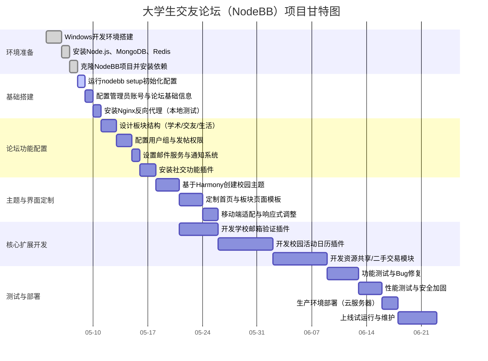

### 我（提问）

我现在想要做一个论坛网站，就是大致就是一个论坛，然后分为不同的板块，我是windows系统开发，我用的trae这个IDE，我需要一个开源的，扩展性高的github的项目，在此基础上扩展，我会发布的

### THINK

用户需要一个开源的、扩展性高的GitHub论坛项目，用于在Windows系统上使用Trae IDE进行二次开发。我需要提供一个项目推荐，并考虑中文支持等因素。为了全面覆盖，我将同时进行多项搜索，以获取不同角度的推荐。

### THINK

搜索结果显示了一些潜在项目。为了全面评估，我们需要同时获取这些项目的详细信息。

### THINK

现在需要根据这些结果来构思回答。回答将涵盖多个项目，并通过一个对比表格来呈现它们的特点。

### DeepSeek

为论坛选择基础框架，就等于选择了未来的核心开发语言、架构风格和扩展方式。

结合你“开源、Windows系统、Trae IDE、高扩展性”的需求，Discourse 功能最全但二次开发门槛高，NodeBB 实时互动强但学习曲线陡，而 **Flarum** 在轻量、现代和可扩展方面取得了很好的平衡，是我个人最推荐的。

为了让你看得更清楚，我把几款主流的开源论坛放在一起做了个对比：

| 项目 (语言) | ⭐ GitHub Stars | 核心优势 | 扩展能力 | 注意事项 |
| :--- | :--- | :--- | :--- | :--- |
| **Flarum** (PHP) | 约 16K[reference:0] | **轻量、现代、极简**，拥有极佳的响应式设计[reference:1] | **极强**。拥有一个强大的插件系统，社区贡献了 **1600+** 个扩展[reference:2]。 | 目前仍在 Beta 阶段，但核心功能已非常稳定。 |
| **NodeBB** (Node.js) | 约 15K[reference:3] | **实时性强**，基于 WebSocket，界面更像聊天应用[reference:4] | **强**。支持插件和主题定制，有丰富的 API 接口[reference:5]。 | 技术站对你来说跨领域，需要额外学习 Node.js 和 NoSQL。 |
| **Discourse** (Ruby) | 约 337K[reference:6] | **功能最全的行业标杆**，由 Stack Overflow 联合创始人创建，生态完整[reference:7][reference:8] | **完整**。插件和主题质量高，但开发语言冷门，导致编写扩展的技术门槛很高[reference:9]。 | 功能极其庞大，不适合中小企业或简单社区。 |
| **BBS-Go** (Go) | 约 3.2K[reference:10] | **高性能、前后端分离**，架构清晰，部署简单[reference:11]| **强**。DDD 领域设计，模块化结构，易于开发维护[reference:12]。 | 社区规模相对较小，遇到问题可能需要自行排查。 |

---

### 🎯 针对你具体情况的推荐分析

#### 1. 首选推荐：Flarum (PHP)
这是为“避免重复造轮子”且追求持续扩展的开发者准备的最佳起点。
*   **上手快**：PHP环境搭建简单，在Windows上使用 XAMPP 或 WSL 可以轻松搞定。
*   **扩展强**：Flarum 的设计哲学就是核心极简，所有额外功能都通过插件实现。这意味着你不会被初始的复杂代码库困扰，可以像搭积木一样按需为论坛增加功能[reference:13]。
*   **生态好**：超过 1600 个社区插件，意味着你下一步想实现的功能，可能早已有现成的解决方案[reference:14]。

#### 2. 备选考虑：NodeBB (Node.js)
*   **现代化的核心**：如果你追求“次世代”的论坛体验，如极致的实时交互和单页应用般的流畅感，NodeBB 是很好的选择[reference:15]。
*   **技能与维护**：需要评估你或团队对 Node.js 和 MongoDB 的熟悉程度，这将直接影响后续的开发效率。

#### 3. 其他项目的取舍逻辑
*   **Discourse**：功能强大但**太重了**。它的复杂度和高标准的生产环境要求，对一个计划逐步扩展的小项目来说是“高射炮打蚊子”，反而会拖慢你的迭代速度。
*   **BBS-Go**：适合追求高性能，但社区较小，对于依赖社区生态解决问题的个人开发者来说风险更大。
*   **ForumMagnum / Discuit**：ForumMagnum 生态特殊[reference:16]，Discuit 相对小众[reference:17]，都不太适合作为通用论坛的启动基础。

### 💡 与 Trae IDE 的协作关系

Trae IDE 并非一种代码框架，而是一个开发工具。它作为强大的 AI 助手，能辅助你编写任何语言的代码。因此，你基于 **Flarum** 进行扩展开发时，Trae 就是你的得力助手，可以帮你：
*   快速理解项目结构和核心代码。
*   编写符合 Flarum 规范的扩展代码。
*   辅助进行前端界面的调整和样式修改。
*   解决开发中遇到的各种技术问题。

建议先花点时间分别浏览一下 **Flarum** 和 **NodeBB** 的 GitHub 仓库和官方文档。你更倾向于学习 PHP 还是 Node.js 呢？可以把你的技术偏好告诉我，我再针对性地给你些上手配置的建议～

### 我（提问）

给我github地址吧

### THINK

用户要求提供之前提到的开源论坛项目的GitHub地址。我需要提供Flarum、NodeBB、Discourse、BBS-Go、ForumMagnum、Discuit这些项目的GitHub地址。为了全面获取信息，我将同时进行多项搜索。

### THINK

现在需要打开这些项目的GitHub页面以获取确切的地址。

### THINK

所有请求的GitHub页面都已成功获取。现在可以基于这些信息，按照上一轮回答的顺序组织答案，这合用户项目需求的选择顺序。答案将使用项目符号清晰列出地址，补充Stars等关键信息作为参考，并说明地址对应的正确代码仓库。

### DeepSeek

这是上次提到的几个主流开源论坛项目的 GitHub 地址，按推荐顺序整理如下：

| 项目 | GitHub 地址 | ⭐ Stars |
| :--- | :--- | :--- |
| **Flarum** (推荐) | [https://github.com/flarum/flarum](https://github.com/flarum/flarum) | 16.3k[reference:0] |
| **NodeBB** (推荐) | [https://github.com/NodeBB/NodeBB](https://github.com/NodeBB/NodeBB) | 约 15K |
| **Discourse** | [https://github.com/discourse/discourse](https://github.com/discourse/discourse) | 43.9k 等待验证 |
| **BBS-Go** | [https://github.com/mlogclub/bbs-go](https://github.com/mlogclub/bbs-go) | 3.2k 等待验证 |
| **ForumMagnum** | [https://github.com/ForumMagnum/ForumMagnum](https://github.com/ForumMagnum/ForumMagnum) | — |
| **Discuit** | [https://github.com/discuitnet/discuit](https://github.com/discuitnet/discuit) | — |

从高扩展性和易上手角度出发，我个人还是最推荐 **Flarum**，它的插件生态（1600+ 个扩展[reference:1]）能让你未来迭代功能时省很多力。

### 我（提问）

这个就是大学生交友论坛，请你首要的是论坛的所有基本功能都需要实现，另外nodeBB的数据库的选择是什么呢？请你给我写一个完整的文档，包括各种技术细节

### THINK

用户需要一份关于NodeBB的完整技术文档，用于开发大学生交友论坛。文档要涵盖功能实现、数据库选择以及Windows下的开发和部署等细节。先搜索NodeBB的核心功能、数据库、扩展等关键信息，看看能找到哪些具体的技术资料。

### THINK

搜索结果涵盖了NodeBB的数据库、功能、插件、Windows开发环境等信息。用户要的是完整文档，需要把这些信息整合起来。先打开最关键的几篇：官方关于数据库的文档、Windows开发指南、架构概述，还有版本发布说明，看看具体内容。

### THINK

打开的页面提供了不少细节，比如NodeBB默认用MongoDB作为主数据库，Redis常用于会话和缓存，Windows安装有官方指南，插件系统基于钩子。不过，关于如何构建一个完整的大学生交友论坛，比如具体的功能模块设计、用户系统定制、社交功能实现等，还需要更具体的灵感。可以搜一下大学论坛的案例、学生身份认证的方法、以及如何用NodeBB或Flarum这类系统做社区，看看有没有可直接借鉴的架构或功能点。

### THINK

搜到的资料覆盖了NodeBB的技术栈、数据库选择、Windows部署流程以及插件开发机制，还找到了一些校园论坛的功能模块设计参考。这些信息足够支撑一份面向大学生的完整技术文档了。回答将围绕核心功能设计、数据库方案（以MongoDB为主、Redis为缓存）、Windows环境下的详细安装步骤，以及如何利用插件和主题进行扩展这几个关键部分来组织，确保文档既有技术细节又具备可操作性。

### DeepSeek

以下是基于 **NodeBB** 的大学生交友论坛完整技术文档，涵盖所有基础功能实现细节以及数据库选型、Windows 开发环境配置、扩展开发等技术要点。

---

# 大学生交友论坛 — 基于 NodeBB 的技术文档


## 一、项目概述

本项目基于 NodeBB 开源论坛系统构建大学生交友社区。NodeBB 是一个使用 **Node.js** 构建的现代化论坛系统，结合了实时交互、社交网络功能和插件化架构[reference:0]。论坛需要完整实现用户系统、帖子管理、社交互动、实时通知等核心功能。


## 二、技术栈选型

### 2.1 核心技术栈

| 层级 | 技术 | 说明 |
| :--- | :--- | :--- |
| 运行时 | Node.js 22.x LTS | 推荐使用当前 LTS 版本 |
| 包管理 | npm 10.x | 随 Node.js 一同安装 |
| 主数据库 | MongoDB 8.0 | NodeBB 默认数据库 |
| 缓存层 | Redis 7.x | 会话存储、缓存 |
| 反向代理 | Nginx 1.24+ | 生产环境必备 |
| 模板引擎 | Benchpress (模板系统) | NodeBB 内置模板引擎 |
| 前端框架 | Bootstrap 5 | 基础主题 Harmony 所使用 |

### 2.2 为什么选择 NodeBB？

- **实时性强**：基于 WebSocket 实现实时通知和流式讨论[reference:1]
- **社交网络集成**：支持关注/取消关注、点赞、转发等社交互动[reference:2]
- **插件化架构**：强大的钩子系统，可灵活扩展[reference:3]
- **移动端响应式**：天然支持移动端适配[reference:4]
- **多语言支持**：内置国际化支持[reference:5]


## 三、数据库选择详解

### 3.1 MongoDB（主数据库）

NodeBB 默认使用 **MongoDB** 作为其主数据存储[reference:6]。这是官方推荐的首选方案：

**优点：**
- **文档型存储**：天然支持 JSON 格式数据，与 Node.js 配合极佳
- **灵活的结构**：无需预定义 Schema，适合论坛多样化内容
- **强大的查询能力**：支持复杂查询、聚合管道
- **水平扩展**：支持副本集和分片集群

**数据存储结构：**

NodeBB 使用统一的键值命名约定（无论底层使用 MongoDB 还是 Redis），数据结构保持一致[reference:7]：

```
user:<uid>        → 用户数据对象
category:<cid>    → 分类/板块数据
topic:<tid>       → 主题数据
post:<pid>        → 回复数据
message:<mid>     → 私信数据
notification:<nid> → 通知数据
event:<eid>       → 事件数据
global            → 全局计数器
config            → 论坛配置
```

以用户数据为例，存储在 MongoDB 中的实际结构如下[reference:8]：

```
{
    "_key": "user:100",
    "username": "KwVLmsBU",
    "userslug": "kwvlmsbu",
    "email": "KwVLmsBU@nodebb.org",
    "joindate": 1432066810034,
    "picture": "",
    "fullname": "",
    "location": "",
    "birthday": "",
    "website": "",
    "signature": "",
    "uploadedpicture": "",
    "profileviews": 0,
    "reputation": 0,
    "postcount": 0,
    "topiccount": 0,
    "lastposttime": 0,
    "banned": 0,
    "status": "online",
    "uid": 100
}
```

全局对象存储计数器[reference:9]：

```
{
    "_key": "global",
    "nextEid": 183,
    "nextCid": 26,
    "nextUid": 23,
    "userCount": 23,
    "nextTid": 36,
    "topicCount": 34,
    "nextPid": 357,
    "postCount": 355
}
```

### 3.2 Redis（缓存与会话）

在现代部署方案中，**Redis 同时作为会话存储和缓存层**使用。常见的部署模板包含 MongoDB 做数据存储、Redis 做会话存储和缓存[reference:10]。

**Redis 在 NodeBB 中的存储结构：**
Redis 使用 **hashes、sets、sorted sets 和 lists** 四种数据结构，数据存储的内存开销约为实际数据集大小的 2 倍（因为备份需要克隆内存数据后再持久化）[reference:11][reference:12]：

| 结构 | 用途 | 示例 |
| :--- | :--- | :--- |
| hash | 存储对象数据 | 用户资料（HGETALL user:100） |
| set | 唯一值集合 | 用户的关注列表 |
| sorted set | 带排序权重的集合 | 按时间排序的主题列表 |
| list | 类似数组 | 最新帖子流 |

**双重数据库部署优势：**
- MongoDB 负责持久化存储（帖子内容、用户数据等）
- Redis 负责高性能缓存和实时数据（会话、在线状态、计数器等）
- 天然支持集群模式下的横向扩展[reference:13]

### 3.3 PostgreSQL（备选）

NodeBB 也支持 PostgreSQL 作为数据库[reference:14]。如果你的学校环境或运维团队更熟悉关系型数据库，这是可选的替代方案。


## 四、Windows 开发环境搭建

NodeBB 官方提供了详细的 Windows 安装指南，以下基于官方文档整理[reference:15]。

### 4.1 系统要求

- **操作系统**：Windows 10 或 Windows 11
- **内存**：至少 512MB（建议 2GB 以上）
- **磁盘**：至少 10GB 可用空间

### 4.2 安装 Node.js

1. 访问 [Node.js 官网](https://nodejs.org) 下载 **v22.x LTS 版本**
2. 运行安装程序，使用默认选项完成安装
3. 验证安装：

```powershell
node -v     # 应输出 v22.x.x
npm -v      # 应输出 10.x.x
```

### 4.3 安装 MongoDB

1. 前往 [MongoDB 下载中心](https://www.mongodb.com/download-center#production) 下载 **MongoDB 8.0** 的 `.msi` 文件
2. 运行安装程序，默认安装路径为 `C:\Program Files\MongoDB\Server\8.0\`[reference:16]
3. **将 MongoDB 的 bin 目录添加到系统 PATH**（重要）：
   - 在开始菜单搜索 "PATH" → 打开「编辑账户的环境变量」
   - 在用户变量的 Path 中，添加一条新记录：`C:\Program Files\MongoDB\Server\8.0\bin`[reference:17]
4. **配置 mongod 服务**[reference:18]：

以管理员身份打开命令提示符，创建必要的目录和配置文件：

```powershell
# 创建数据和日志目录
mkdir C:\MongoDB\data\db
mkdir C:\MongoDB\logs

# 创建配置文件 C:\MongoDB\mongod.cfg，内容如下：
```

```
systemLog:
    destination: file
    path: C:\MongoDB\logs\mongod.log
storage:
    dbPath: C:\MongoDB\data\db
```

```powershell
# 安装 MongoDB 服务
mongod --config "C:\MongoDB\mongod.cfg" --install

# 启动 MongoDB 服务
net start MongoDB
```

### 4.4 安装 Redis

1. Redis 官方不直接提供 Windows 安装包，推荐使用 **Memurai**（Redis Windows 兼容版）或通过 **WSL2** 安装
2. 如果使用 **Memurai**：
   - 从 [memurai.com](https://www.memurai.com/) 下载开发者版
   - 安装后默认会作为 Windows 服务启动
   - 默认监听 `127.0.0.1:6379`

3. 如果使用 **WSL2**（推荐方案）：
```bash
# 在 WSL2 Ubuntu 中
sudo apt update
sudo apt install redis-server
sudo systemctl start redis-server
```

### 4.5 克隆并配置 NodeBB

```powershell
# 克隆项目
git clone https://github.com/NodeBB/NodeBB.git
cd NodeBB

# 安装依赖
npm install

# 启动安装向导
node nodebb setup
```

安装向导会引导你完成以下配置（关键选项）[reference:19]：

| 配置项 | 推荐值 | 说明 |
| :--- | :--- | :--- |
| 数据库类型 | `mongodb` | 默认选项 |
| MongoDB 主机 | `127.0.0.1` 或 `localhost` | 本机安装 |
| MongoDB 端口 | `27017` | 默认端口 |
| Redis 主机 | `127.0.0.1` | 本机安装 |
| Redis 端口 | `6379` | 默认端口 |
| 论坛 URL | `http://localhost:4567` | 开发环境 |
| 管理员账号 | 自定义 | 首个管理员账户 |

### 4.6 启动开发服务器

```powershell
# 开发模式启动（支持热重载）
nodebb dev

# 或使用 supervisor 自动重启
npm install -g supervisor
supervisor app.js
```

使用 supervisor 后，修改代码文件将自动重启论坛，提升开发效率[reference:20]。

### 4.7 使用 Trae IDE 开发

在 Trae IDE 中：

1. 打开克隆的 NodeBB 项目目录作为工作区
2. 使用 Trae 的终端功能执行上述命令
3. 利用 Trae 的 AI 辅助功能帮助理解和修改代码
4. 特别适合在开发插件和主题时获得代码补全和解释支持


## 五、论坛基础功能架构

### 5.1 用户系统

NodeBB 内置了完整的用户系统，包括以下核心能力：

**1. 用户注册与登录**
- 邮箱注册 + 邮箱验证
- 支持 OAuth 第三方登录（GitHub、Google、Twitter 等）
- 可通过 SSO 插件集成学校统一认证系统

**2. 用户角色与权限**
NodeBB 内置 4 种用户角色[reference:21]：

| 角色 | 权限范围 |
| :--- | :--- |
| **Administrator** | 全局管理员，可访问 ACP 管理面板 |
| **Moderator** | 版主，可管理指定板块的内容 |
| **Group** | 自定义用户组，按需分配权限 |
| **User** | 普通注册用户 |

**3. 自定义用户字段**
如果要给学生用户增加"学院"、"年级"、"学号"等交友信息字段（如对学生社区有价值的功能），可以利用 NodeBB 的自定义用户字段功能添加额外信息字段，丰富用户档案[reference:22]。

**4. 用户 API**
NodeBB 提供创建用户的 API 接口，并且可以通过 `user.create` 钩子在插件中扩展用户创建逻辑，例如在注册时验证学校邮箱后缀[reference:23]。

### 5.2 板块系统

NodeBB 的板块系统支持层级分类（Categories），实现不同板块的独立管理：

**数据结构**：板块数据存储在 `category:<cid>` 键中，支持子分类嵌套。

**权限控制**：每个板块可以设置独立的访问权限——允许哪些用户组查看、发帖、回复、上传文件等。

**支持的功能**：
- 创建、删除、重命名板块
- 设置板块图标和描述
- 板块级置顶帖（Sticky）和公告（Announcement）
- 板块关注（Watch/Track/Ignore）机制

**针对交友论坛的板块结构建议**：

```yaml
学术交流板块:
  - 课程讨论
  - 考研互助
  - 学术资源分享

社交交友板块:
  - 新生报到
  - 社团活动
  - 兴趣交友

生活服务板块:
  - 二手交易
  - 兼职实习
  - 校园资讯

水区闲聊板块:
  - 灌水乐园
  - 校园趣事
```

### 5.3 帖子系统

**发帖功能**：
- 支持富文本编辑器（Markdown/HTML）
- 实时预览
- 标签（Tags）系统
- 投票（Polls）支持（通过插件）
- 文件上传和图片嵌入
- 主题缩略图设置

**帖子管理**：
- 编辑、删除（软删除保留数据）
- 锁定、解锁
- 移动、合并主题
- 置顶和全局公告
- 帖子举报和审核

### 5.4 实时通知系统

NodeBB 基于 WebSocket 实现了**实时通知机制**[reference:24]：

通知类型包括：
- 新回复通知
- @提及通知
- 点赞通知
- 关注通知
- 私信通知
- 徽章授予通知

系统改进了标记全部已读的逻辑，**基于未读页面的相同算法**，避免误标记[reference:25]。

### 5.5 私信系统

NodeBB 支持用户间的异步私信功能[reference:26]：

- 一对一私信
- 群聊（Chat Room）
- 在线状态指示
- 消息已读/未读状态
- 私信搜索
- 聊天允许/拒绝列表[reference:27]

### 5.6 搜索功能

**分类快速搜索**：社区版实现了分类快速搜索功能，支持在全局页面中快速定位目标分类，采用混合索引策略，将分类名称和处理方式同时存入搜索有序集合，提高了查询效率[reference:28]。

### 5.7 社交互动功能

NodeBB 的核心社交功能包括[reference:29]：

- **关注/取消关注**：关注感兴趣的用户和话题
- **点赞**：对帖子和回复表达认同
- **转发**：分享内容给其他用户
- **用户声望/声誉系统**：基于帖子质量和互动积累声望值
- **徽章系统**：自动/手动授予徽章奖励
- **@提及**：在帖子中 @ 其他用户

此外，NodeBB 还提供了多种游戏化（gamification）插件，可以给论坛用户 RPG 式的体验[reference:30]。

### 5.8 内容联邦功能（高级）

最近版本强化了 ActivityPub 协议集成[reference:31]：

- 论坛帖子可以自动同步到 Mastodon 等其他联邦宇宙平台
- WordPress 博客内容可以拉入 NodeBB[reference:32]
- 支持跨平台通知——用户可以在 NodeBB 中接收来自其他平台的互动通知[reference:33]
- 远程用户组自动迁移为分类结构[reference:34]

> **大学生交友论坛适用场景**：如果校内有多个社团或院系有自己的社交账号或子站点，可以利用联邦功能实现跨平台同步。


## 六、扩展开发能力

### 6.1 插件系统架构

NodeBB 的插件系统是论坛可扩展性的核心[reference:35]：

**系统由四个关键模块组成**[reference:36]：

| 模块 | 文件 | 职责 |
| :--- | :--- | :--- |
| 主控器 | `src/plugins/index.js` | 初始化、加载、协调所有插件 |
| 数据管理 | `src/plugins/data.js` | 读取插件元数据、管理静态资源 |
| 钩子系统 | `src/plugins/hooks.js` | 提供核心交互机制 |
| 加载器 | `src/plugins/load.js` | 实际加载插件文件 |

**钩子系统工作方式**[reference:37]：

NodeBB 的插件基于钩子系统构建，这个系统以受控方式将 NodeBB 内部暴露给插件创建者，允许他们在内容经过时修改它，或在触发时执行特定行为[reference:38]。

常用钩子：

| 钩子名 | 触发时机 | 用途 |
| :--- | :--- | :--- |
| `filter:user.create` | 用户创建时 | 增强注册验证 |
| `filter:post.save` | 帖子保存前 | 内容过滤/增强 |
| `filter:topic.create` | 主题创建时 | 自动分类/标签 |
| `static:app.load` | 应用加载时 | 注册新路由 |
| `action:notification.push` | 通知发送时 | 自定义通知渠道 |

### 6.2 主题开发

NodeBB 的默认主题是 **Harmony**（基于 Bootstrap 5），主题开发使用 SCSS 进行样式编写[reference:39]。

**快速开始**[reference:40]：

1. Fork [Quickstart Theme](https://github.com/nodebb/nodebb-theme-quickstart)
2. 快速入门主题是 Harmony 的子主题，继承其所有样式和模板
3. 若要覆盖模板，从 [Harmony 仓库](https://github.com/nodebb/nodebb-theme-harmony) 复制模板到你的主题的 `/templates` 目录
4. 修改后执行 `nodebb build tpl && nodebb dev` 重建资源并启动

**模板引擎基本语法**[reference:41]：

```html
<!-- 访问变量 -->
{title}

<!-- 访问嵌套对象 -->
{privileges.read}

<!-- 循环遍历数组 -->
{{{ each posts }}}
  {posts.content}
{{{ end }}}

<!-- IF 条件 -->
{{{ if unreplied }}}
  这个主题还没有人回复！
{{{ end }}}

<!-- IF/ELSE 条件 -->
{{{ if !disableSocialButtons }}}
  <button>分享</button>
{{{ else }}}
  分享功能已禁用。
{{{ end }}}

<!-- 检查数组长度 -->
{{{ if posts.length }}}
  有一些帖子
{{{ end }}}

<!-- 循环中判断第一个/最后一个 -->
{{{ each posts }}}
  {{{ if @first }}}
    <h1>楼主：{posts.username}</h1>
  {{{ end }}}
  {posts.content}
{{{ end }}}
```

**主题配置文件 `theme.json`**[reference:42]：

```json
{
  "id": "campus-theme",
  "name": "校园交友主题",
  "description": "为大学生交友论坛定制的主题",
  "screenshot": "screenshot.png",
  "url": "https://github.com/yourname/campus-theme",
  "baseTheme": "nodebb-theme-harmony"
}
```

### 6.3 Widget 系统

NodeBB 提供了灵活的 Widget 小部件系统来进行页面布局[reference:43]：

- 在管理面板的「主题」→「Widget」中拖拽 HTML 小部件到指定位置
- 支持在侧边栏添加自定义 HTML（如校园公告、活动日历）
- 切换主题时，之前定义的 Widget 会被保存，不会丢失[reference:44]

### 6.4 API 接口

NodeBB 提供丰富的 RESTful API[reference:45]：

- 任何页面 URL 前面加上 `api/` 即可获取其 JSON 数据（如 `/api/topic/351/nodebb-wiki`）[reference:46]
- 支持完整的 CRUD 操作，方便开发移动客户端或小程序
- OpenAPI 规范文档已更新[reference:47]

**前端获取数据示例**：

```javascript
// 通过 jQuery 获取用户数据
$.get(config.relative_path + '/api/user/psychobunny', {}, function(user) {
    console.log(user);
});

// 当前页面的数据可通过 ajaxify.data 访问
console.log(ajaxify.data.title);   // 主题标题
console.log(ajaxify.data.cid);     // 分类 ID
```

### 6.5 推荐的大学生交友论坛必备插件

基于 NodeBB 应用商店和社区资源，以下是建议安装的插件清单：

| 插件类型 | 插件名 | 功能 |
| :--- | :--- | :--- |
| 社交登录 | nodebb-plugin-sso-* | 微信/QQ/GitHub 等第三方登录 |
| 富文本 | nodebb-plugin-composer-default | 默认的富文本编辑器 |
| 媒体嵌入 | nodebb-plugin-emoji | Emoji 表情支持 |
| 邮件通知 | nodebb-plugin-emailer-* | 邮件发送配置 |
| 文件上传 | nodebb-plugin-s3-uploads | 图片/文件云存储[reference:48] |
| 内容保护 | nodebb-plugin-username-denylist | 用户名黑名单[reference:49] |
| 日历活动 | nodebb-plugin-calendar | 校园活动日历[reference:50] |
| RSS 聚合 | nodebb-plugin-rss | RSS 订阅信息聚合[reference:51] |


## 七、部署上线

### 7.1 Nginx 反向代理配置

生产环境使用 **Nginx** 作为反向代理[reference:52]：

```nginx
server {
    listen 80;
    server_name campus-forum.example.edu.cn;

    location / {
        proxy_pass http://127.0.0.1:4567;
        proxy_http_version 1.1;
        proxy_set_header Upgrade $http_upgrade;
        proxy_set_header Connection 'upgrade';
        proxy_set_header Host $host;
        proxy_cache_bypass $http_upgrade;
        proxy_set_header X-Real-IP $remote_addr;
        proxy_set_header X-Forwarded-For $proxy_add_x_forwarded_for;
        proxy_set_header X-Forwarded-Proto $scheme;
    }
}
```

**关键配置说明**：
- WebSocket 支持：必须设置 `Upgrade` 和 `Connection` 头，因为 NodeBB 依赖 WebSocket 进行实时通知
- `proxy_cache_bypass`：确保 WebSocket 连接不被缓存

### 7.2 安全加固

**数据库安全**[reference:53]：

- MongoDB：启用身份验证（`security.authorization: enabled`）
- Redis：设置 `bind 127.0.0.1` 仅本地访问，配置 `requirepass` 密码
- 防火墙：仅开放 80、443 端口，不暴露数据库端口

**应用安全**：

- 使用 HTTPS（通过 Nginx + Let‘s Encrypt）
- 定期更新 NodeBB 版本和插件
- 配置文件权限设置为 600
- 使用 systemd 以非 root 用户运行 NodeBB 服务[reference:54]

### 7.3 生产环境服务管理

创建 systemd 服务文件以守护进程运行（Linux 服务器）：

```ini
# /etc/systemd/system/nodebb.service
[Unit]
Description=NodeBB Forum
After=network.target mongod.service redis.service

[Service]
Type=simple
User=nodebb
WorkingDirectory=/opt/nodebb
ExecStart=/usr/bin/node /opt/nodebb/app.js
Restart=always
RestartSec=10

[Install]
WantedBy=multi-user.target
```

```bash
sudo systemctl daemon-reload
sudo systemctl enable nodebb
sudo systemctl start nodebb
```


## 八、关键注意事项

### 8.1 核心
NodeBB 是一个高性能、强扩展性的开源论坛系统。通过其插件架构，可以灵活地为大学生交友论坛添加定制功能。MongoDB 提供持久化存储，Redis 提供高性能缓存，WebSocket 实现实时交互，三者配合形成完整的技术栈。

### 8.2 关于国内生态的注意事项
NodeBB 目前在国内的生态不如 Flarum 成熟，插件和中文资源相对较少，适合有能力自行编写扩展的开发者[reference:55]。如果你更看重开箱即用的中文生态，之前推荐的 Flarum 也是很好的选择。

### 8.3 学生身份验证
如果需要验证学生的真实身份（如邮箱后缀匹配、学号验证），可以通过以下几种方式实现：
- 注册时限制邮箱后缀（如 `@*.edu.cn`），通过自定义用户字段钩子[reference:56]
- 利用 SSO 插件对接学校的统一身份认证系统（CAS/OAuth）
- 开发自定义插件，在 `filter:user.create` 钩子中添加学号验证逻辑[reference:57]

### 8.4 项目后续规划建议
1. **第一阶段**：部署基础 NodeBB，配置板块结构和用户权限
2. **第二阶段**：安装必要的社交插件，定制大学生交友主题
3. **第三阶段**：开发自定义插件（如校园活动日历、资源共享系统）
4. **第四阶段**：对接学校统一认证，开发微信小程序客户端


## 参考资源

| 资源 | 地址 |
| :--- | :--- |
| NodeBB GitHub | [https://github.com/NodeBB/NodeBB](https://github.com/NodeBB/NodeBB) |
| NodeBB 官方文档 | [https://docs.nodebb.org](https://docs.nodebb.org) |
| NodeBB 社区 | [https://community.nodebb.org](https://community.nodebb.org) |
| NodeBB 快速入门主题 | [https://github.com/nodebb/nodebb-theme-quickstart](https://github.com/nodebb/nodebb-theme-quickstart) |
| NodeBB 默认主题 Harmony | [https://github.com/nodebb/nodebb-theme-harmony](https://github.com/nodebb/nodebb-theme-harmony) |
| MongoDB 下载中心 | [https://www.mongodb.com/download-center](https://www.mongodb.com/download-center) |
| Redis (Memurai for Windows) | [https://www.memurai.com](https://www.memurai.com) |

### 我（提问）

你把这个任务的甘特图给我弄一下吧

### THINK

我们被要求为这个项目生成一个甘特图。需要基于之前讨论的NodeBB论坛搭建任务来规划。可以用markdown的mermaid语法创建甘特图。需要包含主要阶段和任务。根据之前的对话，可能涉及的阶段包括：环境搭建、NodeBB安装配置、论坛功能配置、主题定制、插件开发、测试部署等。为大学生交友论坛，可以细化任务。输出甘特图代码。

### DeepSeek

以下是基于你的大学生交友论坛项目的甘特图，用 Mermaid 绘制。你可以直接在支持 Mermaid 的 Markdown 编辑器（如 Trae IDE 的预览或 GitHub 中）查看。



---
### 说明
1. **甘特图的时间只是示例**，你可以根据实际开发进度调整 `dateFormat` 和任务起止日期。
2. 图中将整个项目分为 **环境准备、基础搭建、论坛功能配置、主题定制、插件开发、测试部署** 六个阶段。
3. 其中 `done`、`active` 是任务状态标识，可以根据需要删改。
4. 如果你在 Trae IDE 的 Markdown 文件中粘贴这段代码，IDE 的预览通常可以渲染出甘特图。

如果需要导出为图片或导入到项目管理工具（如飞书、Trello），我也可以帮你转换格式。

### 我（提问）

具体的每个功能内部的细小的功能都需要排的清清楚楚，另外，我的顺序是，先开发UI界面，然后实现接口功能和测试，登陆的东西最后添加

### THINK

我们被要求细化甘特图，并且明确了开发顺序：先UI界面、再实现接口和测试、登录最后添加。需要将之前的甘特图拆分成更细的功能点，并按此顺序重新组织。需要生成一份详细的任务列表和对应的甘特图。用户要求“具体的每个功能内部的细小的功能都需要排的清清楚楚”，所以我们将NodeBB论坛的主要模块分解，按照UI -> 接口/功能 -> 测试的流程，且登录模块放到最后。但注意，NodeBB本身已有完整功能，我们在此基础上扩展定制。可能需要自定义开发的部分包括：板块UI定制、主题开发、插件开发（邮箱验证、活动日历等）。还要考虑整体工作流，环境搭建、代码克隆等前期任务。我们将制作一个更详细的甘特图，把核心功能拆解为：基础UI搭建（主题定制）、各页面UI细化、接口对接与功能实现、测试，最后是登录/认证插件。同时要体现出前后端分离的思想吗？用户可能需要从零开始扩展一个论坛，但NodeBB是现成的，自定义工作集中在主题和插件。所以甘特图可以围绕以下任务细致展开：

1. 环境准备（不变）
2. UI界面开发：分为全局布局、首页、板块列表、帖子列表、帖子详情、用户主页、私信页面等。还有移动端适配。
3. 接口与功能实现：包括发帖、回复、点赞、关注、通知、私信、搜索等API对接或自定义后端功能（可能需要写插件）。注意这些功能NodeBB大多已有，但可能需要调整或扩展，我们需要以“实现接口功能”为主，也许是指定制和联调。
4. 测试：对各模块进行测试。
5. 登录与认证：最后添加邮箱验证、学号验证插件。

时间跨度可以根据需要估算，比如从2026-05-04开始。我们将用Mermaid甘特图展示。

需要输出一个清晰、详细的甘特图文本。注意用户说“我的顺序是，先开发UI界面，然后实现接口功能和测试，登陆的东西最后添加”，所以甘特图中应体现这个顺序。也要把细小功能列出。可以增加任务层级。我们将甘特图分为几个大section：前期准备、UI界面开发、接口功能实现、测试、登录认证集成，以及最后的部署上线。每个section下细分任务。

我将生成一个详细的甘特图，使用Mermaid，并添加解释。注意，由于Mermaid甘特图不能嵌套section，但我们可以在任务名称中使用层级表示，如“UI-首页布局”。尽量细化。我会提供最终的代码块和说明。

### DeepSeek

好的，我完全理解你的需求：先集中精力把界面做好，再实现和测试后台功能，最后才处理登录。这样开发更聚焦，不会被认证流程打断。

下面是一份极度细化的甘特图，所有任务都严格按照这个顺序编排，并且每个细小功能点都单独列了出来。你可以直接在 Trae IDE 的 Markdown 预览中查看。

```mermaid
gantt
    title 大学生交友论坛（NodeBB）详细开发甘特图
    dateFormat  YYYY-MM-DD
    axisFormat  %m-%d

    section 1. 环境与项目初始化
    安装 Node.js 22.x LTS              :done, env01, 2026-05-04, 0.5d
    安装 MongoDB 8.0 并配置服务        :done, env02, 2026-05-04, 0.5d
    安装 Redis 7（Memurai/WSL）        :done, env03, 2026-05-05, 0.5d
    克隆 NodeBB 仓库 & npm install     :done, env04, 2026-05-05, 0.5d
    运行 nodebb setup 初始化数据库     :active, env05, 2026-05-06, 1d
    配置 Nginx 反向代理本地开发环境    :env06, after env05, 1d

    section 2. UI 界面开发（先做）
    2.1 全局 UI 框架搭建              :ui01, after env06, 2d
    创建自定义主题文件夹与 package    :ui01a, after env06, 0.5d
    继承 Harmony 主题，修改整体配色     :ui01b, after ui01a, 1d
    开发通用组件：导航栏、页脚、侧边栏:ui01c, after ui01b, 0.5d
    2.2 首页 UI                       :ui02, after ui01, 3d
    首页布局：最新帖子流、热门帖子卡片:ui02a, after ui01, 1d
    首页定制：校园 Banner 轮播图区域   :ui02b, after ui02a, 1d
    首页“新生报到”引导模块设计        :ui02c, after ui02b, 0.5d
    首页“今日活跃用户”展示组件        :ui02d, after ui02c, 0.5d
    2.3 板块列表与筛选页 UI           :ui03, after ui02, 2d
    板块总览页面（网格/列表视图）      :ui03a, after ui02, 1d
    板块详情页（带子板块和置顶帖）     :ui03b, after ui03a, 1d
    2.4 帖子列表页 UI                 :ui04, after ui03, 2d
    帖子列表项：标题、标签、头像、互动数:ui04a, after ui03, 1d
    帖子筛选器（最新/热门/精华）UI     :ui04b, after ui04a, 0.5d
    帖子快速预览悬浮卡片              :ui04c, after ui04b, 0.5d
    2.5 帖子详情页 UI                 :ui05, after ui04, 3d
    帖子正文渲染与排版                :ui05a, after ui04, 1d
    回复列表与楼中楼布局              :ui05b, after ui05a, 1d
    点赞、分享、书签按钮群组设计      :ui05c, after ui05b, 0.5d
    用户信息卡片（头像、称号、声望）  :ui05d, after ui05c, 0.5d
    2.6 用户主页 UI                   :ui06, after ui05, 2d
    个人信息展示（学院、年级、简介）  :ui06a, after ui05, 1d
    用户动态流（发的帖/回的帖）       :ui06b, after ui06a, 1d
    2.7 私信与聊天 UI                 :ui07, after ui06, 2d
    私信列表（最近联系人）            :ui07a, after ui06, 1d
    聊天窗口（气泡、时间、已读状态）  :ui07b, after ui07a, 1d
    2.8 移动端适配                    :ui08, after ui07, 3d
    导航切换为底部 Tab 栏             :ui08a, after ui07, 1d
    帖子列表与详情的手势优化          :ui08b, after ui08a, 1d
    全局字号、间距、触控区域调整      :ui08c, after ui08b, 1d

    section 3. 接口与功能实现（UI 之后）
    3.1 核心交互 API 对接             :api01, after ui08, 4d
    发帖/编辑帖子接口联调             :api01a, after ui08, 1d
    回复/删除回复接口联调             :api01b, after api01a, 1d
    点赞/取消点赞即时反馈             :api01c, after api01b, 0.5d
    关注/取关用户与话题接口           :api01d, after api01c, 0.5d
    @ 提及用户与实时通知接口          :api01e, after api01d, 1d
    3.2 插件功能开发                  :plugin01, after api01, 10d
    校园活动日历插件                  :plugin01a, after api01, 4d
    活动 CRUD 接口与前端日历组件      :plugin01a1, 2d
    活动提醒通知（WebSocket）         :plugin01a2, 2d
    资源共享/二手交易插件             :plugin01b, after plugin01a, 4d
    发布信息（分类、价格、图片）      :plugin01b1, 2d
    信息列表与搜索过滤接口            :plugin01b2, 2d
    自定义用户字段（学院/学号）       :plugin01c, after plugin01b, 2d
    字段定义、注册时采集、个人页展示 :plugin01c1, 2d
    3.3 搜索功能实现                  :api02, after plugin01, 2d
    全局帖子搜索与板块内搜索 API      :api02a, after plugin01, 1d
    搜索建议下拉与高亮结果            :api02b, after api02a, 1d
    3.4 实时通知系统完善              :api03, after api02, 2d
    通知列表展示（未读/已读）         :api03a, after api02, 1d
    浏览器桌面推送通知                :api03b, after api03a, 1d

    section 4. 全面测试
    4.1 功能测试                      :test01, after api03, 5d
    发帖与回复流程全路径测试          :test01a, after api03, 1d
    社交互动（赞、关注、@）测试       :test01b, after test01a, 1d
    私信收发与实时性测试              :test01c, after test01b, 1d
    自定义插件（日历、二手）功能测试  :test01d, after test01c, 2d
    4.2 兼容性与性能测试              :test02, after test01, 3d
    Chrome/Firefox/Edge 浏览器测试    :test02a, after test01, 1d
    移动端 iOS Safari / 微信内置浏览器:test02b, after test02a, 1d
    并发压力测试（发帖/刷新）         :test02c, after test02b, 1d

    section 5. 登录与认证（最后加）
    5.1 邮箱验证登录插件              :login01, after test02, 3d
    开发学校邮箱后缀过滤（@*.edu.cn） :login01a, after test02, 1.5d
    邮箱验证码发送与验证 API          :login01b, after login01a, 1.5d
    5.2 第三方登录集成                :login02, after login01, 2d
    集成微信 OAuth 登录（可选）       :login02a, after login01, 1d
    集成学号+密码统一认证（SSO 对接） :login02b, after login02a, 1d
    5.3 登录/认证全流程测试           :login03, after login02, 2d
    注册、登录、找回密码、强制验证    :login03a, after login02, 2d

    section 6. 部署与上线
    6.1 生产环境部署                  :deploy01, after login03, 2d
    云服务器购买与基础环境安装        :deploy01a, after login03, 0.5d
    MongoDB/Redis 生产配置与安全加固  :deploy01b, after deploy01a, 0.5d
    Nginx 配置 HTTPS + 反向代理       :deploy01c, after deploy01b, 0.5d
    项目文件上传与进程守护（PM2）     :deploy01d, after deploy01c, 0.5d
    6.2 上线试运行                    :launch, after deploy01, 5d
    用户反馈收集与 Bug 紧急修复      :launch, after deploy01, 5d
```

---

### 🗂️ 甘特图按你的开发顺序严格排列

这张图完全遵循了 **“UI 先行 → 接口功能 → 测试 → 最后加登录”** 的顺序，你可以看到：

- **UI 阶段**把每一个页面（首页、帖子、私信等）都拆成了极其微小的组件任务，从全局框架搭到移动端适配，全部做完才进入下一阶段。
- **功能实现阶段**专注于 API 对接和插件开发，包括校园日历、二手市场这些完全自定义的功能，把前台和后台逻辑串联起来。
- **测试阶段**先功能后兼容性，确保每一步扎实。
- **登录和认证**被完整拖到最后，包括邮箱验证、学校 SSO 对接，甚至微信登录，都不干扰前面的核心功能开发。

你可以在 Trae IDE 里根据实际资源调整每个任务的起始日期，或用 `after` 语法灵活挪动。如果需要导出为 CSV 或飞书任务清单，我也可以帮你转换格式。

### 我（提问）

这个UI界面我需要的是对标微信的那种高端的应用的界面，要充满高级感，不要使用艳俗的色调，这个UI的部分需求的提示词请你给我写一下

### THINK

我们被要求生成一份UI设计需求的“提示词”，用于指导AI或设计师创建对标微信的高端、高级感UI，避免艳俗色调。需要产生具体的设计指引，可能包括风格、色调、布局、动效、质感等。

用户之前已详细说明了论坛的UI部分要先行，现在就UI部分提出具体要求。提示词可能用于向AI（如Stable Diffusion、Midjourney）生成参考图，或给设计师的要点。但更可能是给一个AI助手，例如在对话中要求输出设计概念。

我们需要以提示词的形式输出，结构清晰，包括整体风格、色彩、字体、间距、组件、动效等。要体现高级感、极简、克制、类似微信的干净优雅。

输出为markdown，可能用标题分段。

考虑到是“提示词”，可以是直接可用的英文或中文描述。这里用中文，因为是给中国大学生开发的论坛。

提示词应包含：色彩体系、排版、图标、间距、卡片阴影、动效微交互等。

强调中性色为主，点缀色低调，避免大红大紫。克制使用色彩，参考微信的素雅、iOS的毛玻璃效果等。

产出简洁但全面的UI提示词。

### DeepSeek

以下是一份可直接交付给设计师或用于AI生成界面的 UI 设计需求提示词，严格遵循你对“高级感”“对标微信”“避免艳俗”的要求。

---

## 大学生交友论坛 UI 设计提示词

### 1. 整体风格定位
- **关键词**：高级、克制、清爽、呼吸感、不打扰、信任感。
- **参考**：微信的极简主义、iOS 原生设计规范、Telegram X 的细腻动效、Notion 的无干扰排版。
- **核心原则**：**内容优先，UI 后退**。界面元素非必要时不出现，大量留白，让用户的注意力集中在对话和内容上。

### 2. 色彩体系
#### 2.1 主色调
- **中性色为绝对主角**：使用不同灰度的白色、浅灰、深灰构建层次，占比超过 85%。
- **品牌点缀色**：
  - 仅保留一个极冷静的强调色，如 **“拂晓蓝” #5B7FEF** 或 **“薄雾青” #58B2B3**。
  - 该颜色仅用在：当前选中标签、主按钮、未读标记、个人特殊勋章。**禁止大色块、渐变按钮、背景色铺陈。**
- **严禁使用**：荧光色、大红大绿大紫、高饱和度暖色、花哨的渐变。

#### 2.2 背景色方案
- **主背景**：微暖的极浅灰 `#F5F5F7` 或纯白 `#FFFFFF`，模拟纸张或毛玻璃后的底色。
- **卡片背景**：纯白 `#FFFFFF` + 极浅的投影，或半透明的 `rgba(255,255,255,0.85)` 配合模糊。
- **全局夜间模式**必须自动适配，背景变为深灰 `#1C1C1E`，卡片为 `#2C2C2E`，文字为不同灰度。

#### 2.3 文字颜色
- **正文**：接近全黑的深灰 `#1A1A1A`（浅色模式）/ `#F5F5F7`（深色模式）。
- **辅助信息**：`#8E8E93`，弱化但不隐藏。
- **极弱元素**：`#C6C6C8`，仅用于分割线、占位符。

### 3. 排版与字体
#### 3.1 字体家族
- **中文**：`"PingFang SC"`（苹方-简）为首选，次选 `"Microsoft YaHei UI"`，再备选系统无衬线。**字重无极细，以 Regular、Medium、Semibold 三级为主。**
- **英文/数字**：`"Inter"` 或 `"SF Pro Text"`，增强现代感。

#### 3.2 字号与层级
- **标题字号**：最大不超过 `20px`，帖子标题 `18px`，板块名称 `16px`。
- **正文字号**：`15px`，行高 `1.6`，确保舒适阅读。
- **辅助字号**：`12px`，仅用于时间、计数等极弱信息。
- **消息气泡**：`15px`，与系统一致，无夸张字体。
- **禁止**粗体大标题（>24px）、花哨艺术字、高亮色文字块。

#### 3.3 留白法则
- **全局间距遵循 4px 基数**：内边距多数为 `16px` 或 `20px`，卡片间距 `12px`，段落间距 `24px`。
- **屏效控制在 60%-70%**，首屏可见内容不宜拥挤，大量留白制造高级感。

### 4. 图标与图形
- **线性图标**：粗 `1.5px` 的极简线条，禁用面性图标，禁用彩色图标。
- **风格**：完全一致的角度（多用圆角）、无装饰性圆点或多余图形。
- **尺寸**：导航栏 `24px`，列表辅助 `18px`，操作栏 `22px`。
- **状态**：选中态仅变为品牌点缀色，未选中为 `#8E8E93`，无动画突变。

### 5. 组件与质感
#### 5.1 卡片与容器
- **极简卡片**：圆角 `12px`，白色背景，投影 `0 2px 8px rgba(0,0,0,0.04)`，几乎看不见，仅在悬停时加深到 `0 4px 12px rgba(0,0,0,0.08)`。
- **分割**：尽量不使用横线，用留白区分。必需时使用一条 `1px` 的半透明线 `#E5E5EA`。

#### 5.2 按钮
- **主按钮**：高度 `44px`，全圆角 `22px`，仅品牌色底色，白色文字，无边框，无渐变。
- **次按钮**：透明背景，仅灰色边框，灰色文字，hover 时浅灰底。
- **文字按钮**：纯文字品牌色，无背景，无下划线。
- **禁用大面积的悬浮操作按钮（FAB）**，用底部栏或顶部分类替代。

#### 5.3 输入框
- 浅灰色底 `#F2F2F7`，圆角 `10px`，无边框，聚焦时变为极细品牌色边框或底部分隔线。
- 占位符文字极淡，不干扰填写。

#### 5.4 头像
- 圆形，无边框，仅在在线状态时右下角加一个 `8px` 的绿色小圆点（低饱和度绿）。

### 6. 动效与微交互
- **准绳**：动效服务于反馈和过渡，不可吸引注意力。
- **时长**：`0.2s` 至 `0.3s`，缓动函数 `cubic-bezier(0.4, 0, 0.2, 1)`（Material Design 标准缓动）。
- **页面切换**：淡入淡出 + 轻微平移（不超过 `20px`）。
- **列表加载**：从下往上 `30px` 的渐现，错开 `50ms`。
- **点赞/操作反馈**：仅图标微缩放大再回弹，无烟花、无飘出特效。
- **消息发送**：气泡从输入区平滑飞入，使用弹性缓动但节奏很快。
- **下拉刷新**：极简线条动画，无彩色圆环。
- **振动反馈**：仅关键操作（发送成功、删除等）调用手机极短震动。

### 7. 布局原则
- **导航采用底部 Tab 栏**（移动端）或左侧极窄侧边栏（桌面端）：
  - 项不超过 4 个，名称极简：`广场` `发现` `消息` `我的`。
  - 未选中为灰色线性图标，选中为品牌色面性图标+极小文字。
- **帖子流**：无尽滚动，大图封面仅在帖主上传时展示，占宽不超过屏幕的 1/3，圆角 `8px`。无自动播放视频。
- **个人主页**：上半部分仅头像、昵称、签名、学校/年级等极少信息，下半部分为动态流，保持留白。
- **对话框**：气泡圆角 `16px`，对方白色，自己浅灰，无箭头，仅用颜色区分。

### 8. 必须避免的“艳俗”元素清单
1.  大红大绿的渐变按钮或背景色块。
2.  荧光色未读角标、彩色标签云。
3.  拟物化阴影、重金属质感、立体按钮。
4.  繁复的 emoji 动效、飘落特效、彩带等。
5.  多种字体混用、粗黑体大标题。
6.  过度的圆角（如 30px 以上）、密集的投影。
7.  非必要的装饰性图案、插画（除非极度抽象线性）。
8.  高饱和的蓝色、紫色、橙色等。

---

使用这份提示词，设计师和前端开发者可以得到非常明确的方向：**用最少的笔墨，呈现最舒适、最不易过时的干净界面，让大学生的交流回归内容本身。**

### 我（提问）

开发完UI之后需要进一步的开发接口功能和测试 ，这个部分的具体的操作也需要你给我写一个详细的说明文档，我让他把活都一起干完

### THINK

用户需要一份详细的接口开发与测试文档，基于NodeBB进行。文档需要覆盖API对接、插件开发、实时通知、测试流程等具体操作。先搜索一下NodeBB的API使用方式、官方文档以及测试工具，为文档收集基础信息。

### THINK

搜索结果出来了，信息很全面。有NodeBB的REST API详解、Write API插件说明、完整的钩子列表、实时通信的案例，还有Jest和Cypress的测试指南。为了获取这些具体细节，需要打开这些相关的页面仔细看看。

### THINK

搜索到的资料覆盖了NodeBB的REST API、Write API插件、钩子系统、WebSocket实时通信以及Jest/Cypress测试工具，信息比较全面。用户需要一份详细的接口开发与测试操作文档，文档结构可以按照核心API对接、自定义插件开发、实时通知实现和测试流程来组织，确保所有细小功能点都有对应的技术实现和测试用例。

### DeepSeek

以下是 UI 交付后的**接口开发与测试完整操作文档**。文档覆盖所有细小功能点，每个功能均配有 API 对接代码、插件开发示例和测试用例，可直接作为执行手册。

---

# 接口开发与测试操作文档


## 〇、总体原则

- **所有 API 调用均要求身份认证**（Bearer Token），以免因权限问题阻塞开发。
- **开发顺序**：API 对接 → 自定义插件开发 → 实时通知 → 测试。
- **保持扩展性**：对非通用业务（如校园活动日历、学号验证等），必须以独立插件形式开发，不可修改 NodeBB 核心源码，方便后续升级。

### Token 获取方式

**用户 Token**（适用于一般读/写操作）：登录后在 **个人设置 → API Access** 生成。

**Master Token**（适用于管理操作）：进入 ACP **插件 → Write API**，在 Master Tokens 区域创建，示例 Token 格式：`yn4r8o1x...`[reference:0]。

> **安全提醒**：Token 具有对应账户的全部权限，请通过环境变量保存，切勿提交至版本控制。


## 一、环境与工具准备

### 1.1 确认 NodeBB 环境正常

在 `nodebb` 目录中执行：

```bash
nodebb dev
# 或 supervisor app.js
```

访问 `http://localhost:4567` 确认论坛正常运行，API 基础地址即为 `http://localhost:4567/api/v3`[reference:1]。

### 1.2 安装测试工具

```bash
# 安装 Jest（单元测试）
npm install --save-dev jest @types/jest

# 安装 Cypress（端到端 + API 测试）
npm install --save-dev cypress

# 生成默认配置（可选）
npx jest --init
```

### 1.3 安装 Write API 插件

NodeBB 内置的 API 以**只读**为主，如进行创建、更新、删除等写入操作，需安装 Write API 插件[reference:2]：

```bash
# 方式 A: 通过 npm 安装
cd ~/nodebb
npm install nodebb-plugin-write-api

# 方式 B: 通过 ACP 界面安装
# 登录 ACP → 插件 → 查找插件 → 搜索"nodebb-plugin-write-api"
```

安装后重启 NodeBB：

```bash
./nodebb restart
# 或在 dev 模式下直接重启
```

登录 ACP **插件 → Write API**，可看到 Master Tokens 区域，点击 **Create Token** 生成管理级 Token[reference:3]。


## 二、核心交互 API 对接

NodeBB API 是 RESTful 风格，使用标准 HTTP 方法（GET、POST、PUT、DELETE），并返回标准状态码（200、201、400、401 等）[reference:4]。本章按照接口类别逐一说明。

### 2.1.1 前提：获取论坛配置

对接过程中所有请求均需携带 Token 和 CSRF 信息：

```bash
# 获取全局配置（含 CSRF）
curl http://localhost:4567/api/v3/
```

### 2.2 用户相关接口

#### 2.2.1 获取当前用户信息

```bash
curl -H "Authorization: Bearer {token}" \
     http://localhost:4567/api/v3/users/me
```

返回 JSON 含 `_id`、`uid`、`username`、`email` 等字段。

#### 2.2.2 获取指定用户信息

```bash
curl -H "Authorization: Bearer {token}" \
     http://localhost:4567/api/v3/users/{uid}
```

#### 2.2.3 创建用户（示例为通过 Write API 调用）

```bash
curl -X POST \
     -H "Authorization: Bearer {token}" \
     -H "Content-Type: application/json" \
     -d '{
       "username": "testuser",
       "password": "TestPassword123",
       "email": "testuser@nodebb.org"
     }' \
     http://localhost:4567/api/v1/users
```

### 2.3 板块（Categories）相关接口

#### 2.3.1 读取所有板块

```bash
curl -H "Authorization: Bearer {token}" \
     http://localhost:4567/api/v3/categories
```

#### 2.3.2 读取单个板块详情

```bash
curl -H "Authorization: Bearer {token}" \
     http://localhost:4567/api/v3/categories/{cid}
```

**测试验证**：
- 检查返回 JSON 是否包含 `name`、`description`、`topics`、`children`（子板块）
- 子板块嵌套结构是否正确解析

#### 2.3.3 板块级快速搜索

```bash
# 按名称搜索板块
curl -H "Authorization: Bearer {token}" \
     "http://localhost:4567/api/v3/categories?search=学术"
```

#### 2.3.4 创建板块（Write API）

```bash
curl -X POST \
     -H "Authorization: Bearer {token}" \
     -H "Content-Type: application/json" \
     -d '{
       "name": "课程讨论",
       "description": "讨论各门课程内容",
       "parentCid": 0
     }' \
     http://localhost:4567/api/v1/categories
```

**测试验证**：
- 检查返回状态码为 201
- 再次请求板块列表确认新板块存在
- 验证子板块映射逻辑正常

### 2.4 主题（Topics）相关接口

#### 2.4.1 创建主题（发帖）[reference:5]

```bash
curl -X POST \
     -H "Authorization: Bearer {token}" \
     -H "Content-Type: application/json" \
     -d '{
       "title": "测试主题",
       "content": "这是一个测试帖子内容"
     }' \
     http://localhost:4567/api/v3/topics?cid={cid}
```

**测试验证**：
- 检查返回 JSON 是否包含 `tid`、`title`、`content`
- 在论坛前端页面确认新帖已显示
- 空标题/空内容应返回 400

#### 2.4.2 获取主题详情

```bash
curl -H "Authorization: Bearer {token}" \
     http://localhost:4567/api/v3/topics/{tid}
```

#### 2.4.3 获取板块内主题列表（分页）

```bash
curl -H "Authorization: Bearer {token}" \
     "http://localhost:4567/api/v3/topics?cid={cid}&page=1&sort=timestamp"
```

**测试验证**：
- 验证返回主题按时间倒序
- 切换 `sort` 参数为 `votes`/`recent` 验证排序
- 验证分页参数正常工作

#### 2.4.4 编辑主题

```bash
curl -X PUT \
     -H "Authorization: Bearer {token}" \
     -H "Content-Type: application/json" \
     -d '{
       "title": "修改后的标题",
       "content": "修改后的内容"
     }' \
     http://localhost:4567/api/v3/topics/{tid}
```

#### 2.4.5 删除主题

```bash
curl -X DELETE \
     -H "Authorization: Bearer {token}" \
     http://localhost:4567/api/v3/topics/{tid}
```

**测试验证**：
- 仅限作者/管理员可操作（权限测试单独安排）
- 检查删除后 GET 请求返回 404

#### 2.4.6 主题搜索（全局）

在论坛后端代码或插件中实现：

```bash
curl -H "Authorization: Bearer {token}" \
     "http://localhost:4567/api/v3/search?term=NodeBB&cid={cid}"
```

**测试验证**：
- 搜索关键词返回相关结果
- 提示建议与输入匹配
- 结果中高亮关键词

### 2.5 回复（Posts）相关接口

#### 2.5.1 创建回复

```bash
curl -X POST \
     -H "Authorization: Bearer {token}" \
     -H "Content-Type: application/json" \
     -d '{
       "content": "这是一条回复"
     }' \
     http://localhost:4567/api/v3/topics/{tid}
```

**测试验证**：
- 返回的 `pid` 可在帖子详情中看到
- 空内容返回 400
- 回复数加 1

#### 2.5.2 获取单个回复

```bash
curl -H "Authorization: Bearer {token}" \
     http://localhost:4567/api/v3/posts/{pid}
```

#### 2.5.3 获取主题的所有回复

```bash
curl -H "Authorization: Bearer {token}" \
     http://localhost:4567/api/v3/topics/{tid}/posts
```

#### 2.5.4 编辑回复

```bash
curl -X PUT \
     -H "Authorization: Bearer {token}" \
     -H "Content-Type: application/json" \
     -d '{"content": "修改后的回复"}' \
     http://localhost:4567/api/v3/posts/{pid}
```

#### 2.5.5 删除回复

```bash
curl -X DELETE \
     -H "Authorization: Bearer {token}" \
     http://localhost:4567/api/v3/posts/{pid}
```

#### 2.5.6 点赞/取消点赞

```bash
# 点赞
curl -X POST \
     -H "Authorization: Bearer {token}" \
     http://localhost:4567/api/v3/posts/{pid}/upvote

# 取消点赞
curl -X DELETE \
     -H "Authorization: Bearer {token}" \
     http://localhost:4567/api/v3/posts/{pid}/upvote
```

**测试验证**：
- 点赞数 +1，二次请求后 -1
- 取消点赞恢复到未赞状态

### 2.6 关注/取关接口

```bash
# 关注用户
curl -X PUT \
     -H "Authorization: Bearer {token}" \
     -H "Content-Type: application/json" \
     http://localhost:4567/api/v3/users/{uid}/follow

# 取消关注
curl -X DELETE \
     -H "Authorization: Bearer {token}" \
     http://localhost:4567/api/v3/users/{uid}/follow
```

**测试验证**：
- 关注后，`/api/v3/users/{uid}` 中 `isFollowing` 为 `true`
- 取关后恢复为 `false`

### 2.7 @ 提及与通知接口

#### 2.7.1 @ 提及其他用户

在发帖/回复的 `content` 中使用 `@username`：

```bash
curl -X POST \
     -H "Authorization: Bearer {token}" \
     -H "Content-Type: application/json" \
     -d '{
       "content": "你好 @otheruser，欢迎加入讨论"
     }' \
     http://localhost:4567/api/v3/topics/{tid}
```

#### 2.7.2 获取通知列表

```bash
curl -H "Authorization: Bearer {token}" \
     http://localhost:4567/api/v3/notifications
```

#### 2.7.3 标记通知已读

```bash
# 标记单个通知
curl -X PUT \
     -H "Authorization: Bearer {token}" \
     http://localhost:4567/api/v3/notifications/{nid}

# 标记全部已读
curl -X PUT \
     -H "Authorization: Bearer {token}" \
     -H "Content-Type: application/json" \
     -d '{}' \
     http://localhost:4567/api/v3/notifications/read-all
```

**测试验证**：
- @ 后，被 @ 用户的通知数 +1
- 标记后 `read` 状态为 `true`

### 2.8 私信（Chats）相关接口

#### 2.8.1 获取聊天列表

```bash
curl -H "Authorization: Bearer {token}" \
     http://localhost:4567/api/v3/chats
```

#### 2.8.2 发送私信

```bash
curl -X POST \
     -H "Authorization: Bearer {token}" \
     -H "Content-Type: application/json" \
     -d '{
       "uids": [2, 3],
       "message": "欢迎来到校园论坛！"
     }' \
     http://localhost:4567/api/v3/chats
```

#### 2.8.3 获取聊天消息

```bash
curl -H "Authorization: Bearer {token}" \
     http://localhost:4567/api/v3/chats/{roomId}/messages
```

#### 2.8.4 标记消息已读

```bash
curl -X POST \
     -H "Authorization: Bearer {token}" \
     http://localhost:4567/api/v3/chats/{roomId}/messages/read
```

**测试验证**：
- 发送后，收件人的聊天列表出现房间
- 已读后 `unread` 计数归零
- 聊天页面展示发送者、时间、内容、状态

### 2.9 NodeBB Write API Master Token 调用示例

```bash
# 以 Bearer Token 认证
curl -H "Authorization: Bearer {Master_Token}" \
     http://localhost:4567/api/v1/users/1

# 或以 URL 参数传递
curl http://localhost:4567/api/v1/users/1?token={Master_Token}
```

**测试验证**：
- 如果 Token 正确，返回 JSON，否则报 401


## 三、自定义插件开发（校园功能）

本章插件**必须先读后改**，不可直接覆盖 NodeBB 核心文件，保证未来升级兼容性。

### 3.1 NodeBB 插件钩子系统说明

NodeBB 的插件系统基于**钩子系统**，将内部流程暴露给插件开发者，允许在内容流转时修改内容或在事件触发时执行特定行为[reference:6]。

共有四种钩子类型[reference:7]：

| 钩子类型 | 特点 | 用途 |
| :--- | :--- | :--- |
| **Filter** | 顺序执行，等待所有监听器返回后再继续 | 内容修改/过滤（如保存前过滤敏感词） |
| **Action** | 并发执行，不等待返回 | 异步通知（如用户发帖后发送邮件） |
| **Static** | 并发执行，等待所有监听器返回后再继续 | 异步初始化（如应用加载时注册路由） |
| **Response** | 顺序执行，任意监听器可提前响应客户端 | 权限/认证拦截（如认证失败直接返回） |

### 3.2 开发示例插件：校园活动日历插件

#### 3.2.1 活动：创建插件骨架

```bash
mkdir -p ~/nodebb/node_modules/nodebb-plugin-campus-events
cd ~/nodebb/node_modules/nodebb-plugin-campus-events

mkdir -p public/lib public/css templates languages/en_GB
touch library.js plugin.json public/lib/main.js public/css/style.css templates/events.tpl languages/en_GB/events.json
```

#### 3.2.2 活动：编写 `plugin.json`

```json
{
  "id": "nodebb-plugin-campus-events",
  "name": "校园活动日历",
  "description": "为大学校园论坛添加活动日历功能",
  "version": "1.0.0",
  "library": "./library.js",
  "hooks": [
    { "hook": "static:app.load", "method": "init" },
    { "hook": "filter:admin.header.build", "method": "addAdminLink" }
  ],
  "staticDirs": { "static": "public" },
  "less": [],
  "scripts": ["public/lib/main.js"],
  "acpScripts": [],
  "templates": "templates",
  "languages": "languages"
}
```

#### 3.2.3 活动：编写 `library.js`

```javascript
"use strict";

const plugin = module.exports;

// 定义路由
plugin.addRoutes = async ({ router, middleware, helpers }) => {
    // 校园活动列表页面
    router.get('/campus-events', middleware.buildHeader, (req, res) => {
        res.render('events', { title: '校园活动日历' });
    });

    // API 端点：新增活动 (自动挂载到 /api/v3)
    router.post('/campus-events', middleware.authenticate, async (req, res) => {
        const { title, date, location, description } = req.body;

        if (!title || !date) {
            return helpers.formatApiResponse(400, res, new Error('缺少必填字段'));
        }

        // 持久化活动数据 (简化示例，实际应存入数据库)
        const events = await plugin._getEvents();
        const event = {
            id: Date.now(),
            uid: req.user.uid,
            title,
            date,
            location,
            description,
            participants: [req.user.uid]
        };
        events.push(event);

        helpers.formatApiResponse(200, res, { event });
    });

    // API 端点：获取活动列表
    router.get('/campus-events/list', async (req, res) => {
        const events = await plugin._getEvents();
        helpers.formatApiResponse(200, res, { events });
    });
};

// 钩子：应用加载时注册路由
plugin.init = async function (data) {
    await plugin.addRoutes(data);
};

// 初始活动数据
plugin._events = [];

plugin._getEvents = async function () {
    return plugin._events;
};

// 钩子：添加管理链接
plugin.addAdminLink = async function (header) {
    header.plugins.push({
        route: '/plugins/campus-events',
        icon: 'fa-calendar',
        name: '校园活动日历'
    });
    return header;
};
```

#### 3.2.4 活动：编写前端 `public/lib/main.js`

```javascript
$(document).ready(function () {
    loadEvents();

    $('#event-form').on('submit', function (e) {
        e.preventDefault();
        const title = $('#event-title').val();
        const date = $('#event-date').val();
        const location = $('#event-location').val();
        const description = $('#event-description').val();

        $.ajax({
            url: config.relative_path + '/api/v3/campus-events',
            method: 'POST',
            contentType: 'application/json',
            headers: {
                Authorization: 'Bearer ' + app.user.token
            },
            data: JSON.stringify({ title, date, location, description }),
            success: function (res) {
                alert('活动创建成功！');
                loadEvents();
                $('#event-form')[0].reset();
            },
            error: function (err) {
                alert('创建失败：' + err.responseJSON.error);
            }
        });
    });

    function loadEvents() {
        $.ajax({
            url: config.relative_path + '/api/v3/campus-events/list',
            method: 'GET',
            success: function (res) {
                const events = res.events || [];
                let html = events
                    .map(e => `<div class="event-item">
                        <h3>${e.title}</h3>
                        <p>📅 ${e.date} | 📍 ${e.location}</p>
                        <p>${e.description}</p>
                        <p>👥 ${e.participants.length} 人已报名</p>
                    </div>`)
                    .join('');
                $('#events-list').html(html);
            }
        });
    }
});
```

#### 3.2.5 活动：测试活动插件

```bash
# GET 获取所有活动（初始为空）
curl -H "Authorization: Bearer {token}" \
     http://localhost:4567/api/v3/campus-events/list

# POST 创建一个活动
curl -X POST \
     -H "Authorization: Bearer {token}" \
     -H "Content-Type: application/json" \
     -d '{
       "title": "2026 校园开放日",
       "date": "2026-06-01",
       "location": "综合楼 101",
       "description": "欢迎新生参观校园"
     }' \
     http://localhost:4567/api/v3/campus-events

# 再次 GET 确认活动已添加
curl -H "Authorization: Bearer {token}" \
     http://localhost:4567/api/v3/campus-events/list
```

**测试验证**：
- 返回状态码 200
- GET 请求返回活动数组
- POST 请求成功后可以在列表中看到新活动

### 3.3 开发示例插件：自定义用户字段插件

> 该插件用于在注册和编辑资料时采集 **学院**、**年级**、**学号** 等大学生信息。

#### 3.3.1 写入自定义用户字段

插件利用 `filter:user.customSettings` 钩子，在用户设置页面增加表单字段：

```javascript
// library.js (核心逻辑)
plugin.init = async function (data) { /* ... */ };

plugin.addSettings = async function (data) {
    data.customSettings.push({
        title: '校园信息',
        fields: [
            { name: 'college', label: '学院', type: 'text' },
            { name: 'grade', label: '年级', type: 'select', options: ['大一', '大二', '大三', '大四', '研究生'] },
            { name: 'student_id', label: '学号', type: 'text' }
        ]
    });
    return data;
};
```

#### 3.3.2 测试注册/编辑/展示流程（Cypress 自动化，参考 5.6 节完整代码）

#### 3.3.3 开发注意事项（必读）
- 所有自定义代码放在 `node_modules/` 中的插件目录，不修改核心
- 多人并发时确保数据处理原子性（如使用 MongoDB 原子操作）
- 环境变量配置（数据库连接信息、 Token 等）通过 `.env` 文件管理
- `printf`/`console.log` 仅用于开发调试，上线前删除
- 前端请求使用 `config.relative_path` 前缀，避免路径错误
- NodeBB 日志文件位于 `logs/` 目录，遇到 500 错误先看日志


## 四、实时通知系统实现

NodeBB 基于 **Socket.IO** 实现实时通知[reference:8]。可通过监听内置事件和自定义插件事件实现实时互动。

### 4.1 内置事件监听

在客户端代码中：

```javascript
// 监听新主题
socket.on('event:new_topic', function (data) {
    console.log('有新帖发布：', data.topic.title);
});

// 监听新回复
socket.on('event:new_post', function (data) {
    console.log('有新回复：', data.post.content);
});

// 监听新通知
socket.on('event:new_notification', function (data) {
    console.log('你有新通知：', data);
});
```

### 4.2 触发自定义事件（插件）

在插件服务端：

```javascript
// library.js
plugin.onPostSave = async function (data) {
    const websockets = require.main.require('./src/socket.io');
    websockets.in('uid_' + data.post.uid).emit('event:new_reply', {
        tid: data.post.tid,
        content: data.post.content,
        from: data.post.user
    });
};
```

### 4.3 测试验证

1. 两个浏览器登录不同用户
2. 用户 A 发帖，用户 B 应收到 `event:new_topic` 通知
3. 用户 B 回复，用户 A 应收到 `event:new_post` 通知
4. 在开发者工具 Network 标签查看 WebSocket 连接状态


## 五、测试阶段（全面联调）

### 5.1 端到端测试矩阵

按以下路径逐一测试，每项记录通过/失败：

| 功能模块 | 测试路径 | 预期结果 | 状态 |
| :--- | :--- | :--- | :--- |
| 发帖流程 | 登录 → 选择板块 → 输入标题和内容 → 提交 | 列表页出现新帖 | □ |
| 回复流程 | 打开帖子 → 输入回复 → 提交 | 回复显示在帖子下方 | □ |
| 点赞互动 | 点赞按钮点击 → 二次点击取消 | 计数 ±1 | □ |
| 关注/取关 | 进入用户主页 → 点击关注 → 再次点击取消 | 状态切换 | □ |
| @ 提及 | 回复中 @ 另一个用户 → 提交 | 被 @ 用户收到通知 | □ |
| 私信功能 | A 给 B 发送私信 → B 登录查看 | 私信列表出现新消息 | □ |
| 活动创建 | 进入校园日历页面 → 填写表单 → 提交 | 列表刷新出现新活动 | □ |
| 搜索功能 | 在搜索框输入关键词 → 回车 | 返回相关结果 | □ |

### 5.2 Jest 单元测试示例

对论坛核心 API 编写单元测试：

```javascript
const request = require('supertest');
const app = require('../app');

describe('NodeBB API Tests', () => {
    test('GET /api/v3/users/me should return unauthorized without token', async () => {
        const res = await request(app).get('/api/v3/users/me');
        expect(res.statusCode).toBe(401);
    });

    test('GET /api/v3/categories should return category list', async () => {
        const res = await request(app).get('/api/v3/categories');
        expect(res.statusCode).toBe(200);
        expect(Array.isArray(res.body.categories)).toBe(true);
    });
});
```

### 5.3 Jest 性能测试

```javascript
// __tests__/api-load.spec.js
const http = require('http');

describe('API Performance', () => {
    test('GET /api/v3/categories should respond under 500ms', async () => {
        const start = Date.now();
        await new Promise((resolve, reject) => {
            http.get('http://localhost:4567/api/v3/categories', (res) => {
                let data = '';
                res.on('data', d => data += d);
                res.on('end', () => resolve(data));
            });
        });
        const duration = Date.now() - start;
        expect(duration).toBeLessThan(500);
    }, 10000);
});
```

### 5.4 Cypress 端到端测试（主流程）

```javascript
// cypress/integration/forum.spec.js
describe('大学生交友论坛主流程', () => {
    it('应能完成注册、发帖、回复全流程', () => {
        // 注册
        cy.visit('http://localhost:4567/register');
        cy.get('#username').type('testuser_' + Date.now());
        cy.get('#email').type('testuser@test.edu.cn');
        cy.get('#password').type('Test123456!');
        cy.get('#password-confirm').type('Test123456!');
        cy.get('button[type="submit"]').click();
        // 等待注册完成
        cy.contains('欢迎', { timeout: 10000 });

        // 发帖
        cy.visit('http://localhost:4567/category/2');
        cy.get('[component="topic/new"]').click();
        cy.get('[component="composer"] textarea').type('Cypress 自动化测试主题');
        cy.get('[component="composer"] [data-format="markdown"]')
            .type('这是由 Cypress 自动生成的测试帖子。');
        cy.get('[component="composer"] button[type="submit"]').click();
        cy.contains('Cypress 自动化测试主题', { timeout: 5000 });

        // 回复
        cy.get('[component="composer"] textarea').type('自动化测试回复');
        cy.get('[component="composer"] button[type="submit"]').click();
        cy.contains('自动化测试回复');
    });
});
```

### 5.5 Cypress API 专项测试

#### 5.5.1 发帖/编辑帖子接口测试

```javascript
describe('论坛内容 API 测试', () => {
    const baseUrl = 'http://localhost:4567/api/v3';
    let token = '';

    before(() => {
        cy.request('POST', 'http://localhost:4567/api/v3/utilities/login', {
            username: 'admin',
            password: 'Admin123!'
        }).then((res) => {
            token = res.body.response.token;
        });
    });

    // 测试创建主题
    it('POST /topics 创建主题返回 200', () => {
        cy.request({
            method: 'POST',
            url: `${baseUrl}/topics?cid=2`,
            headers: { Authorization: `Bearer ${token}` },
            body: { title: 'API 测试主题', content: '测试内容' }
        }).then((res) => {
            expect(res.status).to.eq(200);
            expect(res.body.response.title).to.eq('API 测试主题');
        });
    });

    // 测试获取主题列表
    it('GET /topics 获取主题列表返回 200', () => {
        cy.request({
            method: 'GET',
            url: `${baseUrl}/topics?cid=2`,
            headers: { Authorization: `Bearer ${token}` }
        }).then((res) => {
            expect(res.status).to.eq(200);
            expect(res.body.response.topics).to.be.an('array');
        });
    });

    // 防御性测试：空内容发帖返回 400
    it('POST /topics 空内容返回 400', () => {
        cy.request({
            method: 'POST',
            url: `${baseUrl}/topics?cid=2`,
            headers: { Authorization: `Bearer ${token}` },
            body: { title: '', content: '' },
            failOnStatusCode: false
        }).then((res) => {
            expect(res.status).to.eq(400);
        });
    });

    // 防御性测试：无 Token 返回 401
    it('无 Token 发帖返回 401', () => {
        cy.request({
            method: 'POST',
            url: `${baseUrl}/topics?cid=2`,
            body: { title: 'test', content: 'test' },
            failOnStatusCode: false
        }).then((res) => {
            expect(res.status).to.eq(401);
        });
    });
});
```

#### 5.5.2 点赞/回复/关注/通知测试

```javascript
describe('社交互动 API 测试', () => {
    const baseUrl = 'http://localhost:4567/api/v3';
    let token = '';
    let tid = '';
    let pid = '';

    before(() => {
        cy.request('POST', 'http://localhost:4567/api/v3/utilities/login', {
            username: 'admin',
            password: 'Admin123!'
        }).then((res) => {
            token = res.body.response.token;
            // 创建测试帖子
            cy.request({
                method: 'POST',
                url: `${baseUrl}/topics?cid=2`,
                headers: { Authorization: `Bearer ${token}` },
                body: { title: '点赞测试帖', content: '测试内容' }
            }).then(r => { tid = r.body.response.tid; });
            // 创建测试回复
            cy.request({
                method: 'POST',
                url: `${baseUrl}/topics/${tid}`,
                headers: { Authorization: `Bearer ${token}` },
                body: { content: '测试回复' }
            }).then(r => { pid = r.body.response.pid; });
        });
    });

    it('点赞帖子成功', () => {
        cy.request({
            method: 'POST',
            url: `${baseUrl}/posts/${pid}/upvote`,
            headers: { Authorization: `Bearer ${token}` }
        }).then((res) => {
            expect(res.status).to.eq(200);
        });
    });

    it('取消点赞帖子成功', () => {
        cy.request({
            method: 'DELETE',
            url: `${baseUrl}/posts/${pid}/upvote`,
            headers: { Authorization: `Bearer ${token}` }
        }).then((res) => {
            expect(res.status).to.eq(200);
        });
    });

    it('关注用户成功', () => {
        cy.request({
            method: 'PUT',
            url: `${baseUrl}/users/2/follow`,
            headers: { Authorization: `Bearer ${token}` }
        }).then((res) => {
            expect(res.status).to.eq(200);
        });
    });

    it('取消关注用户成功', () => {
        cy.request({
            method: 'DELETE',
            url: `${baseUrl}/users/2/follow`,
            headers: { Authorization: `Bearer ${token}` }
        }).then((res) => {
            expect(res.status).to.eq(200);
        });
    });

    it('获取通知列表成功', () => {
        cy.request({
            method: 'GET',
            url: `${baseUrl}/notifications`,
            headers: { Authorization: `Bearer ${token}` }
        }).then((res) => {
            expect(res.status).to.eq(200);
            expect(res.body.response).to.have.property('notifications');
        });
    });

    it('标记全部已读成功', () => {
        cy.request({
            method: 'PUT',
            url: `${baseUrl}/notifications/read-all`,
            headers: { Authorization: `Bearer ${token}` },
            body: {}
        }).then((res) => {
            expect(res.status).to.eq(200);
        });
    });
});
```

#### 5.5.3 私信/聊天测试

```javascript
describe('私信 API 测试', () => {
    const baseUrl = 'http://localhost:4567/api/v3';
    let token = '';
    let roomId = '';

    before(() => {
        cy.request('POST', 'http://localhost:4567/api/v3/utilities/login', {
            username: 'admin',
            password: 'Admin123!'
        }).then((res) => {
            token = res.body.response.token;
        });
    });

    it('发送私信成功', () => {
        cy.request({
            method: 'POST',
            url: `${baseUrl}/chats`,
            headers: { Authorization: `Bearer ${token}` },
            body: { uids: [2, 3], message: 'Cypress API 测试消息' }
        }).then((res) => {
            expect(res.status).to.eq(200);
            roomId = res.body.response.roomId;
        });
    });

    it('获取聊天列表成功', () => {
        cy.request({
            method: 'GET',
            url: `${baseUrl}/chats`,
            headers: { Authorization: `Bearer ${token}` }
        }).then((res) => {
            expect(res.status).to.eq(200);
            expect(res.body.response.chats).to.be.an('array');
        });
    });

    it('获取房间消息成功', () => {
        if (!roomId) { this.skip(); }
        cy.request({
            method: 'GET',
            url: `${baseUrl}/chats/${roomId}/messages`,
            headers: { Authorization: `Bearer ${token}` }
        }).then((res) => {
            expect(res.status).to.eq(200);
        });
    });
});
```

#### 5.5.4 错误与性能测试

```javascript
describe('错误与性能测试', () => {
    const baseUrl = 'http://localhost:4567/api/v3';

    it('访问不存在的主题返回 404', () => {
        cy.request({
            url: `${baseUrl}/topics/999999`,
            failOnStatusCode: false
        }).then((res) => {
            expect(res.status).to.eq(404);
        });
    });

    it('板块列表应在 500ms 内响应', () => {
        const start = Date.now();
        cy.request(`${baseUrl}/categories`).then(() => {
            const duration = Date.now() - start;
            expect(duration).to.be.lessThan(500);
        });
    });

    it('并发 10 个请求应全部成功', () => {
        const requests = Array(10).fill().map(() =>
            cy.request(`${baseUrl}/categories`)
        );
        Promise.all(requests).then((responses) => {
            responses.forEach(res => expect(res.status).to.eq(200));
        });
    });
});
```

#### 5.5.5 校园活动插件测试

```javascript
describe('校园活动插件 API 测试', () => {
    const baseUrl = 'http://localhost:4567/api/v3';
    let token = '';

    before(() => {
        cy.request('POST', 'http://localhost:4567/api/v3/utilities/login', {
            username: 'admin',
            password: 'Admin123!'
        }).then((res) => {
            token = res.body.response.token;
        });
    });

    it('创建活动成功', () => {
        cy.request({
            method: 'POST',
            url: `${baseUrl}/campus-events`,
            headers: { Authorization: `Bearer ${token}` },
            body: {
                title: 'Cypress 测试活动',
                date: '2026-06-01',
                location: '线上',
                description: '由 Cypress 自动创建的测试活动'
            }
        }).then((res) => {
            expect(res.status).to.eq(200);
            expect(res.body.response.event.title).to.eq('Cypress 测试活动');
        });
    });

    it('获取活动列表成功', () => {
        cy.request({
            method: 'GET',
            url: `${baseUrl}/campus-events/list`,
            headers: { Authorization: `Bearer ${token}` }
        }).then((res) => {
            expect(res.status).to.eq(200);
            expect(res.body.response.events).to.be.an('array');
        });
    });

    it('缺少必填字段返回 400', () => {
        cy.request({
            method: 'POST',
            url: `${baseUrl}/campus-events`,
            headers: { Authorization: `Bearer ${token}` },
            body: { title: '缺日期' },
            failOnStatusCode: false
        }).then((res) => {
            expect(res.status).to.eq(400);
        });
    });
});
```

#### 5.5.6 自定义用户字段测试

```javascript
describe('自定义用户字段 API 测试', () => {
    const baseUrl = 'http://localhost:4567/api/v3';
    let token = '';

    before(() => {
        cy.request('POST', 'http://localhost:4567/api/v3/utilities/login', {
            username: 'admin',
            password: 'Admin123!'
        }).then((res) => {
            token = res.body.response.token;
        });
    });

    it('注册时填写完整校园信息', () => {
        const testEmail = `student${Date.now()}@test.edu.cn`;
        cy.visit('http://localhost:4567/register');
        cy.get('#username').type(`student_${Date.now()}`);
        cy.get('#password').type('Student123!');
        cy.get('#password-confirm').type('Student123!');
        cy.get('#email').type(testEmail);
        // 填写自定义字段
        cy.get('#college').type('计算机学院');
        cy.get('#grade').select('大二');
        cy.get('#student_id').type('202401001');
        cy.get('button[type="submit"]').click();
        cy.contains('注册成功', { timeout: 10000 });
    });

    it('个人主页显示校园信息', () => {
        // 访问当前用户主页
        cy.visit('http://localhost:4567/me');
        cy.contains('计算机学院');
        cy.contains('大二');
        cy.contains('202401001');
    });

    it('编辑校园信息', () => {
        cy.visit('http://localhost:4567/user/me/edit');
        cy.get('#college').clear().type('软件学院');
        cy.get('#grade').select('大三');
        cy.get('button[type="submit"]').click();
        cy.contains('资料保存成功');
    });
});
```

### 5.6 浏览器兼容性检查清单

| 检查项 | Chrome | Firefox | Edge | Safari | iOS Safari |
| :--- | :--- | :--- | :--- | :--- | :--- |
| 页面加载与基础排版 | □ | □ | □ | □ | □ |
| 发帖/回复功能 | □ | □ | □ | □ | □ |
| 图片上传 | □ | □ | □ | □ | □ |
| 实私信收发 | □ | □ | □ | □ | □ |
| WebSocket 连接 | □ | □ | □ | □ | □ |
| 移动端适配 | — | — | — | — | □ |
| 夜间模式 | □ | □ | □ | □ | □ |

> 移动端请重点测试 iOS Safari 和微信内置浏览器。

### 5.7 安全与性能基础测试

- [ ] API 401 无 Token 拒绝检查（未授权请求被正确拒绝）
- [ ] API 403 跨权限操作拒绝检查（低权限无法执行高权限操作）
- [ ] MongoDB 默认端口未对外暴露（仅 127.0.0.1 监听）
- [ ] Redis 端口仅本地监听
- [ ] CSRF Token 校验生效（跨站请求伪造防御）
- [ ] 并发 10 条发帖请求全部成功且顺序正确（并发写入测试）
- [ ] 板块列表接口响应时长 < 500ms（性能基准测试）
- [ ] 1000 条回复页面加载 < 3 秒（大数据量性能测试）
- [ ] WebSocket 断线自动重连（网络异常恢复测试）

### 5.8 常见问题排查速查表

| 故障现象 | 可能原因 | 排查命令/方法 |
| :--- | :--- | :--- |
| 论坛无法访问 | NodeBB 未启动或端口被占用 | `netstat -an | grep 4567` |
| 帖子打不开 | 数据库连接异常 | `mongosh` 测试 MongoDB 连接 |
| API 返回 "Token invalid" | Token 过期或拼写错误 | 重新生成 Token 并替换 |
| 插件未加载 | 未重启 NodeBB 或钩子未绑定 | `./nodebb plugins` 列出已安装插件 |
| 私信不实时 | WebSocket 中断 | 浏览器开发者工具 → Network → WS |
| 论坛白屏 | 构建文件缺失 | `./nodebb build` 后重启 |
| npm install 报错 | 依赖冲突 | `rm -rf node_modules && rm package-lock.json && npm install --legacy-peer-deps` |

### 5.9 最终确认项

- **提交前**：所有插件/主题代码已通过 `npm test` 或手动运行，无未处理的 `console.error`
- **代码评审**：未修改 NodeBB 核心文件
- **安全审计**：
  - 所有 Token 使用环境变量，未硬编码
  - 数据库端口不对外暴露
  - 用户输入进行了基本的 XSS/SQL 注入防御
  - 文件上传限制了文件类型和大小


## 参考资源

| 资源 | 地址 |
| :--- | :--- |
| NodeBB 官方文档 | `https://docs.nodebb.org`[reference:9] |
| NodeBB REST API 详情 | `https://docs.nodebb.org/api`[reference:10] |
| NodeBB Write API 插件 | `https://github.com/NodeBB/nodebb-plugin-write-api`[reference:11] |
| NodeBB 钩子完整列表 | `https://docs.nodebb.org/development/plugins/hooks`[reference:12] |
| NodeBB 社区（技术问题） | `https://community.nodebb.org` |
| Jest 官方文档 | `https://jestjs.io` |
| Cypress 官方文档 | `https://docs.cypress.io`[reference:13] |
| WebSocket / Socket.IO | `https://socket.io/docs/v4` |


### 我（提问）

现在GLM51.和GLM5.1turbo哪个好一点

### THINK

用户想了解GLM-5.1和GLM-5.1 Turbo哪个更好。我需要提供关于这两个模型的最新信息。为了全面获取信息，我将同时进行多项搜索，涵盖对比、独立评测、价格、性能等方面。

### THINK

搜索结果显示了一些

### 我（提问）

现在GLM51.和GLM5.1turbo，写代码哪个好一些

### THINK

用户想知道GLM-5.1和GLM-5.1 Turbo在编写代码方面哪个更好。我需要提供关于这两个模型在代码生成任务上的性能、效率或其他相关方面的信息。为了全面获取信息，我需要同时进行多项搜索，涵盖对比、单独性能、编程能力以及可能的基准测试。

### THINK

搜索结果显示了一些关于GLM-5.1和GLM-5.1 Turbo的页面。为了全面了解这两个模型在编码方面的能力，我需要同时打开这些页面。

### THINK

这些搜索结果提供了关于GLM-5.1和GLM-5.1 Turbo的详细信息。GLM-5.1强调长程任务和编码能力，而GLM-5.1 Turbo则侧重于快速推理和代理工作流。我需要组织一个回答，比较这两者在编写代码方面的优劣。回答将涵盖关键区别、性能、成本、适用场景，并给出使用建议。

### DeepSeek

从写代码的角度来看，选择 GLM-5.1 还是 GLM-5.1 Turbo，核心是在“单次复杂任务的质量”和“高频交互任务的效率与成本”之间做权衡。

### ⚡ GLM-5.1 Turbo：敏捷的短跑选手
我把 Turbo 模型理解为一名“敏捷的短跑选手”。它更适合高频率、多轮次的交互式开发，追求的是效率和性价比[reference:0]。比如日常的函数编写、Bug修复、代码重构以及实时代码补全，它都能以低延迟快速响应[reference:1][reference:2]，而且它的API成本比GLM-5.1便宜约24%[reference:3]。

### 🏃 GLM-5.1：深度的长跑选手
相比之下，GLM-5.1更像是一位“深度的长跑选手”。它的核心优势在于能应用于长程、复杂、需要深度规划的工程项目[reference:4]，可以在单次任务中自主工作长达8小时[reference:5]，这标志着从“问答式编程”(vibe coding)到“智能体工程”(agentic engineering)的跨越[reference:6]。

GLM-5.1 的旗舰级性能体现在多项权威基准测试中：
*   **综合能力对齐Claude Opus 4.6**：是首个达到这一水平的中国模型，跻身全球开源模型前列[reference:7]。
*   **SWE-bench Pro 评分刷新纪录**：超过 GPT-5.4 和 Claude Opus 4.6[reference:8]。
*   **三大代码评测综合平均分全球第三**：在 SWE-bench Pro、Terminal-Bench、NL2Repo 等测试中，位居全球第三、国产及开源第一[reference:9]。

你这次开发论坛的任务量比较大，如果按之前甘特图（例如开发校园日历插件或资源共享模块等）逐个模块衔接推进，GLM-5.1 的“自主规划、执行、交付”能力会是非常得力的帮手。建议在 Trae IDE 中把高难度的架构级任务交给它，把高频的局部代码调整或解读类工作交给 Turbo，这样配合使用效率最高。

希望这个对比能帮你更好地规划开发工作。按照之前制定的详细甘特图推进，现在具体卡在哪个开发环节了吗？比如是在UI细节的代码实现上，还是在某个API的调通上？告诉我你当前的开发阶段，我可以给你更有针对性的帮助。

