# 让虚拟染色不再"必须完美对齐"：DGR 论文深度解读

> **论文**：*Generative AI for Misalignment-Resistant Virtual Staining to Accelerate Histopathology Workflows*  
> **作者**：Jiabo Ma†, Wenqiang Li†, Jinbang Li, Ziyi Liu, Linshan Wu, Fengtao Zhou, Li Liang, Ronald Cheong Kin Chan, Terence T. W. Wong, Hao Chen*（香港科技大学、南方医科大学南方医院、香港中文大学等）  
> **发表**：arXiv:2509.14119v1 [cs.CV]，2025-09-17  
> **代码**：<https://github.com/birkhoffkiki/DTR>  
> **方法名**：**DGR**（**D**ecoupled **G**eneration and **R**egistration，生成与配准解耦）

---

## 0. 先澄清一个命名问题

很多人在读这篇论文时会把方法名记混（比如记成 "Mac" 或 "MUSTARD"）。这里先明确：

> 本文提出的框架叫 **DGR**，全称 **Decoupled Generation and Registration（生成与配准解耦）**。它不是 Mac，也不是 MUSTARD。

DGR 由两个模块组成：

| 模块      | 缩写                                        | 作用                                         |
| ------- | ----------------------------------------- | ------------------------------------------ |
| 用于降噪的配准 | **RNR**（Registration for Noise Reduction） | 用配准网络 $R_1$ 把生成图像对齐到"含噪"真值，让重建损失可信         |
| 位置一致性生成 | **PcG**（Position-consistency Generation）  | 用配准网络 $R_2$ 强制"生成图像 = 输入的逐像素风格翻译"，把生成与配准解耦 |

> 有意思的是，代码仓库名字叫 `DTR`，论文里叫 `DGR`，注意别被绕晕。

---

## 1. 背景：虚拟染色是什么，为什么值得做

组织病理学诊断的黄金标准是**看片子**。但一张片子往往不够——诊断常常需要同一样本的**多张不同染色切片**：

- **H\&E**（苏木精-伊红）：区分细胞核与细胞外基质，最通用的染色；
- **PAS / PAS-AB**（过碘酸-雪夫 / 阿尔新蓝）：特异性靶向糖蛋白，肾脏病理常用；
- **mIHC**（多重免疫组化）：在同一张切片上同时可视化多种蛋白标志物（如 DAPI 标细胞核、panCK 标肿瘤区、CD3 标 T 细胞）。

问题在于，**化学染色这套流程代价很高**：

1. **耗时耗力**：每加一种染色，就要多一轮染色—扫描；
2. **耗组织**：连续切片（serial sectioning）会消耗掉宝贵的组织样本，而同一张切片又**无法在不损伤、不丢失信息的前提下反复染色**；
3. **不环保**：大量化学试剂对环境有负担。

**虚拟染色（virtual staining）** 就是冲着这三条来的：把一张无标记图像或某一种染色图像，**用算法直接转换成另一种染色图像**。它快、省组织、几乎不产生化学废物。

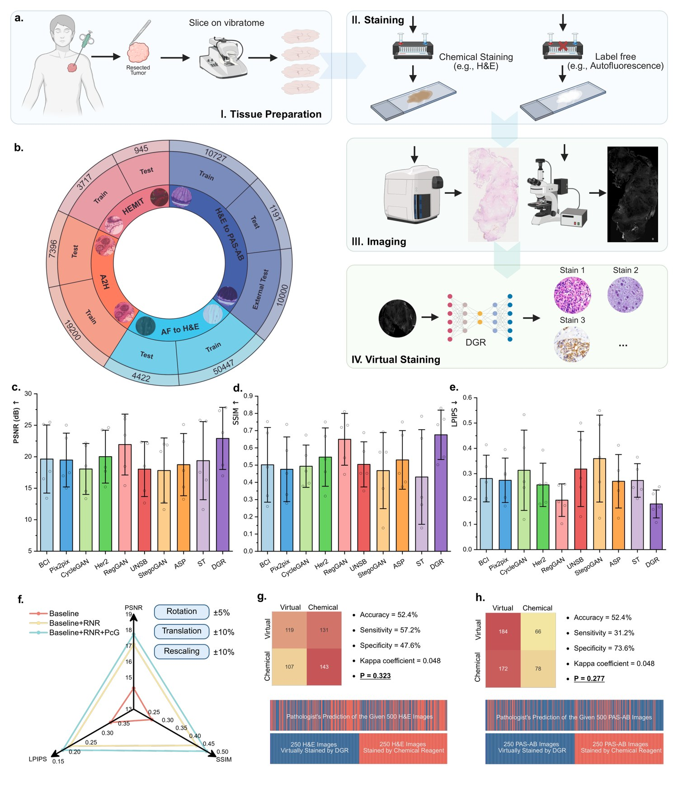

*图 1：虚拟染色总览。a 为完整工作流（组织制备 → 染色 → 成像 → 虚拟染色）；b 为本文使用的五个数据集；c-e 为各方法在五个测试集上的平均性能；f 为严重人工错位下不同 DGR 模块的鲁棒性对比；g-h 为病理医师的盲法鉴别评估。*

---

## 2. 前人工作，以及它们共同的"阿喀琉斯之踵"

虚拟染色这条线上，前人工作大致可以分成四派，每一派都被同一个问题卡住。

### 2.1 监督派：Pix2Pix —— 前提是"完美对齐"

Isola 等（Pix2Pix）的思路最直接：训练一个生成器 $G$，用**像素级 $L_1$ 损失**逼着 $G(x)$ 逼近目标 $y$。这类方法在虚拟染色中被大量使用。

**它的死穴**：$L_1$ 损失是**逐像素**比较的。一旦输入 $x$ 与目标 $y$ 之间存在哪怕几个像素的错位，损失就会"惩罚正确的内容"——生成器学到的不是"该怎么染色"，而是"该怎么把图像挪一挪去凑对齐"。所以 Pix2Pix 的性能**严重依赖配对图像的对齐程度**。

### 2.2 非配对派：CycleGAN —— 不要求配对，但保不住内容

Zhu 等的 Cycle-GAN 用循环一致性（cycle-consistency）训练两个生成器，**不需要配对数据**，因此在非配对场景下通常比 Pix2Pix 表现更好。

**它的死穴**：循环一致性约束本质上是让模型**更关注图像风格（style）而不是内容（content）**。结果就是可能把内容丢掉甚至编造——对虚拟染色这种"必须忠实还原细胞结构"的任务来说，这是致命的。

### 2.3 抗错位派：Pyramid Pix2Pix / BCI —— 缓解，但不解决

Liu 等（后文表格中的 BCI）提出**多尺度（pyramid）损失**，通过在不同尺度上计算损失来增强对结构错位的鲁棒性。这是"抗错位"思路的第一次尝试，但它**只是让损失对错位没那么敏感**，并没有显式地把错位"消掉"。

### 2.4 配准派：RegGAN —— 引入了配准，却留下了耦合

Kong 等提出的 RegGAN 引入了"**损失校正（loss correction）**"思想：加一个配准网络 $R$，估计生成图像 $G(x)$ 与含噪真值 $y$ 之间的形变场 $\phi$，先用 $\phi$ 把 $G(x)$ 扭曲（warp）到对齐，**再**计算损失。这比 Pyramid Pix2Pix 又进了一步。

**但它的漏洞恰恰是本文的切入点**：RegGAN 只保证了「**配准之后**的生成图像 $\phi \circ G(x)$ 与 $y$ 对齐」，**没有**显式保证「生成图像本身 $G(x)$ 与理想真值 $\hat{y}$ 对齐」。由于 $\hat{y}$ 与输入 $x$ 是对齐的，这就等价于：**没有任何约束保证 $G(x)$ 与 $x$ 对齐**。

后果很严重——生成器学会了"**把结构错位藏进自己的输出里**"，反正后面有 $R$ 会去纠正它。生成与配准因此**紧耦合（tightly coupled）**，必须小心翼翼地平衡调参才能work。

### 2.5 一句话总结"为什么现有方法都不行"

> **错位本来是"数据采集"带来的问题，但前人都把它当成"生成模型"的问题在治。**  
> 而这个问题的根源是绕不开的：化学染色过程本身就会让组织发生形变，加上"一张切片不能反复染色"的物理限制，现实中**根本拿不到严格像素级对齐的配对数据**——能拿到的只有 **non-paired（非配对）** 或 **roughly paired（粗略配对）** 数据。

---

## 3. 这篇文章要解决的核心问题

> **在只有"粗略配对"数据的前提下，训练出像素级准确、且对错位鲁棒的虚拟染色模型；并且这个框架要能"即插即用"地装到现有虚拟染色模型上，不改动它们原本的网络结构。**

最终结果：在五个数据集上显著优于 SOTA，内部数据集平均提升 **3.2%**，外部数据集平均提升 **10.1%**；在严重错位数据上 PSNR 提升 **23.8%**。

---

## 4. 方法：DGR 的完整推导（本文最核心的部分）

### 4.0 问题设定与符号

先把记号定清楚，后面所有公式都基于这套符号：

| 符号          | 含义                                                          |
| ----------- | ----------------------------------------------------------- |
| $x_n$       | 第 $n$ 个**输入图像**（源模态，如自发荧光 AF、H\&E）                          |
| $y_n$       | $x_n$ 对应&#x7684;**"含噪"真值**，即化学染色的**粗略配对**图像（与 $x_n$ 存在空间错位） |
| $\hat{y}_n$ | 与 $x_n$ **严格对齐**的理想真值（现实不可得，仅用于理论分析）                        |
| $N$         | 配对样本总数                                                      |
| $G$         | 生成器（虚拟染色网络）                                                 |
| $R_1, R_2$  | 两个配准网络                                                      |
| $\circ$     | 重采样算子（按形变场对图像做网格采样/warping）                                 |

**目标**：用**错位数据集** $\{(x_1,y_1),\dots,(x_N,y_N)\}$ 训练模型，达到与用**对齐数据集** $\{(x_1,\hat{y}_1),\dots,(x_N,\hat{y}_N)\}$ 训练**相当的性能**。

---

### 4.1 基线：Pix2Pix 的 $L_1$ 损失（式 1）

$\min_G \; L(x,y) = \frac{1}{N}\sum_{n=1}^{N} \bigl\|\, G(x_n) - y_n \,\bigr\|_1 \tag{1}$

**怎么理解这个式子的脆弱性？** 假设 $y_n$ 相对 $x_n$ 平移了 $\delta$ 个像素。那么 $G$ 想最小化 $\|G(x_n)-y_n\|_1$，最"省事"的办法就是**让输出也跟着平移 $\delta$**——于是生成器学会的不是"染色"，而是"复制错位"。这就是错位会毁掉像素级监督的根本原因。

---

### 4.2 RegGAN 的 loss correction（式 2、式 3）——以及它的漏洞

RegGAN 引入配准网络 $R$，先估计形变场，再 warp 之后再算损失：

$\phi_n = R\bigl(G(x_n),\, y_n\bigr) \tag{2}$

$\min_{G,R} \; L(x,y) = \frac{1}{N}\sum_{n=1}^{N} \bigl\|\, \phi_n \circ G(x_n) - y_n \,\bigr\|_1 \tag{3}$

RegGAN 的假设是"含噪真值 = 理想真值的位移误差"，即 $y = \phi \circ \hat{y}$。

**关键观察（本文的"发现问题"时刻）**：式 3 只保证

$\phi \circ G(x) \approx y \quad\text{（配准后的生成图像 ≈ 含噪真值）}$

**却完全没有**保证

$G(x) \approx \hat{y} \quad\text{（生成图像本身 ≈ 理想真值）}$

而 $\hat{y}$ 是与 $x$ 对齐的，所以「$G(x)$ 与 $\hat{y}$ 错位」等价于「**$G(x)$ 与输入 $x$ 错位**」。

> **直觉比喻**：RegGAN 请了一个"事后修图师" $R$ 来纠正 $G$ 的错位，但**没有告诉 $G$ "你不许动像素位置"**。于是 $G$ 干脆摆烂——我随便挪，反正有人帮我挪回来。

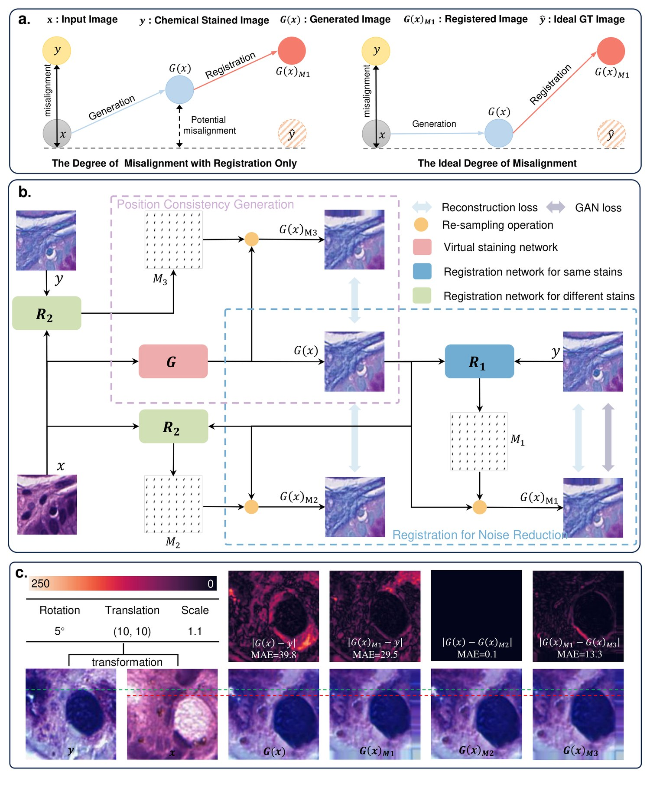

*图 A1：DGR 的架构与可视化。a 用一张示意图对比了"只有配准"与"理想情况"下的错位程度差异；b 是 DGR 的完整框架（蓝色虚线框 = RNR 模块，紫色虚线框 = PcG 模块）；c 是解耦效果的可视化与误差图。*

图 A1a 左边画的就是这个病灶：只靠配准，$G(x)$ 会滑到一个"既不在 $x$ 也不在 $\hat{y}$"的中间态（图中标注的 **Potential misalignment**）；右边是理想情况——$G(x)$ 老老实实落在 $x$ 正上方，只改外观、不改位置。

---

### 4.3 DGR 的核心：把生成与配准解耦

本文的结论是：**生成与配准本质上是相互依赖的**，因为校正损失只作用在 $\phi \circ G(x)$ 上，$G(x)$ 自身没有强约束。所以两者必须小心平衡才能达到最优——这很脆弱。

受 GAN 的启发，作者引入一个**对抗式配准过程**，把两者彻底解耦。下面拆开讲两个模块。

---

#### (A) RNR：用于降噪的配准（Registration for Noise Reduction）

**第一步，用一个配准网络 $R_1$ 把 $G(x)$ 对齐到"含噪"真值 $y$**，让重建损失变得可信。

**① 校正后的 $L_1$ 重建损失（式 4）**

$L_{L1}(x,y) = \frac{1}{N}\sum_{n=1}^{N} \bigl\|\, R_1\bigl(G(x_n), y_n\bigr) \circ G(x_n) - y_n \,\bigr\|_1 \tag{4}$

- $R_1(G(x_n), y_n)$：输入是「生成图像，含噪真值」这一对，输出是二者之间的**形变场 $M_1$**；
- $\circ$：按 $M_1$ 对 $G(x_n)$ 做重采样（warp）；
- 含义：**先把生成图像 warp 对齐，再算 $L_1$**，这样损失就不会因为错位而惩罚正确内容。

**② 结构相似性损失（式 5）**

为了提升结构层面的相似度，再加入 SSIM 项：

$L_{ssim}(x,y) = -\,\frac{1}{N}\sum_{n=1}^{N} \log\Bigl(1 + \mathrm{ssim}\bigl(R_1(G(x_n), y_n) \circ G(x_n),\; y_n\bigr)\Bigr) \tag{5}$

- $\mathrm{ssim}(\cdot,\cdot)$ 值域约 $[-1,1]$，越大越相似；
- 加 1 再取对数是为了**保证对数内为正**；
- 前面加负号，把"**最大化**结构相似性"变成"**最小化**损失"。

**③ 形变场平滑正则（式 6）**

$L_{smooth}(x,y) = \frac{1}{N}\sum_{n=1}^{N} \bigl\|\, \nabla R_1\bigl(G(x_n), y_n\bigr) \,\bigr\|_2 \tag{6}$

- $\nabla$ 是空间梯度算子，$\|\cdot\|_2$ 是 $L_2$ 范数；
- 作用是**惩罚剧烈、非物理的形变**，防止形变场过拟合出乱七八糟的位移。

**④ 对抗损失（式 7、式 8）**

为了让生成图像足够逼真，还要上 GAN：

$L_{adv}(x) = -\,\frac{1}{N}\sum_{n=1}^{N} \log\bigl(D(G(x_n))\bigr) \tag{7}$

$L_{dis}(x,y) = -\,\frac{1}{N}\sum_{n=1}^{N} \Bigl[\log\bigl(1 - D(G(x_n))\bigr) + \log\bigl(D(y_n)\bigr)\Bigr] \tag{8}$

- $D$ 是判别器，$D(\cdot)$ 表示"判为真实化学染色图像"的概率；
- 式 7 是生成器损失（骗过判别器）；式 8 是判别器的非饱和损失。

**⑤ RNR 总损失（式 9）**

$L_{RNR}(x,y) = \alpha\, L_{L1}(x,y) + \beta\, L_{ssim}(x,y) + \gamma\, L_{smooth}(x,y) + \delta\, L_{adv}(x) \tag{9}$

权重取值（论文表 A2）：$\alpha=10$，$\beta=0.5$，$\gamma=10$，$\delta=0.1$。

> **RNR 解决了什么**：让「$G(x)$ 与 $y$」的错位不再污染损失——**但它没有解决「$G(x)$ 与 $x$」的错位**。这正是 PcG 要补上的洞。

---

#### (B) PcG：位置一致性生成（Position-consistency Generation）

**先讲清楚"为什么生成器不许动像素"这个论证**，这是全文最漂亮的一段逻辑：

> 输入图像 $x$（如自发荧光）与目标染色 $y$（如 H\&E）取自**完全同一张物理组织切片**。它们天然成对，**共享完全相同的底层生物结构**，主要差别在于**视觉外观（模态），而非几何形状**。
>
> 因此，一个**正确**生成的图像 $G(x)$ 必须是输入 $x$ 到目标染色风格的**逐像素翻译**。
>
> 所以——**$G(x)$ 与 $x$ 之间的任何空间错位，都不是数据的属性，而是"训练不到位的生成器"带来的伪影。**
>
> 目标是强制这种空间一致性，让生成器**只改染色外观，不扭曲图像**——类似于加一个不会让图像变形的**颜色滤镜**。

这个论证很关键：它把"生成器不得移动像素"从一句直觉，变成了一个**可以写成损失函数的显式归纳偏置**。

**① 恒等性约束（式 10）——用来优化 $R_2$**

$L_{T1}(x) = \frac{1}{N}\sum_{n=1}^{N} \bigl\|\, R_2\bigl(x_n, G(x_n)\bigr) \circ G(x_n) - G(x_n) \,\bigr\|_1 \tag{10}$

- $R_2$ 是**同模态（same-stain）**&#x914D;准网络，输入是「输入 $x$，生成图像 $G(x)$」，输出形变场 $M_2$；
- 这个式子的含义是：**用 $M_2$ 把 $G(x)$ warp 之后，还应该等于 $G(x)$ 自己**——也就是说 $M_2$ 应该近似**恒等映射**；
- **反推逻辑**：如果 $R_2$ 在 $(x, G(x))$ 这对图像上算出来的形变场是恒等映射，那说明 $G(x)$ 和 $x$ **本来就已经对齐了**。

**② 但恒等约束有个致命漏洞**

如果只有式 10，$R_2$ &#x4F1A;**"偷懒"**：对任何输入对都输出恒等形变场，损失就恒为 0，于是什么也学不到。必须再加一个约束，**逼 $R_2$ 去预测真实形变场**。

**③ 跨模态一致性约束（式 11）——堵上漏洞**

推理链条是：既然式 10 保证了 $G(x)$ 与 $x$ 对齐，那么「**$x$ 到 $y$ 的形变场**」应当与「**$G(x)$ 到 $y$ 的形变场**」是同一个形变场。把这个性质写下来就是：

$L_{T2}(x,y) = \frac{1}{N}\sum_{n=1}^{N} \bigl\|\, R_2(x_n, y_n) \circ G(x_n) - R_1\bigl(G(x_n), y_n\bigr) \circ G(x_n) \,\bigr\|_1 \tag{11}$

- $R_2(x_n, y_n)$：跨模态（输入—目标）形变场 $M_3$；
- $R_1(G(x_n), y_n)$：生成图像—含噪真值形变场 $M_1$；
- 含义：**两条配准路径 warp 出来的结果应该一致**。这就迫使 $R_2$ 真的去学"如何对齐跨模态图像"，而不能靠输出恒等蒙混过关。

> 至此，$R_1$ 和 $R_2$ 形成了一个**对抗关系**：$G$ 想让 $R_2$ 认为自己已经对齐了（输出恒等），$R_2$ 则要努力找出真实的形变。

**④ 两个平滑正则（式 12、式 13）**

$L_{T1R}(x) = \frac{1}{N}\sum_{n=1}^{N} \bigl\|\, \nabla R_2\bigl(x_n, G(x_n)\bigr) \,\bigr\|_2 \tag{12}$

$L_{T2R}(x,y) = \frac{1}{N}\sum_{n=1}^{N} \bigl\|\, \nabla R_2\bigl(x_n, y_n\bigr) \,\bigr\|_2 \tag{13}$

式 12 约束同模态形变场 $M_2$ 平滑，式 13 约束跨模态形变场 $M_3$ 平滑——和式 6 是一个道理。

---

#### (C) 训练策略：两个对抗过程（式 14、式 15）

整个框架包含四个网络：生成器 $G$、判别器 $D$、配准网络 $R_1$ 与 $R_2$。训练被拆成**两个对抗过程**：

**第一步：更新 $G$ 和 $R_1$**

$\min_{G,\,R_1} L(x,y) = L_{RNR}(x,y) + \epsilon\, L_{T1}(x) \tag{14}$

- $\epsilon = 5$（表 A2）；
- $L_{RNR}$ 提供"配准校正后的重建 / 结构 / 对抗"监督；
- $\epsilon L_{T1}$ 把「**生成图像与输入图像位置一致**」的信号**回传给生成器 $G$**——这一步是解耦的关键。

**第二步：更新 $R_2$**

$\min_{R_2} L(x,y) = L_{T1}(x) + \gamma\, L_{T1R}(x) + L_{T2}(x,y) + \gamma\, L_{T2R}(x,y) \tag{15}$

- 只更新 $R_2$，同时用上恒等性约束（式 10）、跨模态一致性（式 11）和两个平滑约束（式 12、13）；
- 目的就是**防止 $R_2$ 偷懒**——如果它总输出恒等，$L_{T2}$ 会把它拉回来。

**第三步：更新判别器 $D$**，用式 8。

> **为什么要这样拆？** 如果 $G$ 和 $R_2$ 一起更新，两者会"串通"（$G$ 不动，$R_2$ 也输出恒等，双方损失都为零）。拆成两步交替优化，就构成了真正的对抗，$G$ 必须真的对齐才能让 $R_2$ 满意。

---

### 4.4 解耦效果的可视化验证

作者刻意在配对数据中人为引入错位，然后把各个误差图可视化出来（图 A1c）：

| 误差图                                   | MAE      | 说明                                                                   |
| ------------------------------------- | -------- | -------------------------------------------------------------------- |
| $\lvert G(x)-y \rvert$                | **39.8** | 未配准时，生成图像与含噪真值错位严重                                                   |
| $\lvert G(x)_{M_1}-y \rvert$          | **29.5** | 用 $R_1$ 的形变场 $M_1$ warp 后误差下降 → **$R_1$ 有效**                         |
| $\lvert G(x)-G(x)_{M_2} \rvert$       | **0.1**  | $R_2$ 在 $(x,G(x))$ 上输出的 $M_2$ 几乎是恒等映射 → **$G(x)$ 与 $x$ 已对齐**（符合设计目标） |
| $\lvert G(x)_{M_1}-G(x)_{M_3} \rvert$ | **13.3** | 跨模态两条路径的差异，说明 $R_2$ 的跨模态配准仍有提升空间                                     |

其中 $G(x)_{M_1}$、$G(x)_{M_2}$、$G(x)_{M_3}$ 分别表示用形变场 $M_1$（由 $R_1$ 在 $G(x)$ 与 $y$ 上估计）、$M_2$（由 $R_2$ 在 $x$ 与 $G(x)$ 上估计）、$M_3$（由 $R_2$ 在 $x$ 与 $y$ 上估计）对 $G(x)$ 重采样得到的图像。

$M_2$ 那个 **0.1** 的 MAE 特别有说服力：它直接证明了生成器**没有把错位藏进输出**。

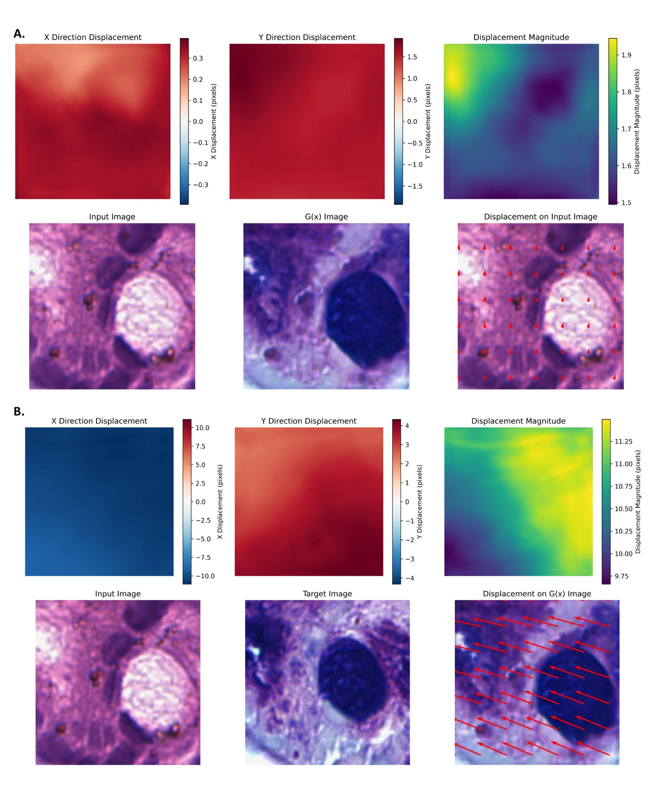

*图 A3：DGR 学到的形变场可视化。a 为输入 H\&E 与生成图像 $G(x)$ 之间的形变场（强对齐说明 $G(x)$ 是对输入的忠实变换）；b 为 $G(x)$ 与目标真值之间的形变场（由 $R_1$ 产生，说明 $R_1$ 的配准机制有效）。*

### 5.2 实验类型一：SOTA 横向对比（跨任务性能对比实验）

**实验设计**：与 9 个方法对比——Pix2Pix（监督）、CycleGAN（非配对）、BCI/Pyramid Pix2Pix（抗错位）、RegGAN（配准）等，覆盖四类技术路线。

**总体结果（五个数据集平均，图 1c-e）**：

| 指标      | DGR           | 相对提升  |
| ------- | ------------- | ----- |
| PSNR ↑  | **22.914 dB** | +4.4% |
| SSIM ↑  | **0.676**     | +4.0% |
| LPIPS ↓ | **0.180**     | +7.7% |

**分任务结果**：

| 任务                     | DGR 表现                                 | 对比次优模型（RegGAN）      |
| ---------------------- | -------------------------------------- | ------------------- |
| **AF → H\&E**          | PSNR **27.803**，SSIM 0.766，LPIPS 0.159 | **+1.4 dB（+5.3%）**  |
| **H\&E → PAS-AB（内部）**  | PSNR **18.677**，SSIM 0.547，LPIPS 0.168 | +0.2 dB（+1.2%）      |
| **H\&E → PAS-AB（外部）**  | PSNR **16.961**，SSIM 0.502，LPIPS 0.220 | **+1.6 dB（+10.1%）** |
| **H\&E → mIHC（HEMIT）** | PSNR **27.306**，SSIM 0.830，LPIPS 0.248 | **+1.3 dB（+5.1%）**  |
| **染色归一化（A2H）**         | PSNR **23.823**，SSIM 0.734，LPIPS 0.107 | +0.4 dB（+1.7%）      |

**几个值得注意的细节**：

1. **CycleGAN（无监督）在所有任务上基本垫底**——它在 AF→H\&E 上只有 18.538 dB，在 H\&E→PAS-AB 上甚至掉到 13.336 dB。这印证了"循环一致性保风格不保内容"的判断。
2. **外部数据集上的提升（+10.1%）远大于内部（+1.2%）**，说明 DGR 的收益主要来自**泛化能力**而非"在训练分布上过拟合"。
3. 作者还做了**强度剖面（intensity profile）分析**：沿图像上的线取像素强度曲线，与真值对比算皮尔逊相关系数（PCC）。DGR 在 H\&E→PAS-AB 任务上 PCC 达到 **0.908** 和 **0.745**，为所有方法中最高，说明它恢复精细细节的能力最强。

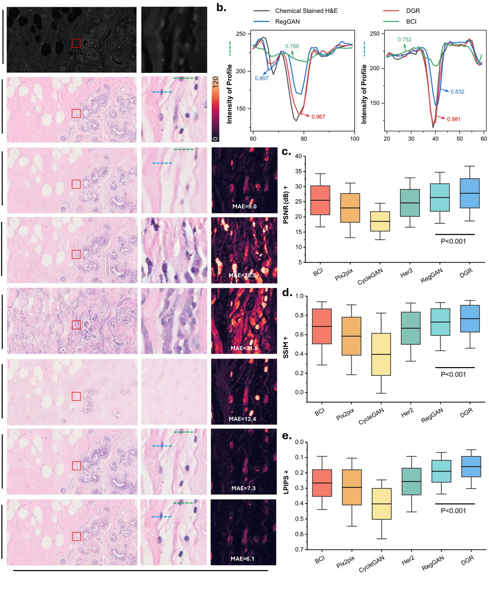

*图 2：AF → H\&E 的各方法对比。a 为各方法生成结果与 MAE 热力图；b 为强度剖面与 PCC；c-e 为 LPIPS/SSIM/PSNR 的分布。*

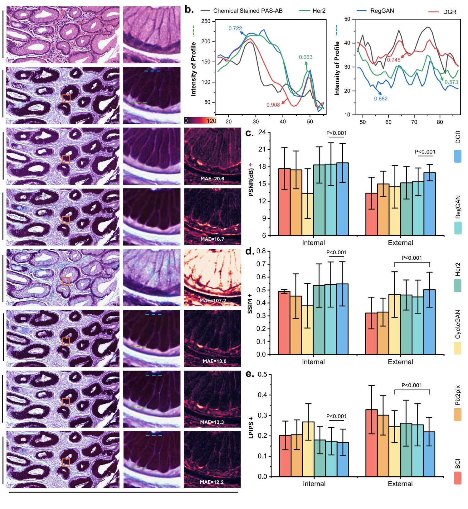

*图 3：H\&E → PAS-AB 的结果。注意 c-e 分列了内部与外部测试集。*

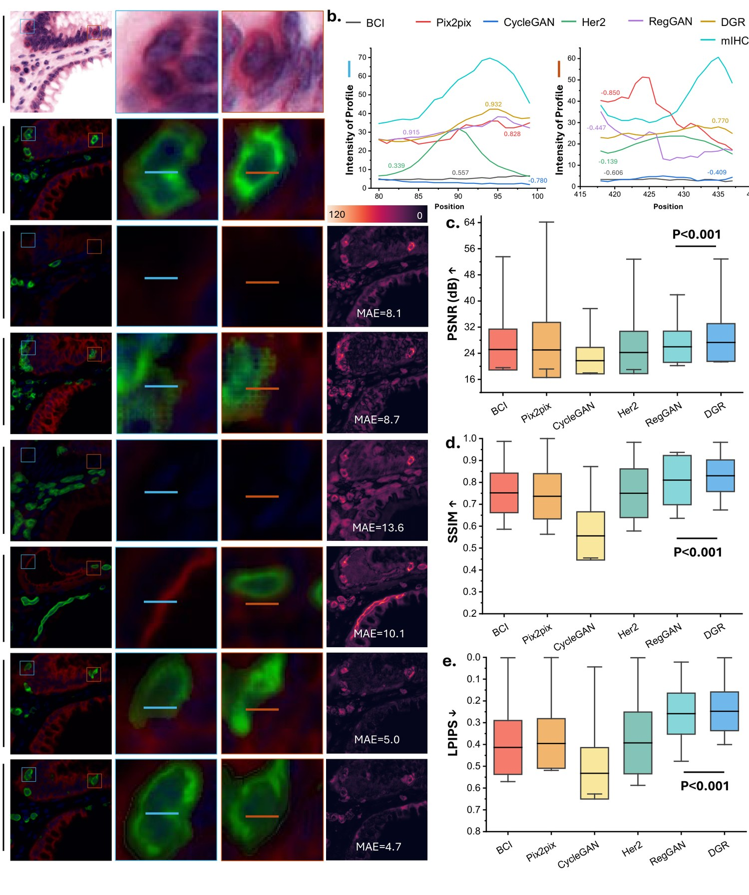

*图 4：H\&E → mIHC 的结果。DGR 在 panCK（红通道）与 DAPI（蓝通道）上都更可靠。*

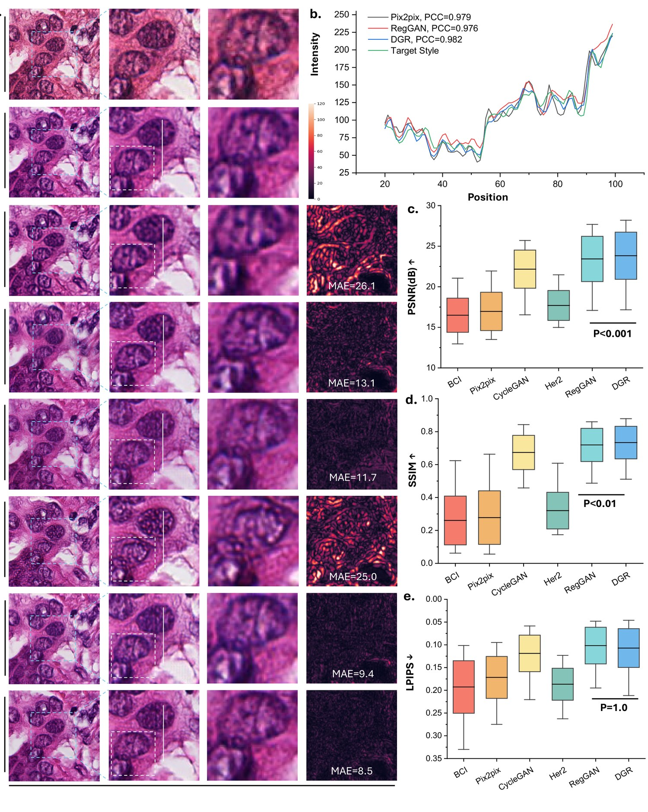

*图 5：染色风格归一化的结果，DGR 的 PCC 达到 0.982。*

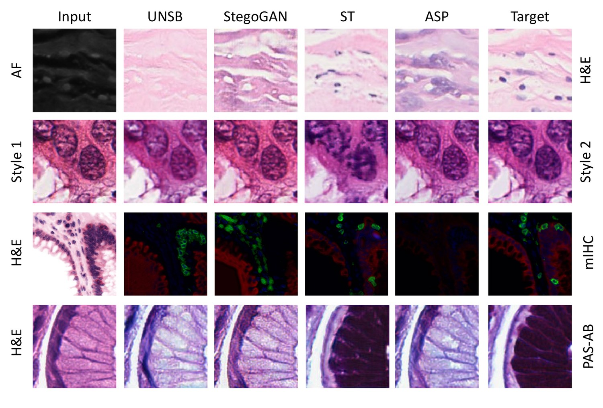

*图 A2：四种较弱方法（ASP、UNSB、ST、StegoGAN）在四个数据集上的可视化，可直观看出它们与真值的差距。*

---

### 5.3 实验类型二：抗错位鲁棒性实验（**本文最重要的实验**）

这是全文最有分量的实验，**专门验证 DGR 的核心主张**。

**实验设计**：

1. 准备一个**良好对齐**的数据集：从 H\&E 与 PAS-AB 的 WSI 中提取 **11,918 对** 256×256 的配对图块；
2. 人为施加 **5 档错位**（旋转 + 平移 + 缩放）：

| 错位等级    | 旋转  | 平移   | 重缩放  |
| ------- | --- | ---- | ---- |
| Level 1 | ±1° | ±2%  | ±2%  |
| Level 2 | ±2° | ±4%  | ±4%  |
| Level 3 | ±3° | ±6%  | ±6%  |
| Level 4 | ±4° | ±8%  | ±8%  |
| Level 5 | ±5° | ±10% | ±10% |

1. 训练时输入与目标图像中心裁剪至 128×128；
2. **关键设定：在"错位数据"上训练，在"良好对齐数据"上测试**——这才能真正检验模型有没有把错位"内化"掉；
3. **三组消融**：
   - **Baseline**：Bai 等的模型，不含任何配准组件；
   - **Baseline + RNR**：加入 $R_1$ 配准模块（等价于 RegGAN 的做法）；
   - **Baseline + DGR**：同时含 RNR 与 PcG，实现生成与配准解耦。

**实验结果**：

| 策略                 | Level 1 PSNR | Level 3 PSNR | Level 5 PSNR |
| ------------------ | ------------ | ------------ | ------------ |
| Baseline           | 17.702       | 15.694       | **14.324**   |
| Baseline + RNR     | 18.228       | 18.031       | 17.095       |
| **Baseline + DGR** | **18.414**   | **18.460**   | **17.730**   |

**三条结论**：

1. **Baseline 随错位急剧退化**（Level 1 → Level 5 掉了 3.4 dB），说明它面对错位数据毫无鲁棒性；
2. **加入 RNR 后性能大幅回稳**（Level 5 提升到 17.095），说明配准模块确实能缓解错位；
3. **再加 PcG 后进一步提升**，且在 **Level 1 到 Level 4 之间 PSNR 始终超过 18 dB**，全程优于前两者。

> **在最大错位（Level 5，±5° 旋转 + ±10% 平移 + ±10% 缩放）下，DGR 相比基线取得 3.4 dB（23.8%）的 PSNR 提升。**

作者还专门强调：这个结果**凸显了通过 PcG 模块施加"显式空间一致性约束"的重要性**——也就是说，光有配准（RNR）不够，必须再加上"不许动像素"的硬约束（PcG）才能真正解耦。

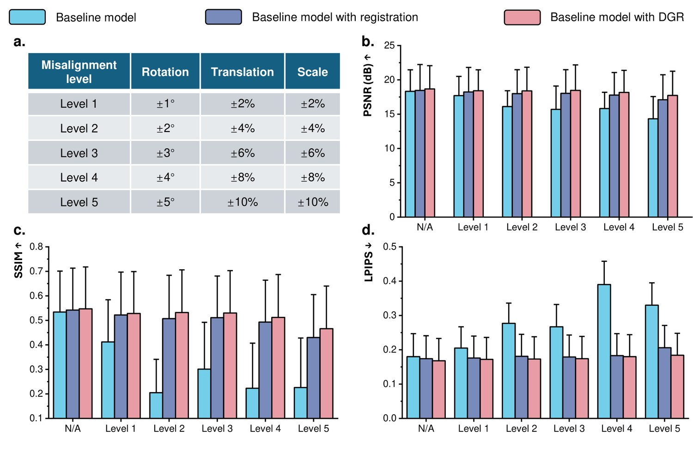

*图 6：DGR 的抗错位能力。a 为五档错位设置；b-d 为三组消融在 PSNR/SSIM/LPIPS 上的对比（蓝=Baseline，紫=Baseline+RNR，红=Baseline+DGR）。*

---

### 5.4 实验类型三：盲法人工评估（**临床可信度实验**）

**实验设计**：定量指标再好，也不能说明病理医师分辨不出来。所以作者做了一次盲法测试：

- 随机选取 **250 张虚拟染色 H\&E + 250 张化学染色 H\&E**（共 500 张），随机打乱；
- 同理再来一组 **250 + 250 的 PAS-AB**；
- 请**资深病理医师**判断每张图"是真实的化学染色，还是虚拟染色"。

**实验结果**：

| 任务     | 判读准确率     | 灵敏度   | 特异度   | Kappa | 卡方检验 P 值      |
| ------ | --------- | ----- | ----- | ----- | ------------- |
| H\&E   | **52.4%** | 57.2% | 47.6% | 0.048 | **P = 0.323** |
| PAS-AB | **52.4%** | 31.2% | 73.6% | 0.048 | **P = 0.277** |

**52.4% 基本就是抛硬币的水平**，卡方检验 P 值均大于 0.05，说明**化学染色与虚拟染色图像之间没有统计学显著差异**——病理医师无法可靠区分二者。

> 这是本文最有冲击力的一个结果：它把"模型指标好"升级成了"**临床专家看不出来**"。

---

### 5.5 实验类型四：细胞结构保真度（下游任务实验）

**实验设计**：用 **Cellpose** 做细胞核分割，以化学染色的真值作为参照，计算 **Dice 系数（DICE）**。DICE 越高，说明虚拟染色图像保留细胞结构的能力越强。

**结果（表 A13，平均 DICE）**：

| 模型       | DICE      |
| -------- | --------- |
| CycleGAN | 0.265     |
| ST       | 0.270     |
| UNSB     | 0.291     |
| ASP      | 0.290     |
| StegoGAN | 0.303     |
| Pix2Pix  | 0.363     |
| BCI      | 0.396     |
| Her2     | 0.397     |
| RegGAN   | 0.421     |
| **DGR**  | **0.422** |

DGR 与 RegGAN 基本持平（0.422 vs 0.421），并列最优。这说明 DGR 在**提升对齐鲁棒性的同时，并没有牺牲结构保真度**。

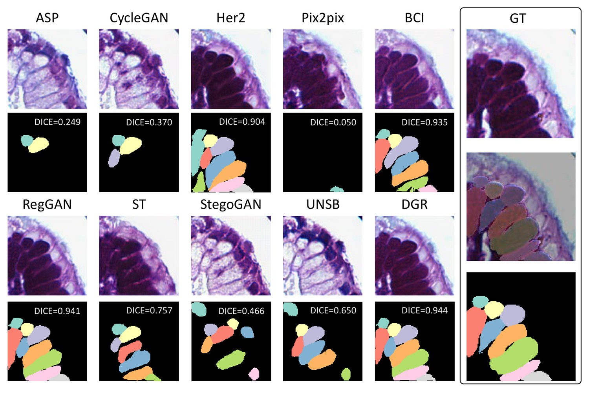

*图 A6：Cellpose 细胞分割结果对比，各子图标注了该样本的 DICE 值。*

---

### 5.6 实验类型五：计算效率（工程可用性实验）

作者用 NVIDIA L20 测了各模型的显存与速度（batch size 1 测显存，batch 32 测推理速度）：

| 模型       | 推理显存      | 推理速度     | 训练显存       | 训练速度      |
| -------- | --------- | -------- | ---------- | --------- |
| Pix2Pix  | 245.94 MB | 0.501 ms | 1051.48 MB | 11.912 ms |
| CycleGAN | 104.73 MB | 4.042 ms | 448.14 MB  | 29.926 ms |
| RegGAN   | 108.73 MB | 4.040 ms | 448.14 MB  | 28.870 ms |
| **DGR**  | 602.78 MB | 9.616 ms | 1441.39 MB | 70.139 ms |

**代价是真实的**：DGR 因为多了一个配准网络 $R_2$，训练速度约 70 ms/图，比 Pix2Pix（11.9 ms）慢约 6 倍。作者在讨论里也坦诚地把这一点列为局限。

---

### 5.7 实验类型六：全切片（WSI）拼接可视化

作者还把虚拟染色图块**拼回整张全切片图像（WSI）**，验证大规模部署时的视觉效果：

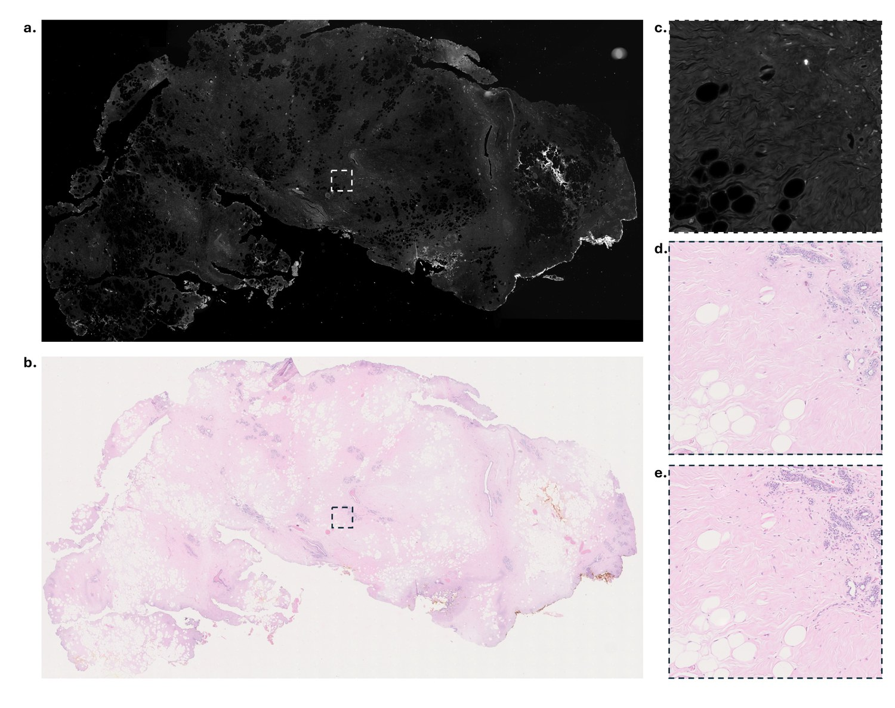

*图 A4：AF → H\&E 的全切片可视化。a 为 AF WSI（输入），b 为 H\&E WSI（真值），c 为放大的 AF，d 为由 256 个虚拟染色图块拼接而成的大幅 H\&E，e 为放大的 H\&E 真值。*

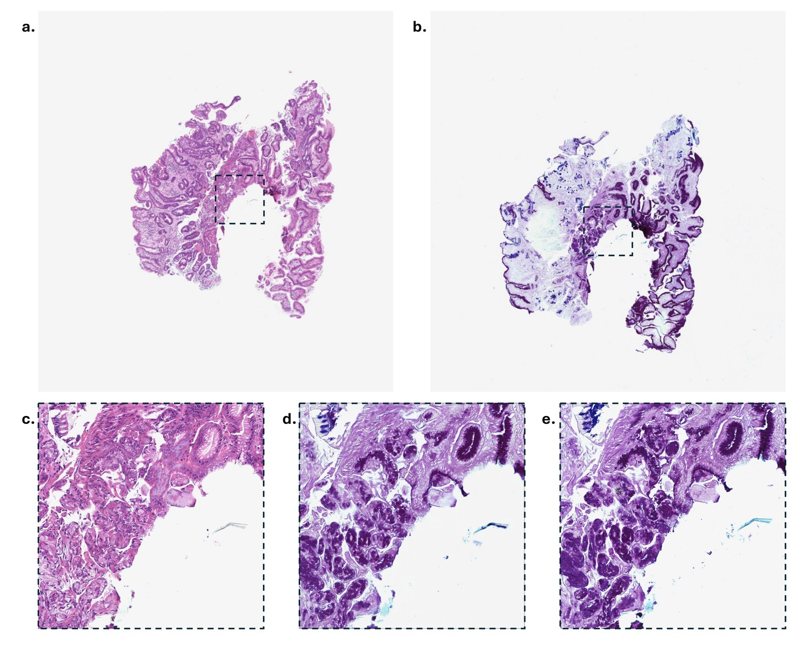

*图 A5：H\&E → PAS-AB 的全切片可视化，同样由 256 个虚拟染色图块拼接而成。*

---

## 6. 讨论、局限与展望

作者在讨论部分坦诚列了两个局限：

1. **泛化能力**：应用到外部数据集时，所评估方法的泛化能力仍有改进空间（不过 DGR 的外部提升 +10.1% 已是最好）；
2. **计算资源**：DGR 相比部分基线需要更高的计算资源（多一个配准网络），可能限制其在资源受限场景的部署。

**未来方向**：

- 构建**大规模、多样化的数据集**来增强鲁棒性与适应性；
- 优化模型架构以提升效率；
- 引入更先进的生成式 AI 模型——**作者明确点名了扩散模型（diffusion model）**，认为这是推动各类染色虚拟染色流程标准化的一个有前景的方向。

---

## 7. 这篇工作最值得记住的三点

**① 问题的重新定义。**  
前人把"错位"当成生成模型的问题来治（多尺度损失、配准校正），本文指出：错位是**数据采集**的固有限制（化学染色导致形变 + 单张切片无法反复染色），因此正确的做法不是在生成端"硬扛"，而是**在损失端把错位显式地消掉，同时把生成器锁死在"不许动像素"上**。

**② 解耦这个动作本身。**  
RegGAN 的失败不在于"配准"这个想法错，而在于**生成与配准耦合**——生成器可以把错位甩锅给配准器。DGR 用"两个对抗过程 + 一个恒等性约束 + 一个跨模态一致性约束"把这层耦合彻底切断。这是本文真正的技术贡献。

**③ 论证的漂亮之处。**  
"$G(x)$ 与 $x$ 的错位不是数据属性，而是训练不到位的伪影"——这一句把生物学的先验（同一张切片、同一套结构）转成了可写进损失函数的数学约束。**先有物理论证，再有公式**，这个顺序值得学习。

---

## 8. 附：公式速查表

| 编号       | 公式                                                                             | 作用                           |
| -------- | ------------------------------------------------------------------------------ | ---------------------------- |
| (1)      | $\min_G L=\frac1N\sum\|G(x_n)-y_n\|_1$                                         | Pix2Pix 基线，对错位敏感             |
| (2)      | $\phi_n=R(G(x_n),y_n)$                                                         | RegGAN 估计形变场                 |
| (3)      | $\min_{G,R}L=\frac1N\sum\|\phi_n\circ G(x_n)-y_n\|_1$                          | RegGAN 校正损失（**漏洞所在**）        |
| (4)      | $L_{L1}=\frac1N\sum\|R_1(G(x_n),y_n)\circ G(x_n)-y_n\|_1$                      | RNR：校正后 $L_1$ 重建损失           |
| (5)      | $L_{ssim}=-\frac1N\sum\log(1+\mathrm{ssim}(\cdot,\cdot))$                      | RNR：结构相似性损失                  |
| (6)      | $L_{smooth}=\frac1N\sum\|\nabla R_1(\cdot,\cdot)\|_2$                          | RNR：形变场平滑正则                  |
| (7)      | $L_{adv}=-\frac1N\sum\log D(G(x_n))$                                           | 生成器对抗损失                      |
| (8)      | $L_{dis}=-\frac1N\sum[\log(1-D(G(x_n)))+\log D(y_n)]$                          | 判别器损失                        |
| (9)      | $L_{RNR}=\alpha L_{L1}+\beta L_{ssim}+\gamma L_{smooth}+\delta L_{adv}$        | RNR 总损失                      |
| (10)     | $L_{T1}=\frac1N\sum\|R_2(x_n,G(x_n))\circ G(x_n)-G(x_n)\|_1$                   | PcG：恒等性约束（逼 $G(x)$ 与 $x$ 对齐） |
| (11)     | $L_{T2}=\frac1N\sum\|R_2(x_n,y_n)\circ G(x_n)-R_1(G(x_n),y_n)\circ G(x_n)\|_1$ | PcG：跨模态一致性（防止 $R_2$ 偷懒）      |
| (12)(13) | $L_{T1R},L_{T2R}$                                                              | $R_2$ 形变场平滑正则                |
| (14)     | $\min_{G,R_1}L=L_{RNR}+\epsilon L_{T1}$                                        | 训练第 1 步                      |
| (15)     | $\min_{R_2}L=L_{T1}+\gamma L_{T1R}+L_{T2}+\gamma L_{T2R}$                      | 训练第 2 步                      |

**超参数**：$\alpha=10$，$\beta=0.5$，$\gamma=10$，$\delta=0.1$，$\epsilon=5$；判别器与两个配准网络学习率均为 1e-5；训练 200 epoch。

---

## 9. 资源

- **论文**：arXiv:2509.14119v1（2025-09-17）
- **代码与权重**：<https://github.com/birkhoffkiki/DTR>
- **数据集**：
  - HEMIT：<https://github.com/BianChang/HEMIT-DATASET>
  - A2H（StainNet）：<https://github.com/khtao/StainNet>
  - AF2HE：<https://github.com/TABLAB-HKUST/U-Frame（可能需要申请）>
  - HE2PAS-AB / HE2PAS-AB-EXT：来自香港威尔斯亲王医院，因隐私原因不公开，需联系通讯作者
- **伦理审批**：香港科技大学 HAREC，编号 HREP-2024-0212

---

*本文为论文解读博客，所有图表均截取自原论文（arXiv:2509.14119）。*
