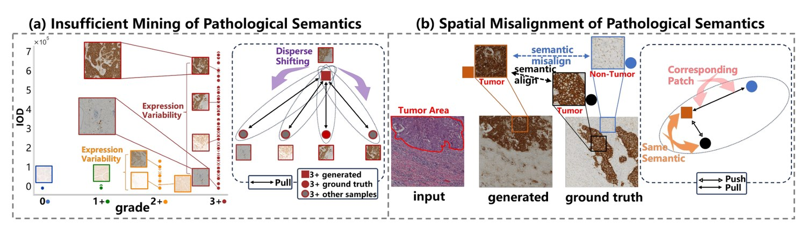
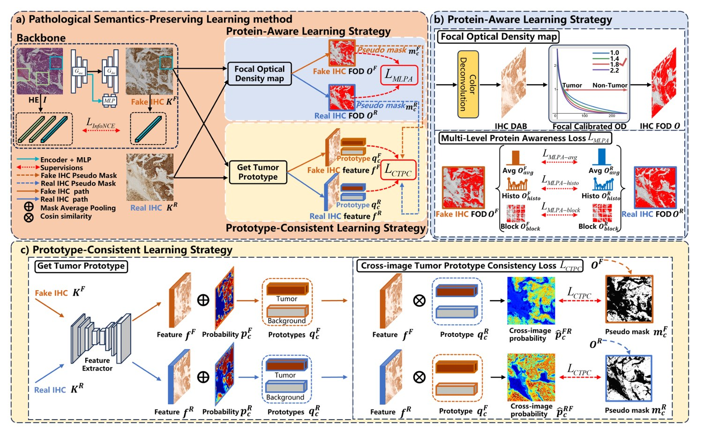
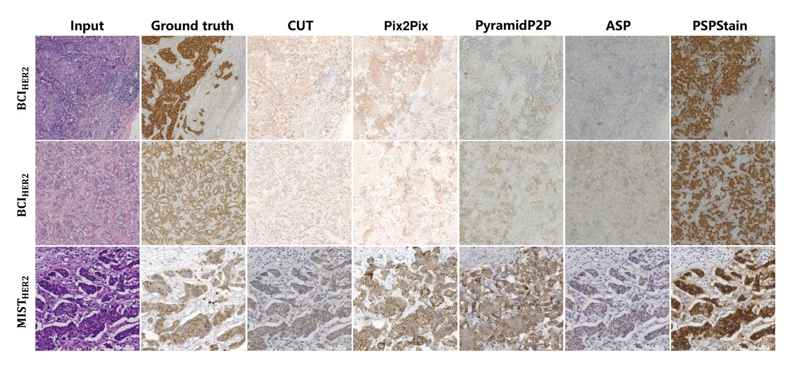
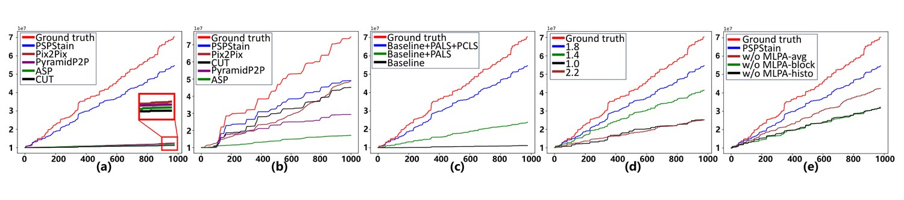

# 虚拟染色不能只"看起来像"：PSPStain 论文深度解读

> **论文**：*Pathological Semantics-Preserving Learning for H&E-to-IHC Virtual Staining*
> **作者**：Fuqiang Chen, Ranran Zhang, Boyun Zheng, Yiwen Sun, Jiahui He, Wenjian Qin*（中国科学院深圳先进技术研究院、中国科学院大学、香港理工大学、宁波诺丁汉大学）
> **发表**：**MICCAI 2024**；arXiv:2407.03655v2 [eess.IV]，2024-07-28
> **代码**：https://github.com/ccitachi/PSPStain
> **方法名**：**PSPStain**（**P**athological **S**emantics-**P**reserving Learning for Virtual **Stain**ing，病理语义保持学习）

---

## 0. 一句话概括

> 前人的 H&E→IHC 虚拟染色只顾着让图像"看起来像"，PSPStain 则直接把**蛋白表达水平**（分子层语义）和**跨图像的肿瘤原型**（语义对齐）做成损失函数，让生成结果在**病理意义上**也说得通——而且**不需要任何额外专家标注**。

它由两个策略组成：

| 策略 | 缩写 | 解决什么 |
|---|---|---|
| 蛋白感知学习策略 | **PALS**（Protein-Aware Learning Strategy） | 问题 (a)：**病理语义挖掘不充分**——没人直接把"蛋白表达水平"提取出来当约束 |
| 原型一致性学习策略 | **PCLS**（Prototype-Consistent Learning Strategy） | 问题 (b)：**病理语义的空间错位**——配对图块里的内容其实对不上 |

---

## 1. 背景：为什么要做 H&E → IHC 虚拟染色

- **H&E 染色**只能揭示**细胞形态与分布**——它告诉你"细胞长什么样、在哪"。
- **IHC（免疫组化）染色**能在**分子水平**上精确、特异地可视化**蛋白激活情况**——它告诉你"这个细胞表达不表达 HER2、表达多少"。

HER2 这类蛋白的表达水平直接决定乳腺癌的靶向治疗策略，所以 IHC 是临床刚需。但 IHC 检测**人力密集、耗时很长**。

**虚拟染色**就是解法：**直接从常规 H&E 图像生成 IHC 图像**，不用再做一次染色。这对癌症诊断效率的提升是直接的。

**但虚拟染色有一个与生俱来的难题**：训练需要**对齐的配对真值（GT）**。而现实中，GT 配对是从同一组织的**两个深度方向连续切片**上分别染色得到的。由于细胞形态变化和染色引起的降解，**像素级的图像对应关系必然被破坏**。

> 注意：这和 DGR 那篇的困境是同一件事——**对齐数据拿不到**。DGR 的思路是"在损失层消掉错位"；PSPStain 的思路是"**换一种不依赖像素对齐的语义约束**"。两篇是同一个问题的两条不同解法，可以对照着看。

---

## 2. 前人工作，以及它们共同的盲区

作者把虚拟染色的发展描述成一个**"从错位 GT 配对中逐步提取病理语义"的过程**，语义的粒度在不断提升：

| 阶段 | 用到的语义粒度 | 代表做法 |
|---|---|---|
| 第一阶段 | **无**（只用图像层面损失） | 直接把 GAN 搬来做虚拟染色，不加任何病理约束 |
| 第二阶段 | **分级水平（grade-level）** | 利用 WSI 的整体分级信息 |
| 第三阶段 | **图块水平（patch-level）** | 增强分子水平语义的保持 |
| 第四阶段 | **像素水平（pixel-level）** | 借助语义掩膜（semantic mask） |

看起来在稳步前进，但作者回过头来审视，发现**两个被所有人忽略的显著问题**（图 1）：

*图 1：H&E→IHC 虚拟染色中的两个关键问题。(a) 同一分级 WSI 内的样本蛋白表达水平差异极大，只保分级不保蛋白表达会导致表征鲁棒性差、语义分散；(b) 生成图像与标签之间的空间错位，会让相似语义的图块产生错误响应。*

### 问题 (a)：病理语义挖掘不充分

**蛋白表达水平是分子水平语义信息的表征，但前人从来没有把它直接提取出来用于施加病理约束。**

作者举了一个非常有说服力的例子：在 **3+ 分级**的 WSI 内部，HER2 的**蛋白表达水平差异极大**（看图 1a 左边那张散点图——同一个 3+ 分级下，IOD 值从 1 一直散到 7）。

> **后果**：如果只保持"分级水平"的病理信息而不管蛋白表达水平，那么**分子水平的病理语义就会变得分散（disperse shifting）**，学到的表征鲁棒性很弱。

**直觉**：分级是"粗标签"，蛋白表达是"细标签"。同一个粗标签下的样本，细标签可能天差地别。只用粗标签监督，模型自然学不到细粒度的分子语义。

### 问题 (b)：病理语义的空间错位

输入（H&E）与标签（IHC）**不可避免地存在空间不一致性**——也就是说，**配对图像中"相互对应"的两个图块，里面装的其实不是同一批细胞**（一个图块里正常细胞多，另一个里肿瘤细胞多）。

> **后果**：一旦训练时直接假设"对应图块内语义相似"，就会出现两种错误——
> - **具有相似语义的表征被错误分离（push 开）**；
> - **具有相反语义的表征被错误聚拢（pull 近）**。

这种干扰直接阻碍病理表征的学习。

### 还有一个方法论层面的观察

作者在验证过程中发现：**PSNR 与 SSIM 这类指标并不总是与高质量虚拟染色结果严格相关**。

原因很实在：**像素值更平均、比较模糊的 IHC 图像，在存在空间错位时反而可能把 PSNR/SSIM 抬高**。换句话说，这两个指标可能奖励"糊"。

> 这促使作者**引入三项病理相关指标**（mIOD、IOD、Pearson-R），而不是只用图像质量指标。这是本文一个很值得学习的做法——**指标选错，结论就会错**。

---

## 3. 方法：PSPStain 的完整推导

### 3.0 符号约定

| 符号 | 含义 |
|---|---|
| $I \in \mathbb{R}^{H\times W\times C}$ | 输入 H&E 图像 |
| $K^R \in \mathbb{R}^{H\times W\times C}$ | 真实 IHC 标签（Real） |
| $K^F \in \mathbb{R}^{H\times W\times C}$ | 生成图像 / 伪 IHC（Fake） |
| $O^R$、$O^F$ | 真实 / 伪 IHC 的聚焦光密度（FOD）图 |
| $f^R$、$f^F$ | 真实 / 伪 IHC 的特征图（$D$ 维） |
| $p^R_c$、$p^F_c$ | 分割 UNet 给出的"像素属于类 $c$"的概率 |
| $q^R_c$、$q^F_c$ | 真实 / 伪 IHC 的类原型向量 |
| $m^R_c$、$m^F_c$ | 由 FOD 阈值化得到的伪掩膜 |

主干网络（backbone）做的事很朴素：**给定 $(I, K^R)$，生成 $K^F$**。

---

### 3.1 PALS：蛋白感知学习策略（解决"语义挖掘不充分"）

#### 起点：为什么是"光密度"

在 IHC 染色中，蛋白作为抗原与一种酶（如过氧化物酶）偶联；**DAB 染料与酶反应会产生强烈的棕色染色**。所以：

> **PALS 的基本思路：聚焦 DAB 通道，就能准确感知分子水平信息——也就是蛋白表达水平。**

**光密度（Optical Density, OD）的定义**来自 Lambert-Beer 定律：

$$\mathrm{OD}_C = -\log_{10}\left(I_C / I_{0,C}\right) = A \cdot c_C \tag{1}$$

- $C$：颜色通道下标，逐通道计算；
- $I_{0,C}$：**入射光强**（进入标本的光）；$I_C$：**出射光强**（透过标本的光）；
- $A$：染料的量；$c_C$：该通道的吸收因子；
- **作用**：用入射/出射光强之比的对数，把"颜色深浅"**线性化**为一个与染料浓度成正比的物理量。

> **为什么这一步很关键？** 因为 RGB 像素值和"染料浓度"不是线性关系——同样多的染料，颜色深浅的变化是非线性的。取对数之后，OD 才与染料量成正比，**才可以直接当"蛋白表达量"来用**。

#### 聚焦光密度（FOD）图：把训练焦点拉回肿瘤区

**流程**：先用传统的**颜色反卷积（color deconvolution）**做染料分离 → 专门取出 **DAB 染料的 OD 值**生成 RGB 图像（记作 IHC DAB）。

**问题来了**：在大多数样本里，**肿瘤区域显著小于非肿瘤区域**，严重不平衡。如果用普通 OD 图（式 1）训练，**绝大多数位置都是"容易的"非肿瘤区域，提供不了有用的学习信号**，训练效率低下。

**解法**：重塑图映射函数，**降低非肿瘤区域权重，把训练聚焦到肿瘤区域**：

$$O_C = \left(-\log_{10}\left(I_C / I_{0,C}\right)\right)^{\alpha} \tag{2}$$

- $O$：FOD 值（式 1 光密度的"聚焦"版本）；
- $\alpha$：**可调的聚焦参数（focusing parameter），且 $\alpha > 1$**；
- **作用**：对光密度取 $\alpha$ 次幂。

> **为什么取幂就能"聚焦"？** 因为 $O>1$ 时，幂次会**放大高表达区（肿瘤）与低表达区（非肿瘤）之间的数值差距**——高表达区被抬得更高，低表达区被压得更低。$\alpha$ 越大，这种"去强调非肿瘤 / 强调肿瘤"的效果越强。

论文报告：在测试过的 $\alpha \in \{1.0, 1.4, 1.8, 2.2\}$ 中，**$\alpha = 1.8$ 取得最佳结果**。

#### 多层级蛋白感知损失（MLPA）：三个层级同时约束

为了让伪 IHC 的 FOD $O^F$ 与真实 IHC 的 FOD $O^R$ 一致，作者设计了**三个层级**的损失。

**① 全局平均层（MLPA-avg）——带容差死区**

$$L_{MLPA\_avg} =
\begin{cases}
\left\| O^F_{avg} - O^R_{avg} \right\|_2, & \text{if } \left| O^F_{avg} - O^R_{avg} \right| \ge \beta \cdot O^R_{avg} \\[4pt]
0, & \text{if } \left| O^F_{avg} - O^R_{avg} \right| < \beta \cdot O^R_{avg}
\end{cases}
\tag{3}$$

其中全图平均表达量为：

$$O_{avg} = \frac{1}{H \times W} \sum_{h=1}^{H} \sum_{w=1}^{W} O_{h,w}$$

- $\beta = 0.2$：**容差值**，形成一个"**死区（dead zone）**"；
- **作用**：**只在平均蛋白表达偏差超出容差范围时才施加惩罚**。

> **为什么要留死区？** 因为不同切片之间天然存在固有差异（切片厚度、染色批次等）。如果强行要求完全一致，模型会被迫去拟合这些**与语义无关的噪声**。设个容差，就是告诉模型："差得不多就别管了。"

**② 分布直方图层（MLPA-histo）——约束分布形状**

把 FOD 的取值范围从 $0$ 到 $e$ 划分成 $N_h = 20$ 个区间：

$$L_{MLPA\_histo} = \frac{1}{N_h} \sum_{i=1}^{N_h} \left\| O^F_{histo_i} - O^R_{histo_i} \right\|_2 \tag{4}$$

其中第 $i$ 个区间的累积量为：

$$O_{histo_i} = \sum_{j=1}^{M_h} O_j, \quad \text{if } (i-1)\cdot\frac{e}{N_h} < O_j \le i\cdot\frac{e}{N_h}$$

- $N_h = 20$：直方图区间数；$M_h$：第 $i$ 个区间内的像素个数；$e$：FOD 取值范围上界；
- **作用**：约束两幅图 FOD 的**整体分布形状**一致，而**不只是均值一致**。

> **均值 vs 分布**：均值相同不代表分布相同。比如"一半细胞高表达 + 一半低表达"和"全部中等表达"，均值可能一样，但病理含义完全不同。直方图层就是在堵这个漏洞。

**③ 局部块层级（MLPA-block）——约束空间分布**

把图像划分成 $N_b = 16$ 个块，独立计算每块的平均表达量：

$$L_{MLPA\_block} = \frac{1}{N_b} \sum_{i=1}^{N_b} \left\| O^F_{block_i} - O^R_{block_i} \right\|_2 \tag{5}$$

其中：

$$O_{block_i} = \frac{1}{M_b} \sum_{j=1}^{M_b} O_j, \quad \text{if } \mathrm{position}(O_j) \in block_i$$

- $N_b = 16$：图像块数量；$M_b$：第 $i$ 块内的像素数；
- **作用**：在**局部空间**层面约束蛋白表达强度。

> **为什么还要分块？** 因为只满足"全局均值 + 全局分布"还不够——可能出现"**整体统计对得上，但空间分布全错**"的情况（肿瘤区该高表达的没高，非肿瘤区反而高了）。分块约束把这个漏洞补上。

**PALS 总损失**：

$$L_{MLPA} = L_{MLPA\_avg} + L_{MLPA\_histo} + L_{MLPA\_block} \tag{6}$$

三个层级分别是：**全局平均 → 全局分布 → 局部空间**。这个"由粗到细"的设计很干净。

---

### 3.2 PCLS：原型一致性学习策略（解决"空间错位"）

**核心思路**：既然配对图块的空间位置对不上，那就**别依赖空间位置**——改依赖"**语义类别**"。

作者的观察是：虽然生成图像 $K^F$ 与标签 $K^R$ 存在空间错位，但**它们内部的肿瘤内容是相对一致的**。所以只要能提取出"肿瘤"这个概念的原型（prototype），就可以在**原型层面**做对齐。

#### 第一步：获取肿瘤原型

**准备**：用真实 IHC 图像上的伪掩膜 $m^R_c$ 预训练一个**分割 UNet**，然后**冻结**它，用来提取肿瘤语义。输入 IHC 图像 → UNet 输出分割概率图 $p_c$；同时从**输出层的前一层**导出特征图 $f$。

**原型聚合**（以分割概率为权重，把整幅图上属于同一类的像素特征加权平均成一个类原型向量）：

$$q^F_c = \frac{\sum_i p^F_c(i)\cdot f^F(i)}{\sum_i p^F_c(i)}, \qquad q^R_c = \frac{\sum_i p^R_c(i)\cdot f^R(i)}{\sum_i p^R_c(i)} \tag{7}$$

- $c$：类别（肿瘤 / 非肿瘤）；$i$：像素索引；$D$：特征维度；
- $f^F(i)$、$f^R(i)$：第 $i$ 个像素的 $D$ 维特征向量；
- $p^F_c(i)$、$p^R_c(i)$：冻结 UNet 给出的"像素 $i$ 属于类 $c$"的概率；
- 分母 $\sum_i p^F_c(i)$：概率加权的归一化项；
- **作用**：把散落在全图上的同类像素特征，**汇总成一个类原型向量**。

> **一句话**：原型 = "这一类东西长什么样的平均画像"。

#### 第二步：跨图像原型相似度（**这里是精髓**）

为了实现**语义交互**，作者用**一幅图的特征**去和**另一幅图的原型**算余弦相似度——**注意是交叉的**：

$$\hat{s}^{FR}_c = \frac{f^F \cdot q^R_c}{\left\| f^F \right\| \cdot \left\| q^R_c \right\|}, \qquad \hat{s}^{RF}_c = \frac{f^R \cdot q^F_c}{\left\| f^R \right\| \cdot \left\| q^F_c \right\|} \tag{8}$$

- 上标 $FR$：**用 $F$ 的特征去匹配 $R$ 的原型**；$RF$ 反之；
- **作用**：**在不要求像素位置对齐的前提下**，度量"一幅图的内容与另一幅图的类语义有多接近"。

> **为什么交叉算就能绕开错位？**
> 因为原型 $q^R_c$ 是**全图同类像素的汇总**——它已经"抹掉"了空间位置信息，只保留"这一类长什么样"。
> 于是 $f^F$ 里的每个像素只需要回答"**我像不像 R 里那类肿瘤的样子**"，而不用回答"我对应 R 里的哪一个像素"。**错位问题被降维掉了。**

#### 第三步：softmax 转概率

$$\hat{p}^{FR}_c = \frac{e^{\hat{s}^{FR}_c}}{\sum_c e^{\hat{s}^{FR}_c}}, \qquad \hat{p}^{RF}_c = \frac{e^{\hat{s}^{RF}_c}}{\sum_c e^{\hat{s}^{RF}_c}} \tag{9}$$

- 在全部 $C$ 个类别上归一化；
- **作用**：把相似度图转换为可在类别之间比较的**概率图**。

#### 第四步：CTPC 损失

$$\small L_{CTPC} = \frac{1}{C \times H \times W} \sum_{i=1}^{H\times W} \sum_{c=1}^{C} \left( \left\| \hat{p}^{FR}_c(i) - m^F_c(i) \right\|_2 + \left\| \hat{p}^{RF}_c(i) - m^R_c(i) \right\|_2 \right) \tag{10}$$

- $m^F_c(i)$、$m^R_c(i)$：由 $O^F$、$O^R$ 经**同一阈值**化得到的伪掩膜（生成图像与标签的类标签）；
- **作用**：让「**生成图特征对标签原型的响应**」去拟合「**生成图自己的肿瘤掩膜**」，反向亦然。

> **解读这个损失在干什么**：
> 左边项 $\|\hat{p}^{FR}_c - m^F_c\|$ —— 如果 $K^F$ 里某个像素真的是肿瘤，那它和 $K^R$ 的肿瘤原型就该高度相似。反过来右边项同理。
> **这是一个"自洽性"约束**：两幅图各自的特征响应，必须和各自的肿瘤掩膜对得上。因为原型来自"另一幅图"（跨图像），这个约束**天然不依赖像素位置对应**。

*图 2：PSPStain 整体框架。(a) 主干与两大学习策略的衔接；(b) 蛋白感知学习策略（含 FOD 图生成与 MLPA 的三级损失）；(c) 原型一致性学习策略（原型提取 + 跨图像原型一致性损失）。*

---

### 3.3 整体损失函数

$$L_{total} = L_{adv} + L_{NCE} + \lambda_M L_{MLPA} + \lambda_C L_{CTPC} + \lambda_S L_{SSIM} + \lambda_G L_{GP} \tag{11}$$

各项来源与分工：

| 项 | 来源 | 关注 |
|---|---|---|
| $L_{adv}$ | CUT / PatchGAN 对抗框架 | 图像质量 |
| $L_{NCE}$ | CUT 的对比学习（非配对翻译） | 图像质量 |
| $L_{MLPA}$ | **本文 PALS**（式 3–6） | **病理一致性** |
| $L_{CTPC}$ | **本文 PCLS**（式 10） | **病理一致性** |
| $L_{SSIM}$ | SSIM | 图像质量 |
| $L_{GP}$ | 源自 PyramidP2P | **病理一致性** |

**权重**：$\lambda_M = 1.0$，$\lambda_C = 2.5$，$\lambda_S = 0.05$，$\lambda_G = 10.0$。

> **注意一个设计取向**：病理一致性项（$L_{MLPA} + L_{CTPC} + L_{GP}$）的总权重（$1.0+2.5+10.0=13.5$）**远大于**图像质量项（$L_{adv}+L_{NCE}+0.05 L_{SSIM}$）。这解释了后面实验里"**PSNR/SSIM 不是最高，但病理指标碾压**"的现象——**这是作者主动做的取舍，不是能力不足**。

---

## 4. 实验

### 4.1 实验设置

**数据集**（两个公开数据集）：

| 数据集 | 规模 |
|---|---|
| **BCI**（Breast Cancer Immunohistochemical challenge） | 51 张 WSI → **3396 对** H&E-HER2 训练 / **977 对**测试 |
| **MIST**（Multi-IHC Stain Translation），用其中的 **MIST_HER2** | 64 张 WSI → **4642 个**训练样本 / **1000 个**测试样本 |

**实现细节**：
- 基线模型：**CUT**；生成器：**ResNet-6Blocks**；判别器：**PatchGAN**
- 随机 $512\times512$ 裁剪，batch size 4
- Adam，学习率 $1\times10^{-4}$，最多 80 epoch

**评估指标（5 项，3 + 2）**：

| 类型 | 指标 | 含义 |
|---|---|---|
| **病理相关** | **IOD**（积分光密度） | 从统计上量化**阳性信号的多少** |
| **病理相关** | **mIOD**（平均积分光密度） | **阳性区域内**阳性信号的**强度** |
| **病理相关** | **Pearson-R** | 与**蛋白表达水平**的病理相关性（不只是阳性区域大小） |
| 图像质量 | PSNR | 峰值信噪比 |
| 图像质量 | SSIM | 结构相似性 |

> **IOD 与 mIOD 是相对 GT 相减得到的差值，越接近 0 越好**（不是越大越好），看表时注意。

---

### 4.2 实验类型一：SOTA 横向对比

**表 1：两个数据集上三项病理指标 + 两项图像质量指标的定量评估**（最优值加粗）

**BCI-HER2：**

| 方法 | mIOD (→0) | IOD×10⁷ (→0) | Pearson-R ↑ | PSNR ↑ | SSIM ↑ |
|---|---|---|---|---|---|
| CUT | -0.3528 | -2.9126 | 0.0276 | 18.1246 | 0.4483 |
| Pix2Pix | -0.3598 | -2.8819 | 0.0431 | 15.8659 | 0.4263 |
| PyramidP2P | -0.3105 | -2.9056 | 0.1018 | 19.9488 | 0.4647 |
| ASP | -0.2438 | -2.9292 | -0.0406 | 17.8651 | **0.4923** |
| **PSPStain** | **-0.1800** | **-0.7808** | **0.7553** | 18.6220 | 0.4498 |

**MIST-HER2：**

| 方法 | mIOD (→0) | IOD×10⁷ (→0) | Pearson-R ↑ | PSNR ↑ | SSIM ↑ |
|---|---|---|---|---|---|
| CUT | -0.0830 | -2.9478 | 0.7164 | 13.8998 | 0.1680 |
| Pix2Pix | -0.0414 | -2.5782 | 0.2986 | 12.9840 | 0.1676 |
| PyramidP2P | -0.0446 | -4.5285 | 0.6894 | 14.9122 | 0.1995 |
| ASP | -0.1303 | -5.7422 | 0.0659 | 14.1841 | **0.2004** |
| **PSPStain** | -0.0834 | **-2.5491** | **0.8303** | 14.1948 | 0.1876 |

**三条关键结论**：

1. **病理指标碾压**：PSPStain 在 **mIOD 与 IOD 上取得最低偏差**（BCI 上 IOD 从 -2.9 量级直接降到 **-0.78**，几乎减半还多），**Pearson-R 取得最高分**（BCI **0.7553** vs 次优 0.1018，MIST **0.8303** vs 次优 0.7164）。
2. **PSNR/SSIM 并不是最高**——这正是作者在引言里预警过的：**"像素值更平均、较模糊的 IHC 图像，在存在空间错位时可能把这两个指标抬高"**。PSPStain 选择了病理保真而非指标好看。
3. **BCI 上 Pearson-R 的提升幅度尤其惊人**：0.7553 vs 0.1018，说明前人方法虽然 PSNR 不低，但**与真实蛋白表达水平几乎没有相关性**——它们只是"糊得像"，不是"表达对"。

**定性结果**（图 3）：PSPStain 能够**有效且鲁棒地突出肿瘤区域**，而 CUT / Pix2Pix / PyramidP2P / ASP 的输出普遍**偏淡、肿瘤区对比不足**。

*图 3：各方法虚拟染色的定性比较。三行分别是 BCI_HER2、BCI_HER2、MIST_HER2 样本；最后一列 PSPStain 的肿瘤区阳性信号最接近 Ground truth。*

---

### 4.3 实验类型二：消融实验（三组）

所有消融均在 **BCI 数据集**上进行。

**表 2：消融研究结果**（最优值加粗）

**（1）策略消融**

| 配置 | mIOD | IOD×10⁷ | Pearson-R ↑ | PSNR ↑ | SSIM ↑ |
|---|---|---|---|---|---|
| Baseline | -0.3524 | -2.9551 | 0.3611 | 21.1427 | 0.5043 |
| Baseline + PALS | -0.2894 | -2.3197 | 0.6197 | 19.7659 | 0.4826 |
| **Baseline + PALS + PCLS** | **-0.1800** | **-0.7808** | **0.7553** | 18.6220 | 0.4498 |

**逐级递进**：加 PALS → mIOD 从 -0.3524 改善到 -0.2894，Pearson-R 从 0.3611 提到 0.6197；再加 PCLS → mIOD 进一步到 **-0.1800**，Pearson-R 到 **0.7553**。**两个策略各自都有效**。

注意代价：**PSNR 从 21.14 一路降到 18.62**——再次印证这是**有意的取舍**。

**（2）FOD 聚焦因子 $\alpha$ 消融**

| $\alpha$ | mIOD | IOD×10⁷ | Pearson-R ↑ | PSNR ↑ | SSIM ↑ |
|---|---|---|---|---|---|
| 1.0 | -0.2108 | -2.2525 | 0.5884 | 19.5469 | 0.4419 |
| 1.4 | -0.2091 | -1.4506 | 0.7223 | 19.3400 | 0.4366 |
| **1.8** | **-0.1800** | **-0.7808** | **0.7553** | 18.6220 | 0.4498 |
| 2.2 | -0.2516 | -2.2563 | 0.5630 | 19.5217 | 0.4656 |

**$\alpha = 1.8$ 最佳**。而且可以看到一个清晰的"倒 U 形"：$\alpha$ 太小（1.0）聚焦不足，$\alpha$ 太大（2.2）过度聚焦反而崩掉——**说明"聚焦"这件事有一个最优点**。

**（3）MLPA 模块消融**

| 配置 | mIOD | IOD×10⁷ | Pearson-R ↑ | PSNR ↑ | SSIM ↑ |
|---|---|---|---|---|---|
| w/o MLPA-avg | **-0.0687** | -1.3915 | **0.0474** | 19.0137 | 0.4353 |
| w/o MLPA-histo | -0.2286 | -1.9272 | 0.6972 | 19.1779 | 0.4338 |
| w/o MLPA-block | -0.1616 | -1.9022 | 0.6728 | 17.0345 | 0.4080 |
| **PSPStain（完整）** | -0.1800 | **-0.7808** | **0.7553** | 18.6220 | 0.4498 |

> **这张表里有个非常值得注意的"陷阱"**：
> 去掉 MLPA-avg 后，**mIOD 反而变得最好**（-0.0687，比完整版的 -0.1800 更接近 0）！如果只看 mIOD，会得出"这个模块没用"的错误结论。
> **但它的 Pearson-R 塌到了 0.0474**（完整版是 0.7553）——**与蛋白表达水平几乎没有相关性了**。
>
> 这正说明：**单一指标会被"钻空子"**。均值对上了，不代表分布对、空间对、相关性对。这也是作者坚持用 3 项病理指标而不是 1 项的原因。

*图 4：消融曲线。(a)(b) 各方法在两个数据集上累积 IOD 与 GT 的匹配情况；(c) 策略消融；(d) FOD 因子 α 消融；(e) MLPA 模块消融。*

**图 4(a)(b) 的读法**：横轴是样本序号，纵轴是该样本的**累积 IOD 值**。PSPStain 的曲线**与 Ground truth 曲线贴合最紧**——这说明它不仅平均表现好，而且**在每个样本上都稳定地对齐**，不是靠个别样本拉分。

---

## 5. 结论与局限

**结论**：
- PALS 通过 FOD 图保持**蛋白表达水平**（分子水平语义），并使训练**聚焦肿瘤区域而非非肿瘤区域**；
- PCLS 通过**跨图像原型一致性**保持语义对齐，且**不依赖像素级空间对应**；
- 实验表明 PSPStain 能**在不依赖额外专家标注**的前提下，有效且鲁棒地保持病理语义；
- 方法已在 **Her2 图像数据集**上验证，并可**推广到其他 DAB 染色的 IHC 图像**。

**从论文可以读出的局限**（部分为读者推断）：
1. **只验证了 HER2 / DAB 染色**。作者自己说"可推广"，但**没有给出其他染料的实验**。
2. **依赖一个预训练的分割 UNet**，而这个 UNet 是用 FOD 阈值化生成的**伪掩膜**训练的——**伪掩膜的质量直接决定原型质量**，这条链路没有做敏感性分析。
3. **PSNR/SSIM 的下降**在临床部署中是否可接受，论文没有讨论（虽然作者论证了这两个指标不可靠）。
4. **训练配置（80 epoch、$512^2$ 裁剪、batch 4）是针对 GAN 调的**，没有涉及其他生成范式的适配。

---

## 6. 这篇工作最值得记住的三点

**① 把"生物学量"直接做成损失函数。**
前人用的是分级、图块、掩膜这些**间接的**语义代理；PSPStain 通过 Lambert-Beer 定律把 DAB 染色的**光密度**变成与染料浓度成正比的物理量，**直接把"蛋白表达水平"这个生物学量写进损失**。这是语义粒度的一次质变。

**② 用"原型"绕开"对齐"。**
错位问题的本质是"我不知道 A 图第 $i$ 个像素对应 B 图第几个像素"。PCLS 的做法是：**干脆不问对应关系**——把每类像素汇总成原型（空间信息被抹掉），再让"一图的特征"去匹配"另一图的原型"。**把空间对齐问题降维成语义匹配问题**，这个思路可以迁移到很多有错位的配对任务上。

**③ 指标选择的自觉。**
作者明确意识到 PSNR/SSIM 在虚拟染色里会奖励"糊"，于是引入 3 项病理指标。而消融表里"**去掉 MLPA-avg 后 mIOD 反而更好、但 Pearson-R 塌掉**"这个现象，恰好反过来证明了**单一指标有多容易被钻空子**。

---

## 7. 附：公式速查表

| 编号 | 公式 | 作用 |
|---|---|---|
| (1) | $\mathrm{OD}_C = -\log_{10}(I_C/I_{0,C}) = A\cdot c_C$ | Lambert-Beer：光密度 ∝ 染料浓度 |
| (2) | $O_C = \left(-\log_{10}(I_C/I_{0,C})\right)^{\alpha}$ | **FOD**：取 $\alpha$ 次幂，聚焦肿瘤区（$\alpha=1.8$） |
| (3) | $L_{MLPA\_avg}$（带 $\beta=0.2$ 死区） | 全局平均蛋白表达一致性 |
| (4) | $L_{MLPA\_histo}$（$N_h=20$ 区间） | 蛋白表达**分布**一致性 |
| (5) | $L_{MLPA\_block}$（$N_b=16$ 块） | 蛋白表达**空间**一致性 |
| (6) | $L_{MLPA} = \sum$ 上述三项 | PALS 总损失 |
| (7) | $q_c = \frac{\sum_i p_c(i) f(i)}{\sum_i p_c(i)}$ | 类原型聚合 |
| (8) | $\hat{s}^{FR}_c = \frac{f^F \cdot q^R_c}{\|f^F\|\|q^R_c\|}$ | **跨图像**原型余弦相似度 |
| (9) | $\hat{p}^{FR}_c = \mathrm{softmax}(\hat{s}^{FR}_c)$ | 相似度 → 概率 |
| (10) | $L_{CTPC}$ | 跨图像肿瘤原型一致性损失 |
| (11) | $L_{total} = L_{adv}+L_{NCE}+\lambda_M L_{MLPA}+\lambda_C L_{CTPC}+\lambda_S L_{SSIM}+\lambda_G L_{GP}$ | 总目标 |

**关键超参数**：$\alpha = 1.8$（FOD 聚焦因子）、$\beta = 0.2$（容差）、$N_h = 20$（直方图区间）、$N_b = 16$（图像块数）、$\lambda_M = 1.0$、$\lambda_C = 2.5$、$\lambda_S = 0.05$、$\lambda_G = 10.0$。

---

## 8. 延伸：对"PSPStain 扩散化 / 频域 / 门控"改造的启示

> 以下内容是**基于论文事实的推断**，非原文陈述，供后续改造参考。

**PSPStain 的两个策略全部作用在损失层，不改生成器内部结构。** 这一点对改造极其友好：

1. **与生成器范式无关的项（可直接复用）**：$L_{MLPA}$、$L_{CTPC}$、$L_{SSIM}$、$L_{GP}$ 都是对**最终图像 $K^F$ / 其 FOD / 其 UNet 特征**计算的。换成扩散生成器后，只要在采样得到 $\hat{K}^F$（或去噪预测的 $\hat{x}_0$）上计算即可。
2. **必须重新定义的项**：$L_{adv}$ 与 $L_{NCE}$ 与 CUT 的 PatchGAN + 对比结构绑定，**换掉 GAN 就必须重写**。
3. **可原样复用的支路**：冻结的分割 UNet（在真实 IHC 上用伪掩膜 $m^R_c$ 预训练）**与生成器解耦**，换生成器时权重可照搬。
4. **需要确认的实现细节**：FOD 计算链（IHC DAB → 灰度 → 式 2 幂次映射 → 阈值化掩膜）**必须可微**才能回传梯度。其中"**同一阈值二值化**"这一步论文没说明是否可微，属于需要自行验证的点。
5. **论文完全没有涉及**：频域分支、门控（gating）机制、扩散模型——这三项在全文（含方法、消融）中均无对应内容，无法从本文获得接入位置的依据。
6. **可直接沿用的常数**：$\alpha=1.8$、$\beta=0.2$、$N_h=20$、$N_b=16$ 属于**损失/量化侧常数，与生成器类型无关**。而训练超参（$512^2$ 裁剪、batch 4、lr $1\text{e-}4$、80 epoch）是针对 GAN 调的，需要重新适配。

---

## 9. 资源

- **论文**：arXiv:2407.03655v2（MICCAI 2024）
- **代码**：https://github.com/ccitachi/PSPStain
- **数据集**：BCI（Breast Cancer Immunohistochemical challenge）、MIST（Multi-IHC Stain Translation，使用其中的 MIST_HER2）
- **资助**：国家自然科学基金（62271475）、科技部重点研发计划（2023YFF0723400）、中国科学院青年创新促进会（2022365）、深圳-香港肿瘤影像智能计算联合实验室（E3G111）

---

*本文为论文解读博客，所有图表均截取自原论文（arXiv:2407.03655）。*
